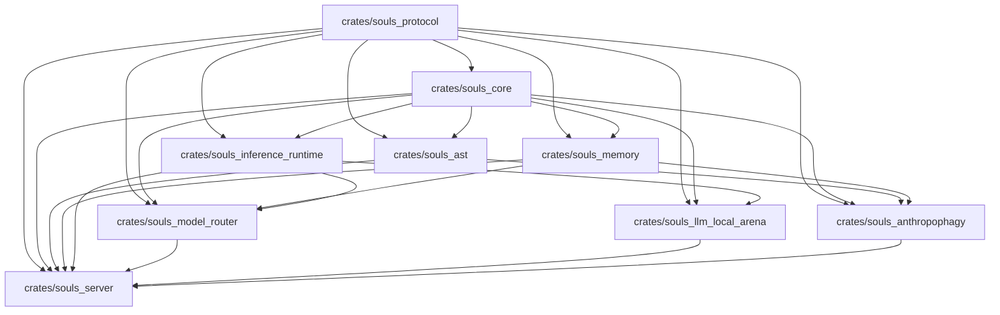

# 👻 SOULS ENGINE (v7 Canônica)

> **"O silício é o nosso limite; a soberania é o nosso dogma; o silêncio é a nossa estética."**  
> *Exoesqueleto Cognitivo Bare-Metal e Prótese de Função Executiva de Baixo Nível.*

[](https://www.rust-lang.org/)
[](https://microsoft.com)
[](https://learn.microsoft.com/windows/dev-drive/)
[](https://nvidia.com)
[](#-topologia-canônica-das-9-crates)
[](#-como-ligar-o-souls-engine-hoje)
[](#-testes-e-verificação)

---

## 📑 Sumário Executivo

1. [Identidade, Missão e Sparring Cognitivo](#-identidade-missão-e-sparring-cognitivo)
2. [As 6 Linhas Vermelhas Arquiteturais](#-as-6-linhas-vermelhas-arquiteturais-leis-negativas)
3. [Topologia Canônica das 9 Crates](#-topologia-canônica-das-9-crates)
4. [Governança Físico-Computacional e Silício (RTX 2060m)](#-governança-físico-computacional-e-silício-rtx-2060m)
5. [Matriz Simbiótica com o Hermes Agent](#-matriz-simbiótica-com-o-hermes-agent)
6. [Catálogo MCP e Revelação Progressiva (52 Ferramentas)](#-catálogo-mcp-e-revelação-progressiva-52-ferramentas)
7. [Como Ligar o Souls Engine Hoje](#-como-ligar-o-souls-engine-hoje)
8. [Como Rodar as Tools via MCP Hoje (Hermes & IDEs)](#-como-rodar-as-tools-via-mcp-hoje-hermes--ides)
9. [Status Forense da Migração e Esteira Antropofágica (`_donor/`)](#-status-forense-da-migração-e-esteira-antropofágica-_donor)
10. [Comandos de Verificação e Higiene Bare-Metal](#-comandos-de-verificação-e-higiene-bare-metal)

---

## 🧠 Identidade, Missão e Sparring Cognitivo

O **Souls Engine** não é um chatbot, não é um assistente genérico de produtividade e não é um mero *wrapper* de APIs comerciais de IA.

Ele é concebido como um **Exoesqueleto Cognitivo** e uma **Prótese de Função Executiva Bare-Metal**, projetado primordialmente para amparar operadores humanos **neurodivergentes (TDAH e Dupla Excepcionalidade — 2e)** na erradicação da **Dívida de Fluxo (*Flow-Debt*)**.

### Mitigação da Dívida de Fluxo (*Flow-Debt*)
Para o operador neurodivergente, o atrito cognitivo não provém da escassez de ideias ou incapacidade técnica, mas da sobrecarga crônica nas funções executivas do córtex pré-frontal:
- **Fadiga de Decisão por Microtarefas:** O custo de transição de contexto, manipulação mecânica de arquivos, navegação em diretórios profundos e setups manuais drena neurotransmissores antes do trabalho profundo iniciar.
- **Esgotamento da Memória de Trabalho:** Hipóteses de arquitetura perdem-se no instante em que a mente é forçada a resolver detalhes de infraestrutura ou sintaxe repetitiva.
- **Inércia de Inicialização e Paralisia de Análise:** Dificuldade em decompor problemas maciços em passos atômicos executáveis.

O Souls Engine absorve a fricção mecânica, protege o estado de hiperfoco, gerencia a persistência de decisões a frio e fornece uma âncora estrutural permanente no bare-metal do usuário.

### Sparring Cognitivo (Criatividade Ancorada)
A dinâmica entre o operador humano e o motor é uma **parceria de pensamento crítico (*cognitive sparring*)**:
- O sistema **rejeita passividade subserviente** e recusa alucinações de concordância vazia.
- Questiona premissas frágeis, calcula o raio de impacto de refatorações (*blast radius*), detecta contradições ontológicas em decisões pregressas e fornece alternativas fundamentadas em custos FinOps explícitos.
- Toda inteligência gerada é ancorada na realidade física do hardware e na integridade matemática do código.

### A Estética do Silêncio
- O Souls Engine v7 é um **Daemon 100% Headless Bare-Metal (`souls_server.exe`)**. É invisível, silencioso e opera na retaguarda como infraestrutura de altíssima velocidade.
- A interface conversacional e executiva pertence ao **Hermes Agent** (Nous Research). Toda a observabilidade visual reside exclusivamente no Web Dashboard oficial do Hermes (`hermes dashboard`).

---

## 🛑 As 6 Linhas Vermelhas Arquiteturais (Leis Negativas)

Qualquer violação das cláusulas abaixo causa **rejeição sumária de código**:

| # | Linha Vermelha | Racional Técnico Inegociável |
|---|----------------|------------------------------|
| **1** | **Zero Desktop UI / Systray** | `souls_server.exe` é um daemon headless. Zero Tauri, Wry, Winit, Svelte embutido ou ícones na bandeja (`tray-icon`). Observabilidade visual é monopólio do Hermes Web Dashboard via plugin REST. |
| **2** | **Zero Proxy Interceptor L7 (:3001)** | O Souls Engine **nunca** intercepta nem faz proxy de chamadas de rede do chat principal do Hermes. O Hermes resolve suas APIs de nuvem diretamente; intermediar quebra o *prefix caching* e corrompe streams SSE. |
| **3** | **Zero Chaveamento Intradiálogo pelo ParetoBandit** | O ParetoBandit atua **exclusivamente** no despacho de subagentes (`delegate_task`) e tarefas auxiliares (`auxiliary.*`). O modelo do chat interativo é imutável durante o diálogo. |
| **4** | **Zero Poluição fora do Dev Drive ReFS (`Z:\`)** | Proibido gravar dados em `%APPDATA%`, `%LOCALAPPDATA%` ou diretórios temporários arbitrários. Toda a persistência reside estritamente em `Z:\souls_engine\.souls_data\`. |
| **5** | **Zero Regressão na Topologia de Crates** | O workspace é composto por **exatamente 9 crates canônicas**. É proibido criar crates adicionais ou colapsar as existentes. |
| **6** | **Zero Uso Arbitrário de `unsafe`** | `#![forbid(unsafe_code)]` padrão em todo o workspace. Exceções únicas e estritamente delimitadas em `souls_inference_runtime` (`memmap2`, NVML FFI) e `souls_memory` (`mmap` do LanceDB), sempre com `// SAFETY: <racional>`. |

---

## 🏛️ Topologia Canônica das 9 Crates

O workspace é estruturado como um **Grafo Acíclico Dirigido (DAG)** de dependências estáticas de alta velocidade:



### Matriz Funcional das Crates

| Crate | Nível | Missão Canônica Única | Tecnologias Chave |
|---|:---:|---|---|
| [`souls_protocol`](file:///Z:/souls_engine/crates/souls_protocol) | **0** | Contratos agnósticos, DTOs universais, envelopes JSON-RPC 2.0, erros de domínio MCP (`-32000..=-32099`) e métricas $E^3$. Zero I/O. | `serde`, `thiserror`, `arrow` |
| [`souls_core`](file:///Z:/souls_engine/crates/souls_core) | **1** | Infraestrutura bare-metal, Block Cloning ReFS CoW Win32, leitura inteligente LEAN com auto-shrink via `tiktoken`, filtros anti-ANSI e logging estruturado. | `tokio`, `tracing`, `windows-sys`, `tiktoken` |
| [`souls_ast`](file:///Z:/souls_engine/crates/souls_ast) | **2** | Análise sintática estática em memória, esqueleto desidratado (*outlines*), Myers Diff estrutural (`similar`), Frecency de commits (`gitoxide`) e parsers Tree-sitter em sandbox Wasmtime. | `tree-sitter`, `similar`, `gix`, `wasmtime` |
| [`souls_memory`](file:///Z:/souls_engine/crates/souls_memory) | **2** | Hipocampo L3 soberano: FrankenSQLite STRICT WAL, LanceDB vetorial (0 MB VRAM), Grafo Causal LadybugDB, fusão lexical/vetorial RRF e Chyros Daemon (Langevin Decay com imunidade `STABLE`). | `sqlx`, `lancedb`, `petgraph`, `arc-swap` |
| [`souls_inference_runtime`](file:///Z:/souls_engine/crates/souls_inference_runtime) | **2** | Execução local em silício: ONNX Runtime CPU (Tier 0), logit probing CPU via llama.cpp (Tier 0.5), CUDA dGPU (Tier 1), parser GGUF $\mathcal{O}(1)$ via `memmap2`, NVML Watchdog e JSON Response Healing determinístico. | `ort`, `nvml-wrapper`, `memmap2` |
| [`souls_model_router`](file:///Z:/souls_engine/crates/souls_model_router) | **3** | Roteador FinOps ParetoBandit multiobjetivo com Thompson Sampling, barreira termodinâmica $\Phi$ e telemetria atômica $\mathcal{O}(1)$ para delegação de subagentes. | `rand`, `rand_distr`, `sqlx` |
| [`souls_llm_local_arena`](file:///Z:/souls_engine/crates/souls_llm_local_arena) | **3** | Harness de benchmark empírico local, medição de tokens/s reais sob carga e testes de rigidez sintática contra gramáticas JSON com `llguidance`. | `llguidance`, `tokio` |
| [`souls_anthropophagy`](file:///Z:/souls_engine/crates/souls_anthropophagy) | **3** | Esteira de engenharia reversa automatizada: dissecação estática de repositórios, firewall de licenças SPDX e catálogo "The Organ Vault". | `spdx-rs`, `petgraph`, `cargo_metadata` |
| [`souls_server`](file:///Z:/souls_engine/crates/souls_server) | **4** | Daemon bare-metal headless na porta `127.0.0.1:9123`. Serve catálogo MCP via HTTP/SSE, endpoints OpenAI-compatíveis para subagentes, telemetria REST e Graceful Shutdown em 5 fases. | `axum`, `tower-http`, `tokio` |

---

## ⚡ Governança Físico-Computacional e Silício (RTX 2060m)

O Souls Engine é calibrado com precisão cirúrgica para a máquina host bare-metal Windows 11:

```
┌─────────────────────────────────────────────────────────────────────────────┐
│                    PERFIL DE HARDWARE HOST BARE-METAL                       │
├──────────────────────┬──────────────────────────────────────────────────────┤
│ Processador (CPU)    │ Intel Core i9-9880H (8 cores / 16 threads, AVX2)    │
│ Memória RAM          │ 32 GB DDR4 Dual-Channel                              │
│ Placa Gráfica (dGPU) │ NVIDIA GeForce RTX 2060m (6.144 MB VRAM física)      │
│ Armazenamento        │ NVMe montado sob Dev Drive ReFS (Z:\souls_engine)    │
└──────────────────────┴──────────────────────────────────────────────────────┘
```

### As 4 Leis Inegociáveis do Silício

1. **Teto Útil Real de 5.294 MB sob WDDM:**
   - O Desktop Window Manager (`dwm.exe`) do Windows 11 consome compulsoriamente até 850 MB de VRAM.
   - O espaço estritamente seguro para alocações CUDA é de **5.294 MB**.
   - Ultrapassar esse limite dispara o fallback de *Shared GPU Memory* via PCIe 3.0, colapsando a vazão de 45 tokens/s para menos de 1,5 tokens/s. O Watchdog NVML aborta requisições antes do *spillover*.
2. **Exclusão Mútua de VRAM:**
   - O Tier 1 (modelo de código na dGPU, ex: Qwen Coder) e modelos pesados concorrentes **nunca coexistem na VRAM**. Se uma carga concorrente for acionada, ela é desviada compulsoriamente para as 16 threads AVX2 da CPU Intel i9.
3. **0 MB de VRAM para AST e Vetores:**
   - O banco vetorial (LanceDB sobre Apache Arrow), parsers sintáticos (Tree-sitter) e embeddings rodam **100% em memória RAM física e CPU AVX2**, preservando todo o silício da dGPU para o LLM.
4. **Dev Drive ReFS & Block Cloning Win32 (ADR-005):**
   - Todas as operações pesadas de cópia de snapshot, rotação de WAL e backups noturnos (`VACUUM INTO`) utilizam *Block Cloning Copy-on-Write* no nível do driver de sistema de arquivos através do control code `FSCTL_DUPLICATE_EXTENTS_TO_FILE` (`windows-sys`). Tempo de cópia: **~0 ms**, sem amplificação de escrita no SSD.

---

## 🤝 Matriz Simbiótica com o Hermes Agent

O ecossistema opera através de uma parceria simbiótica estritamente delimitada entre o **Hermes Agent** (Nous Research, Python 3.11) e o **Souls Engine** (Rust / Tokio):

| Domínio de Sistema | Hermes Agent (Python 3.11) | Souls Engine (Rust / Tokio) |
|---|---|---|
| **Papel Primário** | Orquestrador executivo, cérebro conversacional, voz e UI. | Infraestrutura bare-metal, hipocampo L3, AST e aceleração local. |
| **Memória Primária** | Soberania sobre `MEMORY.md` e `USER.md` (Snapshots intocados). | Leitura em cold boot; **escrita direta estritamente proibida**. |
| **Memória Profunda** | Consome via adapter e chamadas MCP. | Gestão exclusiva de FrankenSQLite STRICT, LanceDB e LadybugDB. |
| **Execução de Shell** | Shell nativo MinGit (`%LOCALAPPDATA%\hermes\git`). | **Nenhuma execução** de processos de terminal ou shell do sistema. |
| **Análise de Código** | Consome esqueletos sintáticos desidratados (*outlines*). | Parsing nativo Tree-sitter, Myers Diff e Gitoxide em RAM. |
| **Inferência e L7** | Chamadas diretas de nuvem para o chat principal (sem proxy). | Execução local Tiers 0, 0.5 e 1; despacho ParetoBandit para subagentes. |

- **Vetor de Transporte Canônico:** O binário `souls_server.exe` expõe o catálogo MCP e endpoints REST exclusivamente em **Localhost TCP Loopback com Streamable HTTP/SSE na porta `127.0.0.1:9123`**.

---

## 🛠️ Catálogo MCP e Revelação Progressiva (52 Ferramentas)

Para anular o paradoxo do inchaço de contexto (*Context Bloat* — onde esquemas estáticos consomem mais de 15.000 tokens no prompt), o Souls Engine adota a **Revelação Progressiva de Ferramentas (Progressive Tool Disclosure)**:

```
┌─────────────────────────────────────────────────────────────────────────────┐
│                 NÍVEL 0: BOOT COMPACTO (Sempre Visível)                     │
│  [outline] [symbol] [read] [edit] [thinking] [route_subtask] [tool_search]  │
└──────────────────────────────────────┬──────────────────────────────────────┘
                                       │ Invoca 'tool_search(namespace)'
                                       ▼
┌─────────────────────────────────────────────────────────────────────────────┐
│                 NÍVEL 1: CATÁLOGOS DINÂMICOS SOB DEMANDA                    │
│   code.*     ──► AST Tree-sitter, Callers/Callees, Myers Diff               │
│   context.*  ──► Compressão LEAN, CCR De/Rehydration, Multi-Read            │
│   memory.*   ──► Grafo LadybugDB, Observações, SQLite STRICT, LanceDB       │
│   think.*    ──► Raciocínio Socrático DAG, Sessões, Intent Probing          │
│   ops.*      ──► Heatmap gitoxide, Impact/Blast Radius, Hardware & FinOps   │
│   sys.*      ──► Estrutura de Diretórios, Busca Textual, Scraper Web        │
└─────────────────────────────────────────────────────────────────────────────┘
```

### Relação Canônica das 52 Garras por Namespace

- **Meta-Ferramenta:** `tool_search` (Busca esquemas por namespace ou keyword em < 1.0 ms).
- **`code.*` (Cirurgia de Código & AST):**
  - `outline`: Esqueleto sintático desidratando corpos de funções (70-85% economia de tokens).
  - `symbol`: Resolução de coordenadas exatas (`file:line:col`) e escopo via Tree-sitter.
  - `callers` / `callees`: Mapeamento de quem invoca e quem é consumido pelo símbolo.
  - `get_ast`: Extração de árvore sintática concreta em JSON estruturado.
  - `edit` / `replace`: Edições Search/Replace cirúrgicas com validação sintática.
  - `delta_diff`: Myers Diff estrutural de alta fidelidade via crate `similar`.
- **`context.*` (Engenharia de Contexto LEAN):**
  - `read`: Leitura estruturada TOON com SymbolMap de alta densidade.
  - `smart_read`: Medição prévia de tokens com auto-shrink adaptativo via `tiktoken`.
  - `multi_read`: Leitura concorrente em lote de múltiplos arquivos na RAM.
  - `compress` / `dedup`: Compressão semântica LEAN e deduplicação de blocos duplicados.
  - `fill` / `stub_fill`: Reidratação sem perdas (*lossless*) de marcadores compactados CCR.
  - `headroom_retrieve`: Resgate de blocos originais da memória virtual CCR via hash hexadecimal.
- **`memory.*` (Hipocampo L3 Soberano):**
  - `semantic_search`: Busca híbrida RRF combinando BM25 (FTS5) e cosseno (LanceDB).
  - `sqlite_query`: Consultas SQL read-only estritas no FrankenSQLite STRICT WAL.
  - `knowledge`: Versionamento e recuperação de diretrizes epistêmicas.
  - `mem_search` / `mem_open_nodes` / `mem_read_graph`: Navegação no grafo LadybugDB.
  - `mem_create_entities` / `mem_create_relations` / `mem_add_observations`: Expansão do grafo.
  - `mem_delete_entities` / `mem_delete_relations` / `mem_delete_observations`: Expurgo sanitizado.
  - `handoff` / `sub_agent`: Coordenação e persistência de troca de turno de subagentes delegados.
- **`think.*` (Cognição Socrática & DAG):**
  - `thinking`: Freio cognitivo socrático (`core_think`) com ramificação de hipóteses em grafo DAG.
  - `session` / `analyze_session` / `export_session` / `merge_sessions`: Governança de raciocínio.
  - `intent`: Sondagem de ambiguidade e entropia de intenção (Tier 0/0.5).
- **`ops.*` (Operações, Silício & FinOps):**
  - `route_subtask`: Despacho multiobjetivo ParetoBandit com barreira termodinâmica $\Phi$.
  - `repo_heatmap`: Medição do calor (*Frecency*) de arquivos via commit graph do `gitoxide`.
  - `repo_impact`: Cálculo do raio de impacto (*Blast Radius*) de alterações via BFS reversa.
  - `feedback` / `metrics` / `sys_time`: Telemetria de cache, hardware e timestamps de precisão.
- **`sys.*` (Sistema & Ferramentas de Apoio):**
  - `tree` / `search`: Exploração de arquivos e regex em memória.
  - `shell` / `execute`: Terminal isolado e execução em sandbox AppContainer/JobObject.
  - `fetch_web` / `web_search`: Scraper HTML limpo via `reqwest` e busca sem rastreamento.
  - `repo_meta` / `routes`: Metadados git via `gix` e inspeção de rotas ativas.

### As 5 Skills Canônicas de Orquestração Procedural
As **Skills** ensinam a IA a encadear as ferramentas MCP sem desperdício de tokens:
1. `souls-code-surgeon`: Proíbe leitura de arquivos inteiros; impõe o fluxo `outline` $\rightarrow$ `symbol` / `callers` $\rightarrow$ `delta_diff` / `edit`.
2. `souls-context-lean`: Mede tokens com `smart_read`; se volumoso, comprime com `compress` na RAM.
3. `souls-memory-triad`: Busca híbrida RRF (`semantic_search`), sanitiza alucinações no LadybugDB (`mem_open_nodes`) e registra fatos (`knowledge`).
4. `souls-socratic-thinking`: Ativa o freio cognitivo `thinking` em tarefas de alta entropia.
5. `souls-ops-finops`: Antes de refatorar, calcula o *Blast Radius* com `repo_impact` e o calor com `repo_heatmap`.

---

## 🚀 Como Ligar o Souls Engine Hoje

O Souls Engine v7 inicializa como um daemon nativo bare-metal Windows 11 com zero dependências de Docker, Node.js ou WSL.

### 1. Pré-Requisitos do Sistema

- **Sistema Operacional:** Windows 11 x64 (Build 22621+ com Dev Drive ReFS habilitado).
- **Volume ReFS:** Unidade `Z:\souls_engine\` configurada com integridade de metadados.
- **Toolchain Rust:** `stable-x86_64-pc-windows-msvc` (Visual Studio 2022 C++ Build Tools).
- **GPU Drivers:** Driver NVIDIA Game Ready / Studio atualizado com suporte a CUDA 12.x e NVML.

### 2. Configuração do Ambiente (.env)

Copie o template de ambiente seguro para a raiz:

```powershell
# No PowerShell (pwsh) dentro de Z:\souls_engine:
Copy-Item .env.example .env
```

Configure suas chaves e caminhos no arquivo `.env`:
- `SOULS_DATA_DIR=Z:/souls_engine/.souls_data`
- `OPENROUTER_API_FREE_KEY`, `OPENROUTER_API_FAST_KEY`, `OPENROUTER_API_HEAVY_KEY`
- `GOOGLE_API_KEY` (Gemini Flash e Pro)

### 3. Compilando e Inicializando o Daemon (`souls_server`)

Execute o bootstrap completo do daemon Axum multithread:

```powershell
# Modo Desenvolvimento (com compilação incremental e logs estruturados)
cargo run -p souls_server

# OU Modo Release de Alta Performance (Zero latência, O3)
cargo run --release -p souls_server
```

Argumentos CLI e variáveis opcionais:
- `--data-dir <caminho>`: Sobrescreve o diretório de dados padrão (`Z:\souls_engine\.souls_data`).
- `RUST_LOG=info,souls_server=debug,souls_inference_runtime=debug`: Configura granularidade de telemetria.

O servidor iniciará exibindo a sequência de boot no terminal:

```
INFO Bootstrapping Souls Engine bare-metal subsystems at: "Z:\\souls_engine\\.souls_data"
INFO FrankenSQLite STRICT pool initialized (16 connections, WAL mode).
INFO Seeding canonical models into registry: [tier0_onnx_cpu, tier05_llama_cpu, tier1_qwen_coder_gpu].
INFO ParetoBanditRouter bootstrap complete (Thompson Sampling priors loaded).
INFO NVML Hardware Watchdog initialized (RTX 2060m thermal barrier at 5294 MB).
INFO All 8 workspace crates successfully bound into AppState.
INFO Listening strictly on http://127.0.0.1:9123 (Zero-Trust Loopback Bare-Metal)
```

### 4. Validação Rápida de Funcionamento

Com o servidor rodando em outro terminal ou em segundo plano:

#### A. Healthcheck e Telemetria de Silício
```powershell
curl http://127.0.0.1:9123/health
```
**Resposta esperada (HTTP 200 OK):**
```json
{
  "status": "healthy",
  "sqlite_status": "ok",
  "hardware": {
    "vram_free_mb": 5120,
    "operational_zone": "Nominal",
    "gpu_temp_c": 54
  }
}
```

#### B. Catálogo de Modelos Locais
```powershell
curl http://127.0.0.1:9123/v1/models
```

#### C. Inferência Local OpenAI-Compatível (com JSON Healing & Streaming SSE)
```powershell
Invoke-RestMethod -Uri "http://127.0.0.1:9123/v1/chat/completions" `
  -Method Post `
  -ContentType "application/json" `
  -Body '{
    "model": "tier1_qwen_coder_gpu",
    "messages": [{"role": "user", "content": "Explique a diferenca entre Arc e Rc em Rust"}],
    "stream": false
  }'
```

---

## 🔌 Como Rodar as Tools via MCP Hoje (Hermes & IDEs)

O ecossistema disponibiliza **dois canais de conexão MCP**: o canal de produção canônico v7 (**Loopback TCP HTTP/SSE na porta `:9123`**) e o canal direto de desenvolvimento (**Standard I/O `stdio` para IDEs**).

---

### Canal 1: Conexão Canônica de Produção (Hermes Agent via HTTP/SSE)

Este é o transporte oficial padronizado pela **ADR-002**. Ele anula qualquer possibilidade de deadlock de buffer Win32 do MSVCRT e permite conexões multiponto simultâneas.

1. **Inicie o daemon `souls_server.exe`** (conforme a seção anterior):
   ```powershell
   cargo run --release -p souls_server
   ```
2. **Configure o Hermes Agent:**  
   No seu arquivo de configuração do Hermes (`$HERMES_HOME/config.yaml` ou `~/.hermes/config.yaml`), declare o servidor MCP apontando para o endpoint SSE:

   ```yaml
   mcp_servers:
     souls_mcp:
       url: http://127.0.0.1:9123/mcp
   ```

3. **Inicie o Hermes Agent:**
   ```powershell
   hermes chat
   ```
   O Hermes Agent detectará o servidor `souls_mcp` instantaneamente, carregará a meta-ferramenta `tool_search` e as 6 garras base de boot do Nível 0.  
   Você pode recarregar as ferramentas a quente em qualquer momento digitando no chat do Hermes:
   ```
   /reload-mcp
   ```

---

### Canal 2: Conexão Direta STDIO para IDEs (Cursor, Windsurf, Claude Code, Trae)

Para IDEs locais que executam o servidor MCP diretamente como subprocesso via Standard I/O (`stdio`), utilizamos o executável despachante `souls_mcp_server`.

#### Passo 2.1: Compilar o binário MCP
Compile o executável otimizado a partir do código do motor:

```powershell
# Compilação release do despachante MCP
cargo build --release --manifest-path Z:\souls_engine\_donor\souls_mc_core\Cargo.toml --bin souls_mcp_server
```
O executável de alta velocidade será gerado em:  
`Z:\souls_engine\_donor\target\release\souls_mcp_server.exe`

#### Passo 2.2: Configurar a IDE (JSON-RPC 2.0 stdio)

Adicione a configuração no arquivo de MCP da sua IDE (ex: `mcp_config.json`, `.cursor/mcp.json` ou Claude Desktop App `claude_desktop_config.json`):

##### Configuração Direta (Executável Compilado — Recomendada):
```json
{
  "mcpServers": {
    "souls_mcp": {
      "command": "Z:/souls_engine/_donor/target/release/souls_mcp_server.exe",
      "env": {
        "SOULS_DATA_DIR": "Z:/souls_engine/.souls_data",
        "RUST_LOG": "warn"
      }
    }
  }
}
```

##### Configuração via Cargo (Hot-Reload em Desenvolvimento):
```json
{
  "mcpServers": {
    "souls_mcp": {
      "command": "cargo",
      "args": [
        "run",
        "--manifest-path",
        "Z:/souls_engine/_donor/souls_mc_core/Cargo.toml",
        "--bin",
        "souls_mcp_server"
      ],
      "env": {
        "SOULS_DATA_DIR": "Z:/souls_engine/.souls_data",
        "RUST_LOG": "info"
      }
    }
  }
}
```

##### Configuração Blindada com `mcp_stdio_guard` (Anti-Deadlock Win32):
Se o cliente sofrer com travamentos de descritores no Windows NT, utilize o guardião nativo com timeout automático:
```json
{
  "mcpServers": {
    "souls_mcp": {
      "command": "cargo",
      "args": [
        "run",
        "--manifest-path",
        "Z:/souls_engine/_donor/souls_mc_core/Cargo.toml",
        "--bin",
        "mcp_stdio_guard",
        "--",
        "--timeout-ms",
        "600000",
        "--",
        "Z:/souls_engine/_donor/target/release/souls_mcp_server.exe"
      ],
      "env": {
        "SOULS_DATA_DIR": "Z:/souls_engine/.souls_data"
      }
    }
  }
}
```

---

### Exemplo Prático de Teste Manual de Chamada MCP (via terminal)

Você pode simular chamadas MCP puras enviando envelopes JSON-RPC 2.0 diretamente pelo pipe stdin do `souls_mcp_server`:

#### 1. Handshake `initialize`
```json
{"jsonrpc":"2.0","id":1,"method":"initialize","params":{"protocolVersion":"2024-11-05","capabilities":{},"clientInfo":{"name":"test-client","version":"1.0"}}}
```

#### 2. Listagem de Ferramentas `tools/list`
```json
{"jsonrpc":"2.0","id":2,"method":"tools/list","params":{}}
```

#### 3. Invocação de Ferramenta `tools/call` (Exemplo: `outline` sintático)
```json
{
  "jsonrpc": "2.0",
  "id": 3,
  "method": "tools/call",
  "params": {
    "name": "outline",
    "arguments": {
      "path": "crates/souls_core/src/fs.rs"
    }
  }
}
```

#### 4. Invocação de Busca Semântica `tools/call` (`semantic_search` RRF)
```json
{
  "jsonrpc": "2.0",
  "id": 4,
  "method": "tools/call",
  "params": {
    "name": "semantic_search",
    "arguments": {
      "query": "ReFS Block Cloning",
      "limit": 5
    }
  }
}
```

#### 5. Invocação do Freio Cognitivo `tools/call` (`thinking` Socrático)
```json
{
  "jsonrpc": "2.0",
  "id": 5,
  "method": "tools/call",
  "params": {
    "name": "thinking",
    "arguments": {
      "thought": "Analisando a arquitetura de transplante do harvester SAST",
      "thought_number": 1,
      "total_thoughts": 3,
      "next_thought_needed": true
    }
  }
}
```

---

## 🔬 Status Forense da Migração e Esteira Antropofágica (`_donor/`)

O código em `_donor/` representa o acervo legado das eras experimentais (v5/v6). Ele passa por um rigoroso processo de **autópsia forense e transplante cirúrgico** regido pelos documentos canônicos em [`docs/migration/autopsy/`](file:///Z:/souls_engine/docs/migration/autopsy):

```
┌─────────────────────────────────────────────────────────────────────────────┐
│                    MATRIZ DE TRIAGEM FORENSE DE ÓRGÃOS                      │
├──────────────────────┬──────────────────────────────────────────────────────┤
│ HEALTHY_ORGAN        │ Algoritmo puro, livre de acoplamentos, transplantado │
│                      │ diretamente com mera higienização CRLF->LF.          │
├──────────────────────┼──────────────────────────────────────────────────────┤
│ ORGAN_REPAIR         │ Algoritmo valioso, mas acoplado a I/O síncrono ou    │
│                      │ structs antigas. Refatorado para Tokio assíncrono.   │
├──────────────────────┼──────────────────────────────────────────────────────┤
│ UPGRADE_CANDIDATE    │ Stubs ou mocks que ganham motores bare-metal         │
│                      │ definitivos no v7 (ex: LanceDB, Wasmtime, NVML).     │
├──────────────────────┼──────────────────────────────────────────────────────┤
│ NECROSIS_INCINERATE  │ Código tóxico que viola as Linhas Vermelhas (Tauri,  │
│                      │ Wry/Winit, :3001). INCINERAÇÃO ABSOLUTA E EXPURGO.   │
└──────────────────────┴──────────────────────────────────────────────────────┘
```

### O Plano de Ondas de Transplante (Status)

- [x] **Onda 1: Estruturas Universais (`souls_protocol`)**  
  DTOs de telemetria, finops $E^3$, erros de domínio MCP `-32000..=-32099`.
- [x] **Onda 2: Infraestrutura Base (`souls_core`)**  
  Filtros anti-ANSI, medição de tokens com auto-shrink LEAN, Block Cloning ReFS via NT IOCTL.
- [x] **Onda 3: Análise Sintática & AST (`souls_ast`)**  
  Myers Diff estrutural (`similar`), Heatmap Frecency (`gitoxide`/`gix`), parsers Tree-sitter em sandbox Wasmtime.
- [x] **Onda 4: Memória Triad L3 (`souls_memory`)**  
  FrankenSQLite STRICT WAL, fusão RRF (BM25 + vetorial), Grafo LadybugDB, Chyros Daemon com Langevin Decay.
- [x] **Onda 5: Inferência & Termodinâmica (`souls_inference_runtime`)**  
  Watchdog NVML da RTX 2060m (500ms EWMA), Tier 0 ONNX, Tier 0.5 CPU llama.cpp, parser GGUF $\mathcal{O}(1)$, JSON Response Healing.
- [x] **Onda 6: Roteamento FinOps (`souls_model_router`)**  
  ParetoBandit multiobjetivo (Thompson Sampling), priors bayesianos no SQLite, barreira termodinâmica $\Phi$.
- [ ] **Onda 7: Transplante Final do Catálogo MCP & SAST (`souls_server` & `souls_anthropophagy`)**  
  Unificação das rotas MCP `/mcp` e dispatchers no `souls_server.exe` nativo e migração do Harvester SAST poliglota.

---

## 🧪 Comandos de Verificação e Higiene Bare-Metal

Em conformidade com a **Single Crate Rule** estipulada em [`AGENTS.md`](file:///Z:/souls_engine/AGENTS.md), nenhum turno de trabalho é considerado concluído sem que as crates compilem e passem em seus testes unitários de forma estritamente limpa:

### Verificação do Workspace Completo
```powershell
# Checagem sintática e tipos de todo o workspace
cargo check

# Bateria de testes unitários e de integração de todas as 9 crates
cargo test
```

### Verificação Atômica por Crate Específica
```powershell
# Protocolo e Contratos
cargo check -p souls_protocol
cargo test -p souls_protocol

# Infraestrutura e ReFS
cargo check -p souls_core
cargo test -p souls_core

# AST, Myers Diff e Tree-sitter
cargo check -p souls_ast
cargo test -p souls_ast

# Hipocampo e Persistência
cargo check -p souls_memory
cargo test -p souls_memory

# Silício, NVML e Inferência
cargo check -p souls_inference_runtime
cargo test -p souls_inference_runtime

# Roteador ParetoBandit
cargo check -p souls_model_router
cargo test -p souls_model_router

# Daemon Headless Raiz
cargo check -p souls_server
cargo test -p souls_server
```

---

## 📜 Governança de Contratos e Documentação como Guardrails

Antes de propor novas implementações ou alterar contratos existentes, consulte a documentação canônica:

- **Manifesto Canônico:** [`docs/SOULS_CANON_MANIFEST.md`](file:///Z:/souls_engine/docs/SOULS_CANON_MANIFEST.md)
- **Especificação das 9 Crates:** [`docs/architecture/CRATES_SPECIFICATION.md`](file:///Z:/souls_engine/docs/architecture/CRATES_SPECIFICATION.md)
- **Contratos das 52 Ferramentas MCP:** [`docs/contracts/MCP_TOOL_CONTRACTS.md`](file:///Z:/souls_engine/docs/contracts/MCP_TOOL_CONTRACTS.md)
- **Esquemas DDL FrankenSQLite & Arrow:** [`docs/storage/SCHEMAS_DDL_MANIFEST.md`](file:///Z:/souls_engine/docs/storage/SCHEMAS_DDL_MANIFEST.md)
- **Mapa Forense do Código Legado:** [`docs/migration/DONOR_EXTRACTION_MAP.md`](file:///Z:/souls_engine/docs/migration/DONOR_EXTRACTION_MAP.md)
- **Registros de Decisões Arquiteturais (ADRs):** [`docs/decisions/adrs/`](file:///Z:/souls_engine/docs/decisions/adrs/) (ADR-001 a ADR-006)

---

*Souls Engine v7 — Construído bare-metal em Rust para soberania computacional plena.*
