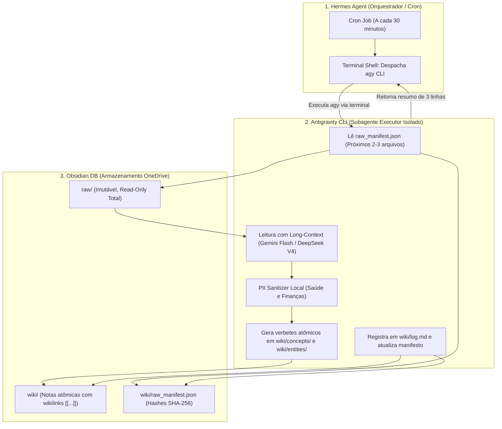

# HERMES_OBSIDIAN_CURATOR_CRON_GUIDE.md — Guia de Orquestração, Cron & Despacho do Antigravity CLI

> **DOCUMENTO OPERACIONAL:** Canônico para integração Hermes Agent Desktop + Antigravity CLI + Obsidian Vault  
> **DATA DE CONSOLIDAÇÃO:** 2026-10-17  
> **DESTINATÁRIO:** Arquiteto Humano e Agente Hermes Bruno  

---

## 1. VISÃO GERAL DO FLUXO DE CURADORIA EM 3 CAMADAS

Para não saturar o contexto do Hermes Agent nem comprometer a velocidade da interface no Telegram, a curadoria do cofre opera em **3 camadas de especialização**:



---

## 2. A CADÊNCIA CANÔNICA DE 30 MINUTOS (THE 30-MINUTE DRIP)

- **Volume por Execução:** 2 a 3 arquivos por rodada.
- **Frequência:** A cada 30 minutos (quando o computador e o Hermes estiverem ativos).
- **Rendimento Estimado:**
  - ~4 a 6 arquivos curados por hora.
  - ~35 a 50 arquivos por dia ativo (8h a 10h de máquina ligada).
  - **Liquidação Completa do Backlog:** Os 497 arquivos de `raw/` são completamente digeridos em **10 a 12 dias úteis**.
- **Benefícios FinOps & Silício:**
  - Zero sobreaquecimento da máquina (cada rodada dura ~1 a 2 minutos).
  - Zero estouro de *rate limits* em APIs de nuvem.
  - Custo diário inferior a centavos utilizando modelos de contexto longo econômicos.

---

## 3. COMO CONFIGURAR O CRON JOB NO HERMES AGENT

Você pode configurar a rotina contínua diretamente no Hermes Agent através de dois métodos:

### Método A: Via Comando Interativo no Hermes Agent (Recomendado)
Na janela de comando ou chat com o **Hermes Bruno**, digite a instrução de agendamento:

```text
/schedule cron="*/30 * * * *" prompt="Execute a esteira de curadoria do Obsidian DB: chame o Antigravity CLI via terminal para processar os próximos 2 arquivos pendentes de 'C:\Users\rosas\OneDrive\Documentos\Obisidian DB\raw' conforme a skill obsidian-vault-curator, atualizando o wiki/log.md e o raw_manifest.json."
```

### Método B: Injeção Direta no Arquivo de Cron do Hermes
Se preferir cadastrar de forma estática no arquivo de cron jobs do Hermes em `%LOCALAPPDATA%\hermes\cron\jobs.json` (ou `.yaml`):

```json
{
  "id": "obsidian_wiki_curator",
  "name": "Curadoria Incremental Obsidian DB",
  "cron_expression": "*/30 * * * *",
  "active": true,
  "command": "agy \"Leia os próximos 2 arquivos com status PENDING no manifesto 'C:\\Users\\rosas\\OneDrive\\Documentos\\Obisidian DB\\wiki\\raw_manifest.json', aplique a skill obsidian-vault-curator sintetizando os verbetes em wiki/concepts/ ou wiki/entities/, anote em wiki/log.md e marque como CURATED no manifesto.\""
}
```

---

## 4. ROTEIRO PARA A PRIMEIRA SESSÃO DE ATIVAÇÃO NO HERMES

Quando você abrir o Hermes Agent para instruí-lo a assumir essa rotina:

### Prompt de Inicialização (Copie e Cole no Hermes Bruno):
> *"Hermes, a partir de agora você é o Maestro da minha LLM Wiki no cofre Obsidian em `C:\Users\rosas\OneDrive\Documentos\Obisidian DB`.  
> Temos uma esteira de 497 arquivos brutos em `raw/` aguardando curadoria.  
> As diretrizes são:  
> 1. Você NÃO deve ler documentos longos no seu próprio chat para não poluir sua memória.  
> 2. Você orquestra a curadoria despachando o Antigravity CLI (`agy`) pelo terminal em micro-lotes de 2 a 3 arquivos a cada 30 minutos.  
> 3. O Antigravity CLI obedece à skill `obsidian-vault-curator`: gera conceitos atômicos em `wiki/concepts/` e `wiki/entities/` com wikilinks `[[...]]`, nunca apaga metadados YAML existentes no `raw/` e atualiza o `wiki/log.md` e o `raw_manifest.json`.  
> 4. Se encontrar notas de saúde ou finanças, obedeça à skill `obsidian-privacy-shield`: sanitize dados de identificação pessoal (PII) antes de enviar para análise de alta inteligência.  
> Por favor, inicie agora executando o primeiro lote de 2 arquivos como prova de voo e confirme o resultado."*

---

## 5. REGRAS DE PRESERVAÇÃO DE DADOS & SEGURANÇA (SSOT)

1. **Preservação Aditiva de YAML:** Se o documento em `raw/` já tiver cabeçalho YAML com `tags: [...]`, autor ou data, o agente mantém todos os campos intactos (merge não-destrutivo).
2. **Imutabilidade do `raw/`:** O corpo de texto das pesquisas brutas nunca é alterado ou recortado.
3. **Detecção de Alterações por SHA-256:** Se você editar um documento no Obsidian no futuro, o hash SHA-256 em disco muda automaticamente. A rotina detecta a divergência e reprocessa apenas o arquivo modificado.
4. **Isolamento de PII:** Dados de cartão, faturas, exames com nomes e documentos civis têm sua identidade redigida localmente antes de qualquer análise cognitiva de fronteira.
