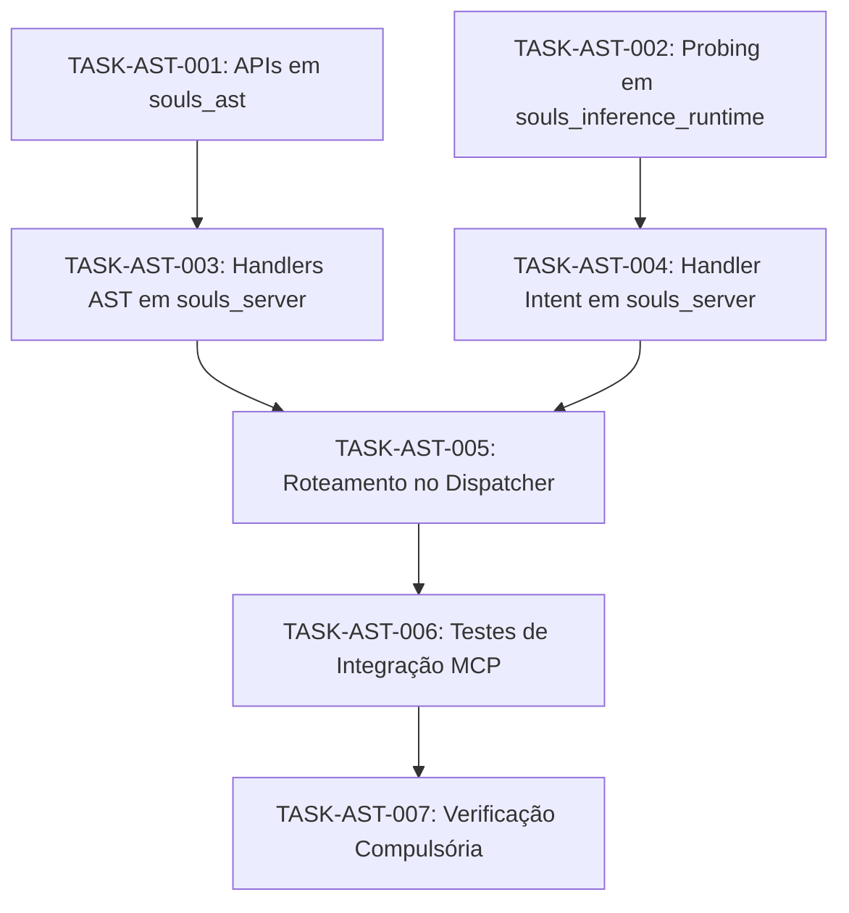

# DAG.md — Grafo de Dependências Dirigido da Sessão 4 (v7)

> **ESTATUS DO DOCUMENTO:** CANÔNICO & VINCULANTE (SDD)  
> **REPRESENTAÇÃO:** Grafo Acíclico Dirigido das Tarefas Atômicas da Sessão 4

---

## 1. SEQUÊNCIA DE EXECUÇÃO E RESTRIÇÃO DE CRATE ÚNICA

## 2. RAZÃO DE DEPENDÊNCIAS
1. **TASK-AST-001** desbloqueia os handlers de desidratação e diff em **TASK-AST-003**.
2. **TASK-AST-002** desbloqueia o handler de avaliação epistêmica em **TASK-AST-004**.
3. Ambos os blocos convergem no despachante de rotas em **TASK-AST-005**.
4. Testes e validação final encerram a sessão em **TASK-AST-006** e **TASK-AST-007**.
