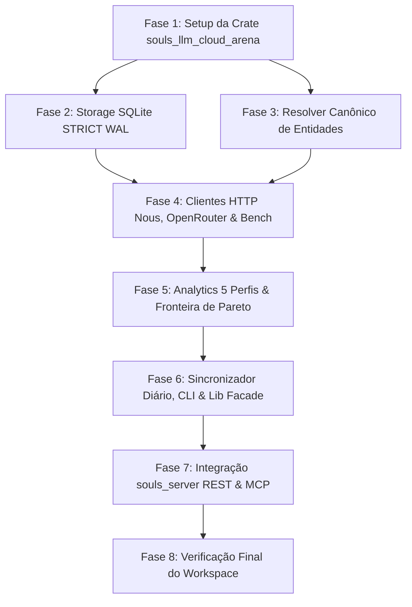

# DAG.md — Grafo de Dependências de Execução: Sessão 5 (v7)

> **ESTATUS DO DOCUMENTO:** CANÔNICO & VINCULANTE (SDD)  
> **DATA DE CRIAÇÃO:** 2026-10-12  

---

## 1. SEQUÊNCIA DE BLOQUEIOS E DEPENDÊNCIAS

## 2. PONTOS DE CONTROLE CRÍTICO (GATEKEEPING)

1. **Gate 1 (Após Fase 1 e 2):** As tabelas `canonical_models`, `model_aliases`, `pricing_telemetry_snapshots`, `benchmark_snapshots` e `daily_evaluations` devem criar limpas com modo `STRICT` no SQLite.
2. **Gate 2 (Após Fase 5):** O cálculo dos 5 perfis cognitivos e algoritmo de Pareto deve passar nos testes matemáticos e isolamento de dominância.
3. **Gate 3 (Após Fase 6):** `cargo test -p souls_llm_cloud_arena` passa com 0 erros e 0 warnings antes de iniciar a Fase 7 (Single Crate Rule).
4. **Gate 4 (Após Fase 7):** `cargo check --workspace` e `cargo test --workspace` passam 100%.
