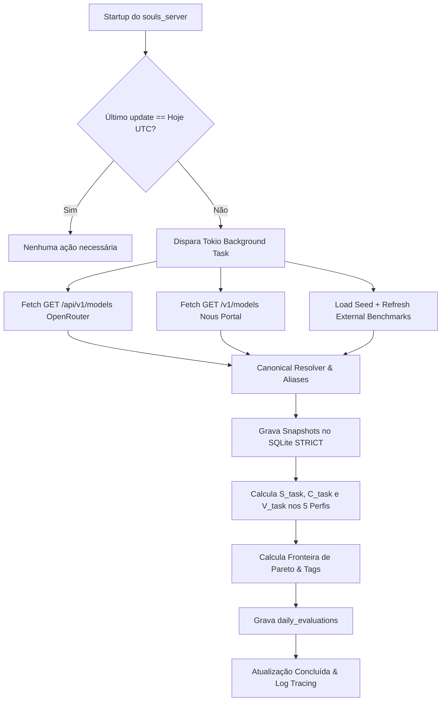

# DESIGN.md — Especificação Técnica Detalhada: Cloud Arena (v7)

> **ESTATUS DO DOCUMENTO:** CANÔNICO & VINCULANTE (SDD)  
> **DATA DE CRIAÇÃO:** 2026-10-12  
> **CRATE ALVO:** `crates/souls_llm_cloud_arena` (`#![forbid(unsafe_code)]`)  
> **BANCO DE DADOS SSOT:** `Z:\souls_engine\.souls_data\db\souls_heuristic_vault.db`  

---

## 1. ESQUEMA DE BANCO DE DADOS (SQLITE STRICT WAL)

Todas as tabelas são criadas em modo `STRICT` com PRAGMAs do Windows NT ativos:

```sql
-- 1. Modelos Canônicos (Entidades normalizadas)
CREATE TABLE IF NOT EXISTS canonical_models (
    id TEXT PRIMARY KEY NOT NULL,                -- ex: "claude-3-7-sonnet"
    display_name TEXT NOT NULL,         -- ex: "Claude 3.7 Sonnet"
    family TEXT NOT NULL,               -- ex: "Claude", "DeepSeek", "Qwen"
    developer TEXT NOT NULL,            -- ex: "Anthropic", "DeepSeek", "Alibaba"
    context_window INTEGER NOT NULL,
    supports_tools INTEGER NOT NULL DEFAULT 0,
    supports_structured_outputs INTEGER NOT NULL DEFAULT 0,
    supports_caching INTEGER NOT NULL DEFAULT 0,
    is_multimodal INTEGER NOT NULL DEFAULT 0,
    created_at TEXT NOT NULL
) STRICT;

-- 2. Tabela de Aliases para Resolução de Slugs Heterogêneos
CREATE TABLE IF NOT EXISTS model_aliases (
    alias TEXT PRIMARY KEY NOT NULL,             -- ex: "anthropic/claude-3-7-sonnet:beta"
    canonical_id TEXT NOT NULL,         -- ex: "claude-3-7-sonnet"
    source TEXT NOT NULL,               -- ex: "openrouter", "nous_portal"
    FOREIGN KEY (canonical_id) REFERENCES canonical_models(id) ON DELETE CASCADE
) STRICT;

-- 3. Snapshots Diários de Preço e Telemetria
CREATE TABLE IF NOT EXISTS pricing_telemetry_snapshots (
    id INTEGER PRIMARY KEY AUTOINCREMENT,
    canonical_id TEXT NOT NULL,
    source TEXT NOT NULL,               -- "nous_portal", "openrouter"
    prompt_price_per_m REAL NOT NULL,   -- USD por 1M tokens
    completion_price_per_m REAL NOT NULL,
    cache_read_price_per_m REAL NOT NULL DEFAULT 0.0,
    cache_write_price_per_m REAL NOT NULL DEFAULT 0.0,
    ttft_ms REAL,                       -- Latência inicial
    throughput_tps REAL,                -- Throughput médio
    recorded_at TEXT NOT NULL,          -- YYYY-MM-DD
    FOREIGN KEY (canonical_id) REFERENCES canonical_models(id) ON DELETE CASCADE
) STRICT;

-- 4. Snapshots Diários de Benchmarks Cognitivos
CREATE TABLE IF NOT EXISTS benchmark_snapshots (
    id INTEGER PRIMARY KEY AUTOINCREMENT,
    canonical_id TEXT NOT NULL,
    general_elo REAL,
    coding_elo REAL,
    hard_prompts_elo REAL,
    bfcl_score REAL,                    -- 0.0 a 100.0
    ifeval_score REAL,                  -- 0.0 a 100.0
    gpqa_score REAL,                    -- 0.0 a 100.0
    vqa_multimodal_score REAL,          -- 0.0 a 100.0
    recorded_at TEXT NOT NULL,          -- YYYY-MM-DD
    FOREIGN KEY (canonical_id) REFERENCES canonical_models(id) ON DELETE CASCADE
) STRICT;

-- 5. Avaliações Consolidadas e Índices de Pareto
CREATE TABLE IF NOT EXISTS daily_evaluations (
    id INTEGER PRIMARY KEY AUTOINCREMENT,
    canonical_id TEXT NOT NULL,
    evaluation_date TEXT NOT NULL,      -- YYYY-MM-DD
    profile_task TEXT NOT NULL,         -- "coding", "agentic", "reasoning", "fast", "design"
    composite_score REAL NOT NULL,      -- 0.0 a 100.0
    task_blended_cost REAL NOT NULL,    -- USD por 1M tokens
    roi_index REAL NOT NULL,            -- V_task
    is_pareto_optimal INTEGER NOT NULL, -- 1 ou 0
    pareto_tag TEXT NOT NULL,           -- "Leader", "BestValue", "UltraLowCost", "Dominated"
    FOREIGN KEY (canonical_id) REFERENCES canonical_models(id) ON DELETE CASCADE
) STRICT;

CREATE INDEX IF NOT EXISTS idx_pricing_lookup ON pricing_telemetry_snapshots(canonical_id, recorded_at);
CREATE INDEX IF NOT EXISTS idx_bench_lookup ON benchmark_snapshots(canonical_id, recorded_at);
CREATE INDEX IF NOT EXISTS idx_eval_date ON daily_evaluations(evaluation_date, profile_task);
```

---

## 2. OS 5 PERFIS COGNITIVOS PONDERADOS

### 2.1 Normalização Min-Max
$$S_{\text{norm}}(x) = \frac{x - x_{\min}}{x_{\max} - x_{\min}} \times 100$$
Onde Elos variam tipicamente entre 1000 e 1450, e benchmarks percentuais variam de 0 a 100.

### 2.2 Fórmulas de Notas Compostas ($S_{\text{task}}$)
1. **Coding & SWE ($S_{\text{coding}}$):**
   $$S_{\text{coding}} = 0.40 \cdot S_{\text{norm}}(\text{Coding Elo}) + 0.25 \cdot S(\text{BFCL}) + 0.20 \cdot S_{\text{norm}}(\text{Hard Elo}) + 0.15 \cdot S(\text{IFEval})$$
2. **Autonomous Agentic & Tool Calling ($S_{\text{agentic}}$):**
   $$S_{\text{agentic}} = 0.45 \cdot S(\text{BFCL}) + 0.30 \cdot S(\text{IFEval}) + 0.15 \cdot S_{\text{norm}}(\text{Hard Elo}) + 0.10 \cdot S_{\text{norm}}(\text{Throughput})$$
3. **Deep Cognitive Reasoning ($S_{\text{reasoning}}$):**
   $$S_{\text{reasoning}} = 0.45 \cdot S(\text{GPQA}) + 0.35 \cdot S_{\text{norm}}(\text{Hard Elo}) + 0.20 \cdot S(\text{IFEval})$$
4. **Fast / Heuristic Triage ($S_{\text{fast}}$):**
   $$S_{\text{fast}} = 0.40 \cdot S_{\text{norm}}(\text{Throughput}) + 0.30 \cdot S_{\text{norm}}(\text{TTFT}) + 0.15 \cdot S(\text{IFEval}) + 0.15 \cdot S_{\text{norm}}(\text{Coding Elo})$$
5. **Design & Multimodal UI ($S_{\text{design}}$):**
   $$S_{\text{design}} = 0.40 \cdot S_{\text{norm}}(\text{Coding Elo}) + 0.30 \cdot S(\text{VQA}) + 0.15 \cdot S(\text{IFEval}) + 0.15 \cdot S_{\text{norm}}(\text{Throughput})$$

---

## 3. CUSTO PONDERADO BLENDED ($C_{\text{task}}$) E RETORNO LOGARÍTMICO ($V_{\text{task}}$)

### 3.1 Custo Blended por Milhão de Tokens
$$C_{\text{task}} = (w_{\text{cache}} \cdot P_{\text{cache}}) + (w_{\text{in}} \cdot P_{\text{in}}) + (w_{\text{out}} \cdot P_{\text{out}})$$

| Perfil | $w_{\text{cache}}$ | $w_{\text{in}}$ | $w_{\text{out}}$ | Racional |
|---|---|---|---|---|
| **Coding** | 0.40 | 0.40 | 0.20 | Arquivos longos em cache, diffs e edições cirúrgicas |
| **Agentic** | 0.60 | 0.30 | 0.10 | Histórico acumulado e tool definitions; retornos JSON curtos |
| **Reasoning** | 0.20 | 0.40 | 0.40 | Contexto moderado, cadeias longas de raciocínio (Chain-of-Thought) |
| **Fast / Triage** | 0.10 | 0.80 | 0.10 | Triagem rápida de documentos volumosos |
| **Design / UI** | 0.30 | 0.40 | 0.30 | Componentes e assets com renderização de código e SVG |

### 3.2 Retorno sobre Custo Amortecido ($V_{\text{task}}$)
Para equiparar exatamente a equação de silício local ($C_{\text{silicon}}$):
$$V_{\text{task}} = \frac{S_{\text{task}}}{1.0 + \ln(1.0 + C_{\text{task}})}$$

---

## 4. FRONTEIRA DE PARETO & TAGS DETERMINÍSTICAS

Para cada perfil, o conjunto de modelos avaliados é submetido à análise de dominância bidimensional $(S_{\text{task}}, C_{\text{task}})$:
* Modelo $A$ domina Modelo $B$ se $S(A) \ge S(B)$ e $C(A) \le C(B)$, com pelo menos uma desigualdade estrita.
* Modelos não dominados recebem `is_pareto_optimal = 1` e são classificados:
  - **Leader (Qualidade Suprema):** Maior $S_{\text{task}}$ da fronteira.
  - **BestValue (Melhor Custo x Benefício):** Maior $V_{\text{task}}$ da fronteira.
  - **UltraLowCost:** Menor $C_{\text{task}}$ da fronteira com $S_{\text{task}} \ge 70.0$.
  - **Dominated:** Superado simultaneamente em custo e qualidade.

---

## 5. CICLO DE VIDA DO SINCRONIZADOR DIÁRIO (`sync.rs`)


