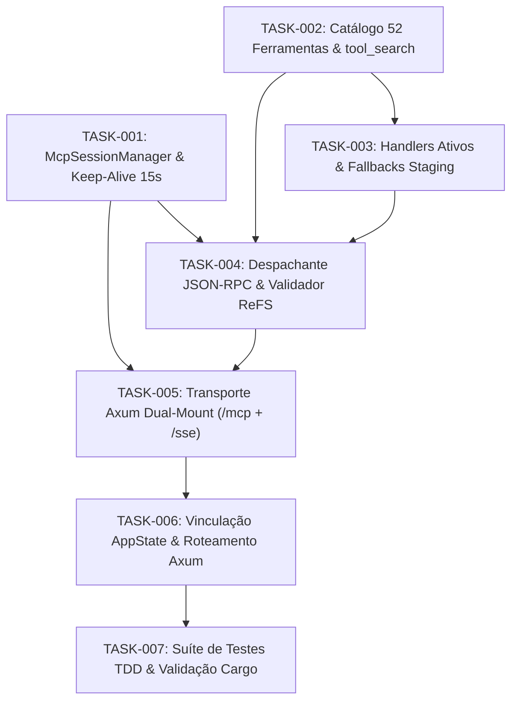

# DAG.md — Grafo Acíclico Dirigido de Execução (`souls_server_mcp`)

> **SUBSISTEMA ALVO:** `crates/souls_server`  
> **ESTATUS DO DOCUMENTO:** ORDEM TOPOLÓGICA DE EXECUÇÃO (DOCS-AS-GUARDRAILS)

---

## 1. VISUALIZAÇÃO DO GRAFO (MERMAID)

---

## 2. ORDEM TOPOLÓGICA SEQUENCIAL DE EXECUÇÃO

1. **Passo 1 (Fundação de Sessões):** Executar `TASK-001` (`session.rs`). Não possui dependências internas.
2. **Passo 2 (Catálogo e Metadados):** Executar `TASK-002` (`registry.rs`). Constrói o repositório imutável das 52 ferramentas.
3. **Passo 3 (Lógica de Execução):** Executar `TASK-003` (`handlers.rs`). Amarra ferramentas com os subsistemas existentes (`state.router`, `chrono`, etc.).
4. **Passo 4 (Núcleo do Despachante):** Executar `TASK-004` (`dispatcher.rs`). Unifica `session`, `registry` e `handlers` sob o envelope JSON-RPC 2.0 e validação ReFS.
5. **Passo 5 (Camada de Rede HTTP/SSE):** Executar `TASK-005` (`transport.rs`). Expõe `/mcp`, `/sse` e `/messages` no Axum.
6. **Passo 6 (Integração e AppState):** Executar `TASK-006` (`state.rs` e `routes/mod.rs`). Registra o gerenciador no estado global e monta as rotas no daemon.
7. **Passo 7 (Validação TDD e Encerramento):** Executar `TASK-007` com testes unitários abrangentes, executando `cargo test -p souls_server`.
