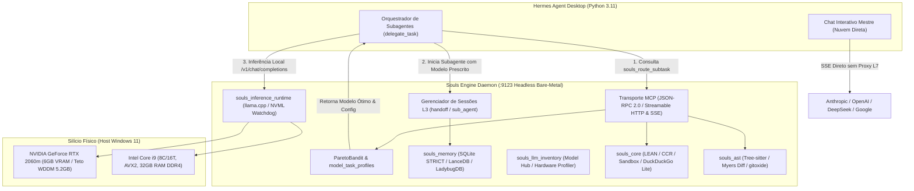
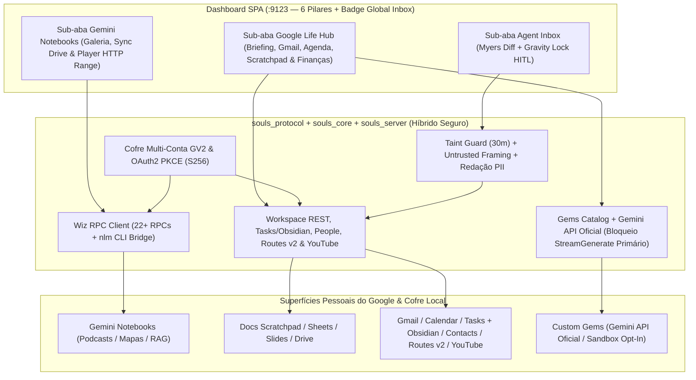

# SOULS_ENGINE_ROADMAP_NEXT_DELIVERIES.md — Roadmap Canônico de Entregas & Evolução Rumo à v1.0

> **STATUS DO DOCUMENTO:** CANÔNICO & VINCULANTE (DOCS-AS-GUARDRAILS)
> **VERSÃO CONSOLIDADA:** v0.9.4+2 (Novembro/2026) ➔ Meta Final: v1.0.0 Real
> **ARQUITETURA:** 11 Crates Canônicas Bare-Metal (Rust/Tokio) • Loopback HTTP/SSE `127.0.0.1:9123`  
> **SIMBIOSE:** Hermes Agent Desktop (Python 3.11) + Antigravity CLI + Web Dashboard SPA  
> **SSOT DE DADOS:** `Z:\souls_engine\.souls_data\db\souls_heuristic_vault.db` (FrankenSQLite STRICT WAL)

---

## 1. VISÃO GERAL & PRINCÍPIOS ARQUITETURAIS VINCULANTES

O **Souls Engine** opera como uma infraestrutura bare-metal headless (Rust/Tokio) em loopback TCP local `127.0.0.1:9123`. Ele atua como acelerador de silício, motor de AST, hipocampo de memória L3 e orquestrador de subagentes para o **Hermes Agent** e IDEs compatíveis (Antigravity, Cursor).



### As 6 Linhas Vermelhas (AGENTS.md)
1. **Zero Desktop UI Local / Systray:** O binário `souls_server.exe` / `souls_engine.exe` é 100% headless. A observabilidade visual pertence ao Web Dashboard SPA servido na porta `9123`.
2. **Nenhum Proxy L7 para o Chat Mestre:** O Hermes Agent resolve suas APIs de nuvem diretamente, preservando o *prefix caching*.
3. **Nenhum Chaveamento Intradiálogo:** O ParetoBandit atua exclusivamente em subagentes (`delegate_task`) e tarefas de suporte (`auxiliary.*`).
4. **Sem Poluição fora do Diretório Canônico de Dados:** No ambiente de desenvolvimento, reside em `Z:\souls_engine\.souls_data\`; em ambientes de produção/distribuição universal, resolve de forma agnóstica via `SOULS_DATA_DIR` (`%LOCALAPPDATA%\SoulsEngine\data\` no Windows, `~/.local/share/souls_engine/` no Linux, `~/Library/Application Support/SoulsEngine/` no macOS), sem nunca espalhar arquivos temporários soltos.
5. **Topologia Controlada:** Workspace estruturado estritamente nas crates canônicas homologadas.
6. **Zero `unsafe` Arbitrário:** Workspace sob `#![forbid(unsafe_code)]`, exceto delimitações auditadas com `// SAFETY:`.

---

## 2. HISTÓRICO CONSOLIDADO DE ENTREGAS (O QUE JÁ FOI REALIZADO)

Até a consolidação da **Milestone v0.6.0**, todo o ciclo fundacional de infraestrutura, inferência, governança comportamental (Skills + Personas) e interface foi construído e homologado:

### 2.1 Tabela Histórica de Sessões e Marcos (v0.1.0 ➔ v0.6.0)

| Sessão / Marco | Escopo Principal | Estado | Principais Entregas |
| :--- | :--- | :---: | :--- |
| **Sessões 1 & 2** | Daemon Base & Cérebro L3 | **100% CONCLUÍDO** | `souls_server` (:9123), Axum HTTP/SSE, FrankenSQLite STRICT WAL, LanceDB e LadybugDB. |
| **Sessão 3** | Conexão Viva Hermes Desktop | **100% CONCLUÍDO** | Configuração do `config.yaml`, junction ReFS de modelos, FinOps guardrails e MCP live. |
| **Sessão 4** | AST Tree-sitter & NVML | **100% CONCLUÍDO** | Transplante `souls_ast` (outlines, slices, callers), watchdog NVML bare-metal e cálculo EWMA. |
| **Sessão 5** | Cloud Arena Benchmarking | **100% CONCLUÍDO** | Crate `souls_llm_cloud_arena`, 9 perfis cognitivos, ingestão Nous/OpenRouter e sync diário. |
| **Sessão 6** | Governança Master Brain | **100% CONCLUÍDO** | Tríade de Líderes na nuvem, cálculo de Fronteira de Pareto e alternância de perfis. |
| **Sessão 7** | Web Dashboard SPA (V1) | **100% CONCLUÍDO** | Interface web inicial servida via Axum com abas de Overview, Arenas e Settings globais. |
| **Sessão 8** | Homologação Clínica E2E | **100% CONCLUÍDO** | 156/156 cenários clínicos aprovados (100%), 52 tools, 15 skills, zero leak de VRAM. |
| **Sessão 9 & 10** | Silício Neural & Des-staging | **100% CONCLUÍDO** | 15 modelos físicos mapeados, sandbox Win32 segura, LEAN compression e dedup SipHash. |
| **Sessão 11** | Skills & Curadoria Obsidian | **100% CONCLUÍDO** | 15 Skills sincronizadas, pipeline de curadoria `raw/` ➔ `wiki/` com Privacy Shield local. |
| **Sessão 12 & 13** | Telemetria SSE & Simbiose | **100% CONCLUÍDO** | Streaming SSE em tempo real, persistência em `souls_config.toml` e integração de plugins Hermes. |
| **Sessão 14 & 15** | Settings UX & Design System | **100% CONCLUÍDO** | Sub-abas com tooltips explicativos, modal de aplicação rápida de modelos e ranking Top 50. |
| **Sessão 16** | Context LEAN & Sandbox | **100% CONCLUÍDO** | Crate `souls_core` (DuckDuckGo Lite na RAM, truncagem head+tail 50/70, 65/65 testes PASS). |
| **Sessão 17** | Model Hub & Profiler | **100% CONCLUÍDO** | Crate `souls_llm_inventory` (RFC-007), download sequencial com HTTP Range e verificação SHA-256. |
| **Sessão 18** | Local Silicon Arena | **100% CONCLUÍDO** | Crate `souls_llm_local_arena`, 5 baterias empíricas ADR-007 no silício real (32/32 testes PASS). |
| **Sessão 19** | Two-Stage Switchboard | **100% CONCLUÍDO** | Switchboard em 2 estágios (<1.7ms na CPU AVX2), projeção dinâmica no `tools/list` (33/33 PASS). |
| **Milestone v0.5.0** | **Modularização UI & SSOT Rust** | **100% CONCLUÍDO** | **ADR-012:** Monólito de 15k linhas decomposto em 25 componentes em `templates/` via `concat!(include_str!(...))` em `.rodata`. Unificação de dependências no root `Cargo.toml`. Teto de contexto dGPU dinâmico baseado em VRAM real. Revisão total das sub-abas de Settings (zero mocks). |
| **Milestone v0.6.0** | **Skills Hub & Hermes Personas** | **100% CONCLUÍDO** | **Skills Hub:** Catálogo multi-ambiente, índice RAM 101k+, quarentena Zero-Trust, Auto-Fix seguro (`body_preserved_exact`) e Estúdio Forge. **Hermes Personas:** Aba dedicada `🎭 Personas`, Guardião de Privacidade & Coerência em 1 clique, cirurgia hierárquica YAML, Bancada Dupla (`Painel Rápido` + `SOUL.md`), Estúdio Criar/Clonar, Arquivamento e Comparador Myers Diff (48/48 testes PASS). |
| **Milestone v0.7.0** | **Deep Research Hub & SSOT Control Plane** | **100% CONCLUÍDO** | **Deep Research Hub:** Aba `🔬 Pesquisa Profunda` (5 sub-abas: Nova Missão STORM, Missões Ativas SSE, Biblioteca viva/Myers Diff/Obsidian, Scorecard E³ + Domain Trust, Doctor & 1-Click Provisioning), SSOT ReFS puro, 4 tools MCP `research.*` (59 tools canônicas), 53/53 testes PASS. |
| **Milestone v0.7.1** | **Tier 0 Determinístico Zero-LLM** | **100% CONCLUÍDO** | **souls_core::research:** Conversor streaming HTML->MD zero-allocation com blindagem UTF-8, chunker deslizante (~500-600 palavras c/ overlap de 80), normalizador de URLs e dedup SipHash 2-4, ranqueador lexical BM25 e esteira integrada de compressão (47/47 testes PASS). |
| **Milestone v0.7.2** | **Tier 1 Operário Local & Protocolo MinionS** | **100% CONCLUÍDO** | **souls_inference_runtime::minions:** Protocolo MinionS para extração de claims epistêmicos, estatísticas e síntese atômica, saídas estruturadas com auto-cura JSON (`heal_json_response`) e orquestrador de lote com FinOps WDDM (fallback CPU AVX2 com zero spillover PCIe a 0 MB VRAM extra, 52/52 testes PASS). |
| **Milestone v0.7.3** | **Universal Cloud Dispatch Gateway & Fallback Chains** | **100% CONCLUÍDO** | **souls_model_router + souls_llm_cloud_arena + souls_server:** Resolução de contingência em sub-150ms (`resolve_fallback_chain`), Circuit Breaker & Quarentena sob HTTP 429/500/timeout com auto-recuperação, FinOps Prompt Cache (DeepSeek, Groq, Cerebras, Together, Bedrock, Azure), catálogo multi-cloud canônico expandido e sub-aba visual `🛡️ Provedores & Fallback` no Dashboard (56/56 testes PASS). |
| **Alfândega v0.7.x** | **Revisão Ampla, Hardening & Release Oficial** | **100% CONCLUÍDO** | **Inspeção de Alfândega:** 193/193 testes PASS no workspace, isolamento Axum de RNG thread-safety (`std::thread::spawn`), MCP `route_subtask` enriquecido com `fallback_chain`/`cached_tokens`/`max_budget_usd`, compilação Release MSVC LTO (114.4 MB), live smoke test sub-5ms e instalação operacional em `%LOCALAPPDATA%\SoulsEngine` via `tools/install_souls.ps1`. |
| **Milestones v0.8.0 ➔ v0.8.3** | **Streaming PDF, Gateways Globais & Visão Cognitiva O(1)** | **100% CONCLUÍDO** | PDF Streaming nativo em SQLite STRICT WAL, integração de gateways de CLIs agênticas (`agy`, `claude`, `codex`), reverse-engineering do NotebookLM (Google Universe Bridge / GV1), e visão AXTree O(1) sem alocação de VRAM. |
| **Milestone v0.9.0** | **SSOT de Modelos, Cockpit de Evolução, Quarentena & Unificação Multi-Cloud** | **100% CONCLUÍDO** | **v0.9.0 Oficial:** Agnosticismo real de hardware no backend (Dynamic NVML / profiler CPU Brand / zero `%USER%` hardcoded em Rust), parser MoE inteligente (`30B-A3B`, `8x7B`, `8x22B`), ciclo de quarentena de skills com endpoints de descarte/limpeza (`/discard` e `/clear`), Doctor 2.0 com cofre atômico de credenciais persistente (`/credentials/save`), unificação dos 16 provedores canônicos no ParetoBandit/Arena/Subagentes, Cockpit de Evolução Pessoal com 4 KPIs e ações rápidas no Overview, modais nativos `appConfirm`/`appPrompt` e resolução de todos os 175 onclicks (296/296 testes PASS). A purga profunda de inline styles e ícones SVG foi formalmente concluída na Milestone v0.9.1 dedicada de Design System. |
| **Milestone v0.9.1** | **Precision Dark UI, Ícones Vetoriais SVG & Purga de Estilos Inline** | **100% CONCLUÍDO** | **v0.9.1-A..F (76/76 testes PASS em `souls_server`):** Topbar consolidada em 6 Pilares + subnavs contextuais + Settings em 4 categorias + Command Palette (`Ctrl+K`), sprite SVG Duotone (`80` símbolos em `components/icons.svg` + `uiIcon()` sem emojis residuais na UI), purga total de hardcodes de hardware (`RTX`/`9980HK`/`i9`) e caminhos absolutos (`Z:\souls_engine`/`rosas`) por vínculos reativos de telemetria/host, 6 Lab Drawers `<details class="lab-drawer">` colapsáveis, tokens `oklch` + purga dos estilos inline estáticos nos 27 parciais HTML e 5 scripts JS (`styles.css`), estabilização CLS = 0 (`min-height` + `contain: layout style;`), Auto-Save com debounce de 400ms em Settings visuais, alinhamento dos 9 perfis cognitivos ADR-009 e ranking multiobjetivo na Cloud Arena, Trio Recomendado evolutivo + catálogo HF híbrido/trending + estimativa física de TPS e Explorer unificado com autocomplete no Model Hub, auditoria cross-tab zero-mocks/zero-404 nas 8 abas e 6 sub-abas de Settings, e Cockpit Pulse auditável em 4 pilares. |
| **Milestone v0.9.2** | **Google Personal & Life Hub, BMAD Agent Inbox & Multi-Conta OAuth2** | **100% CONCLUÍDO** | **v0.9.2 Oficial (ADR-030):** Cofre encriptado multi-conta **GV2** + OAuth2 PKCE (`RFC 7636 S256`) + importação `gws` + Google Doctor, **Híbrido Seguro** (Workspace REST oficial, **Routes API v2** com `X-Goog-FieldMask`, People/Contacts, YouTube Innertube + parser XML/SRV3, Tasks + Obsidian Quick Capture para `@gmail.com`, 22+ RPCs Wiz corrigidos + `nlm` CLI, Custom Gems via Gemini API oficial com bloqueio de `StreamGenerate` na conta primária), **Governança BMAD** (`BlastRadiusTier` em 3 níveis, 4 políticas multi-conta, `wrap_untrusted_content` com nonce anti-injection, `SessionTaintTracker` 30m e `AgentInboxStore` com Myers Diff + Gravity Lock + `audit_log.jsonl`), 17 novas ferramentas MCP (`14 google.*` + `3 inbox.*` = **80 tools canônicas**), 16ª skill `google-life-hub` no Switchboard, 39 rotas `/api/v1/google/*` + 5 rotas `/api/v1/inbox/*`, e abas SPA `Google Life Hub`, `Gemini Notebooks` (player HTTP Range) e `Agent Inbox` + badge global na Topbar (zero inline styles). |
| **Milestone v0.9.2.1** | **Pulso Proativo Multi-Cadência, Apps Script 24/7, Forms, Chat & MinionS** | **100% CONCLUÍDO** | **v0.9.2.1 Oficial (ADR-031 / `version = "0.9.2+1"`):** Heartbeat multi-cadência (5m `oauth_health`/`commute` 90m, 10m `gmail_vip`, 15m `forms`/`drive_sync`) com backoff isolado por monitor, Quiet Hours configurável/desligável e entrega tripla (SSE `/api/v1/google/events/stream`, `prefetch()` efêmero no `hermes_memory_souls` sem tocar em `system_prompt_block()`, Webhook/Telegram opt-in); **Apps Script 24/7** via `script.googleapis.com/v1` + 5 templates curados + scanner estático (`appsscript.json`, segredos, Cartão de Permissões em Português Humano) + BMAD Myers Diff/Gravity Lock; **Google Forms API v1** (stats + Markdown) e **Google Chat API v1** (exclusivo Workspace corporativo + Webhook); **MinionS Google Deep Analyze** (Tier 0 BM25 + cache SHA-256 em `.souls_data/google/minions_cache/` + guarda GGUF/WDDM/AVX2 + exportação 1-clique Obsidian/NotebookLM); **Auto-Sync Drive ↔ NotebookLM** (`sync_links.json` + gancho pós-push Docs/Sheets); OAuth incremental (`include_granted_scopes=true` + `missing_recommended_scopes`); **5 novas tools MCP** totalizando **85 ferramentas canônicas** (`7` Level 0 + `78` progressivas) e **21 novas rotas REST**. |
| **Milestone v0.9.2.2** | **Alfândega Hermes ↔ Souls, Cloud Arena 2.0 & Ledger FinOps Real** | **100% CONCLUÍDO** | **v0.9.2.2 Oficial (ADR-032 / `version = "0.9.2+2"`):** Normalização estrita de slugs e rotas canônicas do Hermes Desktop (`nous`, `openrouter`, `custom`, `deepseek`, `anthropic`, `openai-api`, `gemini`, `copilot`), limpeza de `context_length` órfão, sincronização multi-perfil (`profiles/*`), destravamento de sessões presas em fallback no `state.db`, toggle `moa.enabled` e sincronia não-destrutiva de `hermes.desktop.favorite-models` (`ui-preferences.json`); ingestão de modelos gratuitos `:free` ($0) + OpenRouter exclusivos sem colisão de variantes (`Pro`/`Flash`/`Flex`); rebalanceamento dinâmico de Pareto (Pódio/Tabela/`.sort()`), filtros **`Nous Portal` (padrão) → `OpenRouter` → Gateways Ativas → `Gratuitos ($0)` → `Todos`**, coluna `Usar` após `Status`, modal de aplicação com pré-voo OAuth/API Key inline 1-clique e simulador mensal; **Ledger FinOps Real (`hermes_usage_ledger`)** via `?mode=ro` sobre `state.db` + 3 novas rotas REST (`/api/v1/hermes/customs`, `/customs/repair`, `/api/v1/cloud/finops`). |
| **Milestone v0.9.2+3** | **Despacho Universal `tool_dispatch`, Inferência Física & Scanner `llama.cpp`** | **100% CONCLUÍDO** | **v0.9.2+3 (`version = "0.9.2+3"`):** Meta-ferramenta `tool_dispatch`/`dispatch` promovida ao Boot Level 0 (**8** tools visíveis no handshake estático de clientes como Hermes + trava `-32602` de recursão, elevando o catálogo para **86** ferramentas canônicas); extirpação total de mocks em `/v1/chat/completions`; scanner numérico dinâmico de builds CUDA `llama.cpp` (`resolve_latest_llamacpp_binary`). |
| **Milestone v0.9.3** | **Percepção Multimodal Híbrida, Áudio Soberano PT-BR & Rapport Polivagal** | **100% CONCLUÍDO** | **v0.9.3 Oficial (ADR-033 / `version = "0.9.3"` — Alfândega Grau S+):** Visão AXTree LEAN Windows UIA (`-STA`) + Diff estrutural + Snapshot On-Demand Set-of-Mark (`vision_snapshot_ledger` SHA-256) + `EphemeralVisionRunner` (`Qwen2.5-VL-3B` priorizando `mmproj` irmão e `Auto` sem prompt a `0 MB VRAM`); Áudio Soberano PT-BR em CPU (`ZERO_AUDIO_VRAM_CONSUMPTION_MB = 0`, Silero VAD + PCOMP, SenseVoice + filtro de alucinação, Camada 3 prosódia), cascatas reais TTS (`Kokoro -> Piper -> Edge Neural PT-BR -> Windows SAPI Maria`) e STT (`SenseVoice -> whisper.cpp -> faster-whisper CPU int8 Systran/faster-whisper-base 1-clique -> Windows Speech estrito sem fallback cross-language`), gateway OpenAI (`/v1/audio/speech`, `/v1/audio/transcriptions` c/ `response_format="text"`), Rapport Polivagal EMA (`user_rapport_profile` + `_fetch_voice_rapport_block` `prefix-cache-safe`), Alfândega de Voz multi-perfil (`config.yaml` + `profiles/*` + `.yaml.bak`), **91** ferramentas MCP / **17** skills Switchboard (`souls-multimodal-perception`), sub-aba **Voz & Visão Híbrida** no Cockpit e homologação E2E ao vivo em PT-BR (`88` core / `61` inference / `92` server PASS). |
| **Milestone v0.9.4** | **Souls Evolutive Harness (Cordis, Catnap, Tombstones & The Ralph Loop)** | **100% CONCLUÍDO** | **v0.9.4+2 Oficial (ADR-034 / `version = "0.9.4+2"` — Auditoria & Hardening Final):** Pinagem SHA-256 LF sobre os 4 arquivos `c1` sob `%LOCALAPPDATA%\hermes` (`AGENTS.md` + `SOUL.md` em `fail_closed`, `MEMORY.md` + `USER.md` em `watch` + botão `POST /api/v1/harness/pins/resign`), normalização estrita POSIX `/` e `SCRUB_ENV`; **Microkernel Reversível DeepSeek Cordis** (`c2`/`c5`/`c7`/`c8` em pilha LIFO `< 1 ms`, reativação 1-clique, `cordis_fibers.json`, coefeitos reativos e guarda Split-Brain em `drift_streak >= 3 || ema < 0.40`) com injeção *prefix-cache-safe* **contextual à intenção** via `/api/v1/harness/cues` em `prefetch()` e `route_subtask`; **Cognitive Catnap Protocol** (loop `45s` round-robin, idle `>= 180s` com `PassiveConnectionGuard` sem auto-contagem, GPU `<= 62.0°C` + histerese `+5.0°C` e `<= 68.0°C` CPU-light, preempção `< 1 ms`, `$0.00` padrão, *Quiet Hours* configurável, backoff isolado e `runmark.fingerprint`); **Tombstones Lógicos JIT** (`action="preview"` somente leitura por padrão, blindagem total de `STABLE` em varreduras automáticas, causalidade temporal anti-ciclo, parser `k: v` sem falsos positivos em `http://`/`2e:`, `LadybugDB` limpo ao restaurar); **Fecho de Loop & DX (`v0.9.4+2`)**: `telemetry_events` no DDL `STRICT`, `sub_agent(complete)` integrando `weevolve_ratings` + `telemetry_events` + `pareto_bandit_priors` (`-32013 ResourceNotFound` sem panic), `route_subtask` diferenciando `-32012 TokenBudgetExceeded` de `-32002 VramThermalThrottled`, **The Ralph Loop -> Quarentena & Chave Top-Level `"quarantine"`**, **96** ferramentas MCP (5 `harness_*` unificadas em `ops`) / **18** skills Switchboard, **19** tabelas `STRICT`, **13** rotas `/api/v1/harness/*`, UI zero-jargão e **Companion Systray Desacoplado** não-bloqueante (`souls_icon_gray.ico` quando parado + *takeover* limpo no atalho). |

### 2.2 Inventário de Ativos Consolidados na v0.9.4+2
* **Topologia de Crates:** 11 Crates canônicas estritamente sincronizadas via `[workspace.dependencies]`.
* **Catálogo MCP:** **96** Ferramentas canônicas (**8** Boot Nível 0 com `tool_dispatch` + **88** sob revelação progressiva) divididas nos namespaces (`code.*`, `context.*`, `memory.*`, `think.*`, `ops.*`, `sys.*`, `research.*`, `google.*`, `inbox.*`, `ui.*`, `harness_*`).
* **Persistência & Skills:** **19** tabelas SQLite `STRICT` (WAL), **18** skills canônicas no Switchboard (`19` playbooks operacionais em `.agents/skills/` espelhados para o Hermes) e sub-perfis Hermes sincronizados em PT-BR (`default`, `financas`, `hiperfocos`, `saude`).
* **Binários de Produção:** `souls_server.exe` / `souls_engine.exe` compilados em release MSVC, com gateway OpenAI `/v1/*` + `/mcp` + `/api/v1/harness/*` operando em `127.0.0.1:9123` (`Nominal`).

---

## 3. MATRIZ DE DEMANDAS, SCRATCHPAD & ANÁLISE DE GAPS

Cruzamento do draft [`docs/reference/lembretes.txt`](file:///Z:/souls_engine/docs/reference/lembretes.txt) e dos documentos de pesquisa com o estado do repositório:

| Item do Lembrete | Descrição Sintética | Estado Atual | Destino no Roadmap & Referência |
| :--- | :--- | :---: | :--- |
| **#1 Refatoração de UI** | Quebrar monólito HTML em módulos para manutenção ágil | **JÁ REALIZADO (v0.5.0)** | Concluído via ADR-012 (25 parciais atômicos sob `templates/`). |
| **#2 Revisão de Deps Rust** | Unificar versões e auditar flags de compilação | **JÁ REALIZADO (v0.5.0)** | Concluído via SSOT em `[workspace.dependencies]`. |
| **#3 Skills Hub & Forge** | Visualização, descoberta, busca em APIs e criação agêntica local de skills | **CONCLUÍDO (v0.6.0)** | Concluído em `souls_server`: 4 sub-abas, índice RAM 101k+, Auto-Fix seguro, Pausar/Excluir com backup e Estúdio Forge. |
| **#4 Perfis do Hermes** | Inspecionar/editar `AGENTS.md`, `SOUL.md` e configs dos perfis no Dashboard | **CONCLUÍDO (v0.6.0)** | Concluído em `souls_server`: Aba `🎭 Personas`, Guardião de Privacidade & Coerência em 1 clique, Bancada Dupla, Estúdio Criar/Clonar e Comparador Myers Diff. |
| **#5 Deep Research Engine** | Capability/Tool base de pesquisa profunda em árvore com síntese e fontes | **GAP IDENTIFICADO** | **Milestone v0.7.0** ➔ Ref.: [Deep Research para o Ecossistema Hermes Agent e Souls Engine.md](file:///Z:/souls_engine/docs/reference/Deep%20Research%20para%20o%20Ecossistema%20Hermes%20Agent%20e%20Souls%20Engine.md). |
| **#6 Gateway Cloud Multi-Provedor** | Universalizar despacho de subagentes para além de OpenAI/Claude/Gemini | **GAP IDENTIFICADO** | **Milestone v0.7.0** (DeepSeek API, Groq, Together, Bedrock). |
| **#13 Precision Dark UI & SVG Icons** | Purga de 3.070 inline styles, ícones SVG, gavetas de simuladores e eliminação de hardware fixo na UI | **CONCLUÍDO (v0.9.1)** | **Milestone v0.9.1** (Maturidade Visual, Design System Canônico, Auto-Save 400ms & Zero Layout Shift). |
| **#12 Google Personal & Life Hub** | Workspace (Gmail/Agenda/Docs/Sheets), Gemini Notebooks UI no Dashboard, Tasks/Quick Capture, Contacts, Routes v2 e Gems | **CONCLUÍDO (v0.9.2)** | **Milestone v0.9.2** ➔ Concluído (ADR-030, 80 MCP tools, BMAD Agent Inbox com Myers Diff & Gravity Lock, Google Life Hub & Gemini Notebooks UI). |
| **#11 Percepção Multimodal Híbrida** | AXTree O(1) + On-Demand Snapshots (Canvas/Figma) + Áudio Soberano Local na CPU i9 (0 MB VRAM) | **CONCLUÍDO (v0.9.3)** | **Milestone v0.9.3** ➔ Concluído (ADR-033, 91 MCP tools, 17ª skill `souls-multimodal-perception`, `ui_inspect`/`ui_interact`/`ui_diff`/`ui_snapshot` com SoM + SHA-256 + `EphemeralVisionRunner` sob Watchdog NVML, Áudio CPU `0 MB VRAM` PCOMP/SenseVoice/Prosódia/Kokoro->Piper->SAPI, Gateway OpenAI `/v1/audio/*`, Rapport Polivagal EMA $\alpha=0.15$ em `prefetch()`, Hermes Voice Customs e sub-aba Cockpit **Voz & Visão Híbrida**). |
| **#10 Souls Evolutive Harness** | Auto-evolução contínua, Cordis Microkernel, 8 componentes (`c1`–`c8`) e Catnap Protocol | **CONCLUÍDO (v0.9.4)** | **Milestone v0.9.4** ➔ Concluído ([ADR-034](file:///Z:/souls_engine/docs/decisions/adrs/ADR-034-Souls-Evolutive-Harness-Cordis-Catnap-Tombstone-e-Ralph-Loop.md), **96** MCP tools, **18** Switchboard skills, **19** tabelas STRICT, sub-aba **Auto-Evolução & Aprendizado**). |
| **#8 Souls Anthropophagy** | Ingestão mecânica de repositórios ➔ Essências ➔ Janela de Vidro (85+ colunas Google Sheets) ➔ Deep Analysis & Backlog de Implementação | **GAP IDENTIFICADO** | **Milestone v0.9.5** ➔ Ref.: `_donor/souls_mc_anthropophagy` e `Ideação Curadoria de Contexto Souls MC.md`. |
| **#14 Revisões & Refinamentos** | Baterias de testes integrados, correções de feedback real, refinamentos de UX e novas funcionalidades pré-v1 | **BACKLOG ATIVO** | **Milestones v0.9.6 a v0.9.9** (Ciclo de Estabilização & Hardening Contínuo). |
| **#9 Universal Installer & Hardware Adaptability** | Instalador zero-atrito, piso mínimo na 2060m adaptável a qualquer hardware | **GAP IDENTIFICADO** | **Milestone v1.0.0** (Universal Installer & Release Oficial). |

---

## 4. A TRILHA CANÔNICA RUMO À VERSÃO 1.0 REAL

A jornada da versão 0.5.0 até a 1.0.0 é dividida em **5 Milestones Sequenciais**, integrando os estudos de pesquisa aprofundada:

```
┌──────────────────────────────────────────────────────────────────────────────────┐
│                     JORNADA DE DESENVOLVIMENTO RUMO À v1.0                       │
├───────────────┬──────────────────────────────────┬───────────────────────────────┤
│ v0.5.0        │ Base Bare-Metal & UI Modular     │ [CONCLUÍDO] 11 Crates, ADR-012│
├───────────────┼──────────────────────────────────┼───────────────────────────────┤
│ v0.6.0        │ Governança Visual & Skills Hub   │ [CONCLUÍDO] Skills + Personas │
├───────────────┼──────────────────────────────────┼───────────────────────────────┤
│ v0.7.0        │ Deep Research Hub (Dashboard)    │ [CONCLUÍDO] Aba UI + MCP Pull │
├───────────────┼──────────────────────────────────┼───────────────────────────────┤
│ v0.7.1        │ Tier 0 Determinístico Zero-LLM   │ [CONCLUÍDO] BM25 + SipHash    │
├───────────────┼──────────────────────────────────┼───────────────────────────────┤
│ v0.7.2        │ Tier 1 Batch MinionS Silício     │ [CONCLUÍDO] MinionS SLM 0MB   │
├───────────────┼──────────────────────────────────┼───────────────────────────────┤
│ v0.7.3        │ Gateway Cloud & Fallback Chains  │ [CONCLUÍDO] Sub-150ms + Quaran│
├───────────────┼──────────────────────────────────┼───────────────────────────────┤
│ v0.8.0        │ Streaming PDF & Cache Epistêmico │ [CONCLUÍDO] Strict WAL + L3   │
├───────────────┼──────────────────────────────────┼───────────────────────────────┤
│ v0.8.1        │ Gateways Globais & CLIs Agênticas│ [CONCLUÍDO] agy, claude, codex│
├───────────────┼──────────────────────────────────┼───────────────────────────────┤
│ v0.8.2        │ Google Universe & NotebookLM     │ [CONCLUÍDO] Wiz RPC + Cofre GV1│
├───────────────┼──────────────────────────────────┼───────────────────────────────┤
│ v0.8.3        │ Visão Cognitiva O(1) & AXTree    │ [CONCLUÍDO] LEAN 71% + 0MB VRAM│
├───────────────┼──────────────────────────────────┼───────────────────────────────┤
│ v0.9.0        │ SSOT Modelos, Pulse & Multi-Cloud│ [CONCLUÍDO] Backend + Cockpit │
├───────────────┼──────────────────────────────────┼───────────────────────────────┤
│ v0.9.1        │ Precision Dark UI & SVG Icons    │ [CONCLUÍDO] SVG+OKLCH+AutoSave│
├───────────────┼──────────────────────────────────┼───────────────────────────────┤
│ v0.9.2        │ Google Personal & Life Hub       │ [CONCLUÍDO] BMAD Inbox+LifeHub│
├───────────────┼──────────────────────────────────┼───────────────────────────────┤
│ v0.9.2.1      │ Pulso 24/7, AppsScript, MinionS  │ [CONCLUÍDO] 85 Tools+AutoSync │
├───────────────┼──────────────────────────────────┼───────────────────────────────┤
│ v0.9.2.2      │ Alfândega Hermes + Cloud Arena 2 │ [CONCLUÍDO] ADR-032 + FinOps  │
├───────────────┼──────────────────────────────────┼───────────────────────────────┤
│ v0.9.3        │ Percepção Multimodal Híbrida     │ [CONCLUÍDO] ADR-033 + 91Tools │
├───────────────┼──────────────────────────────────┼───────────────────────────────┤
│ v0.9.4        │ Souls Evolutive Harness (Harness)│ [CONCLUÍDO] ADR-034 + 96Tools │
├───────────────┼──────────────────────────────────┼───────────────────────────────┤
│ v0.9.5 (PRÓX) │ Souls Anthropophagy (Repo Miner) │ 85+ Colunas Google Sheets SSOT│
├───────────────┼──────────────────────────────────┼───────────────────────────────┤
│ v0.9.6–v0.9.9 │ Revisões, Refinos & Hardening    │ Correções, Backlog & Feedback │
├───────────────┼──────────────────────────────────┼───────────────────────────────┤
│ v1.0.0 REAL   │ Universalização & Distribuição   │ Auto-Tuning, Installer 1-Click│
└───────────────┴──────────────────────────────────┴───────────────────────────────┘
```

---

### MILESTONE v0.6.0: GOVERNANÇA VISUAL, SKILLS HUB & HERMES PERSONAS — **[100% CONCLUÍDO]**

O objetivo desta etapa é transformar o Dashboard em uma central completa de gestão comportamental dos agentes e subagentes, sem depender de edição manual de arquivos no terminal.

#### 1. Módulo Skills Hub & Agêntico Forge (`templates/tabs/skills_hub.html`) — **[100% CONCLUÍDO]**
* **Catálogo Visual Multi-Ambiente:** Listagem ordenável e interativa das skills ativas/pausadas com detecção dinâmica de programas instalados no host (`.agents/skills/` ou app local, `%LOCALAPPDATA%\hermes\skills/`, Personas isoladas e `~/.gemini/...`).
* **Editor, Auto-Correção Segura & Governança:** Botão `Corrigir Automaticamente` preservando 100% das instruções do corpo (`body_preserved_exact`), explicação clara dos avisos preventivos/SO, `Pausar` (`SKILL.md.disabled`) e `Excluir` com backup no Histórico.
* **Skills Marketplace & Explorer (101k+):** Busca instantânea em RAM com vitrine personalizada (`Sugeridas para o Seu Ambiente`), filtro por Tema e Origem (`Comunidade` / `Oficial` / `GitHub Live`) e Área de Revisão antes de instalar.
* **Estúdio de Criação & Adaptação (Forge):** Assistente em linguagem natural com motor instantâneo gratuito, modelo local ou nuvem, Myers Diff visual e publicação seletiva multi-ambiente.

#### 2. Hermes Personas & Governance Inspector (`templates/tabs/personas_hub.html`) — **[100% CONCLUÍDO]**
* **Galeria Portátil de Assistentes Hermes:** Descoberta automática da Persona Principal (`default`) e perfis isolados (`%LOCALAPPDATA%\hermes\profiles/*`), com avatares reais (`assets/avatar.png`), status de conexão MCP e resumo de coerência.
* **Guardião de Privacidade & Coerência em 1 Clique:** Diagnóstico cruzando `SOUL.md` vs `config.yaml` vs `profile.yaml` (bloqueio de modelos `:free` em Personas de dados sensíveis, ativação de `mcp_servers.souls_engine` em `:9123/mcp` e higiene textual) com prévia `dry_run` em **Myers Diff** e backup automático antes de gravar.
* **Bancada Dupla (`Painel Rápido` + `SOUL.md`) & Soberania de Memória:** Edição visual sem tocar em YAML bruto via cirurgia hierárquica de blocos (`AGENTS.md` §8.1), checagem de contratos ancorados (`AGENTS.md` / `wiki/` do cofre Obsidian), visualização protegida Read-Only de `MEMORY.md`/`USER.md` (`AGENTS.md` §4) e zero exposição de `.env`/`auth.json`.
* **Estúdio Criar & Clonar + Ciclo de Vida Completo:** Criação guiada ou clonagem de novas Personas prontas para conversar no Hermes (com escolha de Skills iniciais), arquivamento/reativação segura e comparador lado a lado entre Personas com rollback em 1 clique.

---

### MILESTONE v0.7.x: COGNIÇÃO PROFUNDA, DEEP RESEARCH & GATEWAY UNIVERSAL

> **Documento de Referência Arquitetural SSOT:**  
> 📄 [Deep Research para o Ecossistema Hermes Agent e Souls Engine.md](file:///Z:/souls_engine/docs/reference/Deep%20Research%20para%20o%20Ecossistema%20Hermes%20Agent%20e%20Souls%20Engine.md)

Expansão das capacidades analíticas fundamentais combinando cérebro em nuvem, operários locais (SLMs), orquestração via Hermes Agent e eliminação de aprisionamento em provedores proprietários. Para assegurar a **Regra da Crate Única** e commits atômicos de alta previsibilidade, a milestone é dividida em 4 releases canônicas:

```
┌────────────────────────────────────────────────────────────────────────────────────────┐
│                   DECOMPOSIÇÃO CANÔNICA DA MILESTONE v0.7.x                            │
├───────────────┬──────────────────────┬────────────────────────┬────────────────────────┤
│ Versão        │ Escopo de Domínio    │ Crate Única Alvo       │ Entrega Principal      │
├───────────────┼──────────────────────┼────────────────────────┼────────────────────────┤
│ v0.7.0 (HOJE) │ Research ControlHub  │ souls_server           │ Aba UI + MCP + FS SSOT │
├───────────────┼──────────────────────┼────────────────────────┼────────────────────────┤
│ v0.7.1        │ Tier 0 Deterministic │ souls_core             │ BM25 + HTML->MD + SipH │
├───────────────┼──────────────────────┼────────────────────────┼────────────────────────┤
│ v0.7.2        │ Tier 1 Batch MinionS │ souls_inference_runtime│ MinionS SLM + 0MB VRAM │
├───────────────┼──────────────────────┼────────────────────────┼────────────────────────┤
│ v0.7.3        │ Multi-Cloud Gateway  │ souls_llm_cloud_arena &│ DeepSeek/Groq/Bedrock +│
│               │ & Fallback Chain     │ souls_model_router     │ Sub-aba Provedores     │
└───────────────┴──────────────────────┴────────────────────────┴────────────────────────┘
```

#### 1. Versão v0.7.0: Research Hub & Plano de Controle Operacional (`souls_server`) — **[100% CONCLUÍDO]**
* **Aba de Topo `🔬 Pesquisa Profunda`:** Painel de controle no Dashboard SPA modular (ADR-012) dividido em 5 sub-abas:
  - `🚀 Nova Missão`: Scoping interativo com planejador determinístico (STORM), estimativa FinOps antecipada e contrato mestre (`00_research_brief.json`).
  - `📡 Missões Ativas`: Observabilidade em tempo real via SSE (`/api/v1/research/stream`), medidor de turnos (com teto Beast Mode aos 72 turnos) e controle de *steering* em voo (pausar, injetar diretrizes, forçar síntese, cancelar).
  - `📚 Biblioteca`: Acervo de relatórios com leitor epistêmico (chips `[VERIFIED]`, `[SOURCED]`, `[REASONED]`, `[ESTIMATED]`), visualizador de fontes por tier, versões vivas (*deltas* incrementais v2+), ramificação de tópicos em missões filhas autônomas, comparador nativo Myers Diff, exportação de `.md` e promoção soberana para o Cofre Obsidian (`raw/research/` com higienização de PII via Privacy Shield em memória) e Hipocampo L2.
  - `🧪 Qualidade & Reputação`: Scorecard epistêmico consolidado com métrica $E^3$ (Epistemic Efficiency & Evidence), livro-razão dinâmico de reputação de domínios (*allow/block/boost*) com auto-rebaixamento de alucinações recorrentes, formulário de feedback por afirmação e assistente de auto-patch de regras para a skill `deepsoul-research`.
  - `🩺 Motor & Prontidão`: Verificador Doctor de pré-requisitos, formulário de parâmetros globais FinOps (`max_budget_usd`, esforço padrão, timeout de lease) e provisionamento 1-clique com prévia *dry-run* dos perfis (`fast-scout`, `verifier-readonly`) e da skill canônica no Hermes Agent.
* **Persistência Bare-Metal como SSOT no ReFS:** Estado contido em `Z:\souls_engine\.souls_data\research/{run_id}/` (zero DDL neste ciclo), com índice em RAM ultraveloz (`ResearchIndex`) e varredura de leases expirados.
* **Ferramentas MCP de Pull para o Hermes:** Exposição das ferramentas canônicas do namespace `research.*` (`research_claim`, `research_event`, `research_steering`, `research_complete`) expandindo o catálogo oficial para **59 ferramentas canônicas** (53/53 testes unitários e de integração Axum PASS).

#### 2. Versão v0.7.1: Tier 0 Determinístico Zero-LLM (`souls_core::research`) — **[100% CONCLUÍDO]**
* **Conversão HTML para Markdown Zero-Allocation (`html_cleaner.rs`):** Motor de parsing streaming de alta performance em Rust, limpando tags irrelevantes (`<script>`, `<style>`, `<nav>`, `<footer>`, `<header>`, `<iframe>`, etc.) e ruídos de navegação diretamente na memória, com decodificação de entidades HTML e integridade UTF-8 sem mojibake.
* **Segmentação Deslizante (`chunker.rs`):** Divisão de documentos longos em blocos de ~500 a 600 palavras com overlap de ~80 palavras para preservar contexto semântico entre passagens, acompanhado de offsets de caracteres e hash de integridade de 64 bits.
* **Deduplicação Canônica SipHash 2-4 (`dedup.rs`):** Normalização agressiva de URLs (purga de tracking `utm_*`, `fbclid`, âncoras e esquemas) e cálculo de impressões digitais invariantes de conteúdo (`ResearchDedupRegistry`).
* **Ranqueador Lexical Bare-Metal BM25 (`bm25.rs`):** Algoritmo Okapi BM25 rápido na CPU ($k_1 = 1.2$, $b = 0.75$) com tokenização sem stop-words em inglês/português, ranqueando passagens diretamente contra o *Briefing* da missão com 0 custo de tokens.
* **Esteira Determinística Integrada (`process_raw_html_passage`):** Pipeline único conectando limpeza, deduplicação, segmentação e ranking com taxas de compressão de 60% a 90% (47/47 testes unitários PASS).

#### 3. Versão v0.7.2: Tier 1 Operário Local & Protocolo MinionS (`souls_inference_runtime`) — **[100% CONCLUÍDO]**
* **Execução Paralela MinionS em Lote (`src/minions.rs`):** Decomposição de pesquisas e documentos brutos em tarefas atômicas de passo único especializadas (`ExtractClaims`, `VerifyCitation`, `ExtractStatistics`, `DetectContradiction`, `SynthesizeSection`) executadas localmente via `Tier1GenerativeEngine`.
* **Esquema Tipado `StructuredLocalOutput` & Auto-Cura JSON:** Extração determinística de afirmações epistêmicas (`EpistemicClaimOutput`), pontos de dados estatísticos (`StatisticDataPoint`) e sínteses parciais tipadas em Rust com autocorreção resiliente via `heal_json_response`.
* **Conformidade FinOps WDDM & Zero Spillover PCIe:** Orquestrador com seleção de dispositivo em tempo real (`MinionBatchOrchestrator`) monitorando o `HardwareWatchdog`: caso a VRAM ultrapasse $4.800$ MB ou a GPU atinja $\ge 78^\circ\text{C}$, a inferência sofre desvio transparente para CPU com instruções AVX2 (`gpu_layers = 0`), garantindo 0 MB de VRAM adicional e zero estrangulamento PCIe no host (52/52 testes unitários e de integração PASS).

#### 4. Versão v0.7.3: Universal Cloud Dispatch Gateway & Fallback Chains (`souls_llm_cloud_arena` & `souls_model_router` & `souls_server`) — **[100% CONCLUÍDO]**
* **Expansão Multi-Provedor Nativa & Prompt Cache Engine:** Suporte com cálculo de cache hits para DeepSeek API (v3/r1 com 74% de desconto em prompt cache), Groq (LPU a 0.35x de latência), Cerebras (WSE a 0.30x de latência • 420+ TPS), Together AI, Bedrock (Claude 3.5 Sonnet / Nova) e Azure OpenAI (GPT-4o).
* **Fallback Chain Inteligente por Perfil em Sub-150ms:** Roteamento de contingência em sub-150ms (`resolve_fallback_chain`) sob erros HTTP 429 (rate-limit), 500/503 (serviço indisponível) ou timeouts para o próximo modelo na Fronteira de Pareto.
* **Circuit Breaker & Cooldown Manager:** Quarentena automática (60s para 429, 30s para 500/503, 15s para timeout) evitando que subagentes disparem contra provedores em saturação, com auto-recuperação por sucesso verificado ou reset manual via API/UI.
* **Sub-Aba `🛡️ Provedores & Fallback` no Dashboard:** Monitoramento visual de circuit breaker em tempo real, cartões informativos de provedores cloud, tabela de quarentenas ativas com botão 1-clique de liberação e simulador interativo de resolução de cadeia com SLA <150ms (56/56 testes unitários e de integração PASS).

#### 5. Fechamento de Alfândega, Hardening & Instalação Oficial — **[100% CONCLUÍDO]**
* **Auditoria Abrangente do Workspace (193/193 Testes PASS):** Validação estrita de contratos de dados em todas as 9 crates canônicas (`souls_core`, `souls_ast`, `souls_memory`, `souls_inference_runtime`, `souls_llm_inventory`, `souls_llm_local_arena`, `souls_model_router`, `souls_llm_cloud_arena`, `souls_server`). Zero regressões, zero warnings e integridade das 6 Linhas Vermelhas.
* **Hardening de Concorrência Axum (RNG Thread-Safety):** Isolamento do `ThreadRng` do Bandit em `std::thread::spawn` com canal oneshot, garantindo conformidade estrita com o trait `Send` dos handlers do Axum.
* **Enriquecimento MCP & Endpoints REST:**
  - MCP `route_subtask`: inclusão da chave `fallback_chain` e suporte aos campos `cached_tokens` e `max_budget_usd`.
  - Novos endpoints: `GET /api/v1/router/providers`, `GET/POST /api/v1/router/quarantines`, `POST /api/v1/router/fallback/chain` e `POST /api/v1/research/tier0/process`.
  - Dashboard UI/UX: subaba *🛡️ Provedores & Fallback* com badge dinâmica de quarentenas e simulador em tempo real.
* **Compilação Release & Setup Simbiótico:**
  - Binário compilado com MSVC e LTO em 12m 46s (`114.4 MB`).
  - Instalação oficial via `tools/install_souls.ps1` com identidade dupla (`souls_server.exe` e `souls_engine.exe`) em `%LOCALAPPDATA%\SoulsEngine\`.
  - Smoke test ao vivo atestando resolução de fallback em `4.08 ms` e compressão determinística Tier 0 de `55.7%`.

#### 6. Melhorias Mapeadas da Trilha Cognitiva (Backlog Ativo & Matriz de Fases)
Com a entrega da infraestrutura básica do ciclo v0.7.x, as seguintes extensões estratégicas ficam formalmente mapeadas e distribuídas por prudência técnica e impacto imediato:

| Melhoria Mapeada | Fase Canônica | Tipo de Esforço | Justificativa Arquitetural |
|---|:---:|:---:|---|
| **Ingestão Bare-Metal de PDFs (Tier 0)** | **Início da v0.8.0** | Engenharia Direta | Sem incerteza teórica; acelera a ingestão de fontes no Google Drive e curadoria local. |
| **Cache Epistêmico de Passagens (L2/L3)** | **Início da v0.8.0** | Engenharia Direta | LanceDB/LadybugDB já operacionais; evita re-scraping web redundante entre pesquisas. |
| **Quarentena Dinâmica via Headers HTTP** | **Início da v0.8.0** | Refinamento Cirúrgico | Leitura de `retry-after` no Axum/Reqwest substituindo janela fixa de 60s por SLA real. |
| **Streaming SIMD de JSON & Buffer Pool mmap** | **v0.8.0+ / v0.9.0** | Otimização de Performance | Crucial sob alto volume de chamadas MinionS gerado pela automação tátil da v0.8.0. |
| **Pipeline STORM Multi-Agente em DAG** | **Milestone v0.9.0** | Arquitetura de Enxame | Requer o microkernel Cordis e a orquestração de enxame de auto-evolução da v0.9.0. |
| **Telemetria Fechada & Hedging Preemptivo** | **Milestone v0.9.0** | Calibração Estatística | Exige histórico e massa de dados de uso real no Hermes para evitar custos duplicados. |

1. **Evoluções do Deep Research Hub (Trilha Cognitiva & Ingestão):**
   - **Ingestão Bare-Metal de Documentos Ricos (PDF / EPUB / DOCX):** Implementação de parser determinístico no Tier 0 (`souls_core::research::pdf_extractor`) para extração direta de texto estruturado de PDFs locais sem gastar tokens com LLM nem invocar ferramentas externas.
   - **Cache Epistêmico de Passagens no LadybugDB / LanceDB:** Persistência automática de passagens ranqueadas por BM25 no grafo L2/L3 com deduplicação semântica, permitindo que novas pesquisas sobre o mesmo domínio recuperem contextos instantaneamente sem nova raspagem web.
   - **Pipeline STORM Multi-Agente com Debate Concorrente:** Orquestração de subagentes com personas divergentes que debatem hipóteses em grafo DAG antes da consolidação do relatório mestre.

2. **Evoluções do Tier 1 MinionS & Silício Local:**
   - **Streaming Sintático com Validação Incremental (SIMD JSON Parser):** Validação estrutural token-a-token em tempo real de `StructuredLocalOutput`, permitindo abortar prematuramente gerações fora de conformidade antes de consumir a janela máxima de tokens.
   - **Buffer Pool Mapeado (`memmap2`) para Extração em Lote:** Compartilhamento de buffers de tensores mapeados entre tarefas atômicas consecutivas de MinionS, eliminando o overhead de repetidas syscalls Win32 de alocação de memória.

3. **Evoluções do Universal Cloud Dispatch Gateway:**
   - **Telemetria em Malha Fechada (Closed-Loop Feedback):** Captura contínua de latências reais (TTFT / TPS) e taxas de erro reais observadas pelo Hermes Agent, retroalimentando as priors bayesianas do `ParetoBandit` via endpoint REST dedicado.
   - **Hedging Preemptivo (Latency Tail Mitigation):** Disparo assíncrono em background do segundo modelo da cadeia de fallback caso o nó primário não emita o primeiro token (TTFT) dentro de uma janela crítica (ex: 1.200 ms), mitigando picos de latência em tarefas urgentes.
   - **Quarentena Adaptativa com Base em Headers de Rate Limit:** Parsing dinâmico dos headers HTTP `x-ratelimit-reset` e `retry-after` recebidos durante respostas HTTP 429 para programar a janela exata de liberação do Circuit Breaker, substituindo o temporizador fixo de 60 segundos.

---

### MILESTONE v0.8.0: CONECTIVIDADE GOOGLE UNIVERSE, VISÃO COGNITIVA O(1) & CURADORIA CONTÍNUA

> **Documentos de Referência Arquiteturais SSOT:**  
> 📄 [Arquitetura Universal Google e Hermes.md](file:///Z:/souls_engine/docs/reference/Arquitetura%20Universal%20Google%20e%20Hermes.md)  
> 📄 [Arquitetura Agente Rust Bare-Metal (Navegação e Parsing O(1)).md](file:///Z:/souls_engine/docs/reference/%5BUPDATE%5D%20%5BDEPENDENCIES%5D%20Arquitetura%20Agente%20Rust%20Bare-Metal%20(Navega%C3%A7%C3%A3o%20e%20Parsing%20O(1)).md)  
> 📄 [Ideação Curadoria de Contexto Souls MC.md](file:///Z:/souls_engine/docs/reference/%5BRefinamento%5D%20Ideação%20Curadoria%20de%20Contexto%20Souls%20MC.md)  

Abertura do ecossistema para a vida pessoal e profissional do operador através da fusão simbiótica com as superfícies do ecossistema Google, automação tátil de interface e curadoria da base de conhecimento.

#### 1. Google Universe MCP Bridge (`souls_core::google_bridge`)
* **Estratégia de Dupla Camada Workspace:**
  - Multi-conta nativo (`manage_accounts`) suportando simultaneamente contas pessoais `@gmail.com` e corporativas Workspace.
  - Composição via Scratchpad (`manage_scratchpad` com live-sync endereçável por linhas para Docs e Sheets) e operações em lote (`bulk_operations`) para triagem de Gmail e Contatos.
* **Engenharia Reversa Wiz para NotebookLM (22 RPCs Canônicos):**
  - Conexão direta contra `notebook.cloud.google.com/_/.../batchexecute` utilizando cookies `__Secure-1PSID`, `__Secure-1PSIDTS` e `SAPISIDHASH` com extração do token CSRF `SNlM0e`.
  - Operações completas de notebooks: ingestão de fontes (`izAoDd`), verificação de frescura (`yR9Yof`), sincronização forçada com o Google Drive (`FLmJqe`), subagentes nativos de Fast/Deep Research (`Ljjv0c` e `QA9ei`), geração de Audio Overviews/Podcasts (`R7cb6c`) e criação de Mapas Mentais conceituais (`yyryJe`).
* **Gemini Web, Gems & Deep Research via `StreamGenerate`:**
  - Emulação do payload posicional de 69 elementos e cabeçalho JSPB (`x-goog-ext-525001261-jspb`) permitindo que subagentes invoquem Gems personalizadas e o agente de Deep Research do Gemini sem custo de tokens de API.
* **Orquestração de Frotas de Nuvem com Google Jules:**
  - Integração via `@google/jules-sdk` e `SamyRai/Juleson` com suporte a **Sessões Repoless** (máquinas virtuais efémeras na cloud da Google com Rust/Node/Python como ambiente serverless sem consumir recursos do host local) e despacho paralelo de frotas de até 60 sessões para PR reviews e refatorações concorrentes.
* **Google Apps Script Serverless (`@google/clasp`):**
  - Automação via Apps Script Execution API para sintetizar, instalar e invocar triggers orientados a eventos (ao receber email, submeter formulário ou alterar célula de planilha).
* **Automação Furtiva em Rust via `chaser-oxide`:**
  - Cliente CDP em Rust puro (fork especializado de `chromiumoxide`) consumindo apenas **50 a 100 MB de RAM** (contra 500+ MB do Playwright/Node.js), com evasão nativa ao Google SearchGuard, scripts de isolamento injetados antes da primeira navegação e renovação em background do cookie `__Secure-1PSIDTS`.

#### 2. Visão Cognitiva $\mathcal{O}(1)$ & Automação de Interface via AXTree e Formato LEAN (ADR-029)
* **Banimento Definitivo de VLMs e Screenshots Analógicos (0 MB VRAM):**
  - O processamento de imagens e o envio contínuo de capturas de tela (2K/4K) para VLMs (LLaVA, UI-TARS) foi permanentemente expurgado. Alocaria tensores massivos devorando de 1.5 GB a 2.5 GB de VRAM por passagem, violando o teto de 5.294 MB e provocando spillover catastrófico pelo barramento PCIe na RTX 2060m. A percepção do Souls Engine é 100% matemática, semântica e orientada à CPU Host.
* **Extração Nativa da Árvore de Acessibilidade (AXTree):**
  - Em vez de rasterizar pixels, o sistema extrai diretamente a árvore de acessibilidade do sistema operacional (Windows UI Automation API via `windows-sys`) e do navegador (via Chrome DevTools Protocol — `Accessibility.getFullAXTree` na crate Rust `chaser-oxide`).
  - Filtro de ruído extremo: descarta 95% da decoração visual HTML/CSS, capturando estritamente nós com papéis operacionais (`roles`, rótulos acessíveis, botões, campos de texto, menus, estados e caixas delimitadoras/`bounding_boxes`).
* **Mapeamento Geométrico e Controle Vetorial do Mouse:**
  - Ponto de clique determinístico e vetorial calculado na CPU Host pela média geométrica das coordenadas dos pontos diagonais opostos (`DOM.getBoxModel` no CDP ou `RECT` no Win32):
    $$\begin{bmatrix} x_{\text{clique}} \\ y_{\text{clique}} \end{bmatrix} = \begin{bmatrix} \frac{x_0 + x_2}{2} \\ \frac{y_0 + y_2}{2} \end{bmatrix}$$
  - Injeção direta de eventos HID nativos do kernel (`SendInput` via Win32 API e `Input.dispatchMouseEvent` via CDP), proporcionando precisão cirúrgica de clique com latência sub-milissegundo sem qualquer inferência visual de rede neural.
* **Convocação por Apontamento e Spotlight Contextual (`Alt+Space`):**
  - Mapeamento passivo contínuo das coordenadas $(X,Y)$ do mouse e do estado de ociosidade do usuário (`GetLastInputInfo`).
  - Ao convocar o assistente por atalho global (`Alt+Space`) ou pausar o mouse sobre um elemento de interface, o daemon em Rust consulta a coordenada exata contra o Grafo de Acessibilidade ativo na RAM Host e extrai apenas o nó sob o cursor (com seus nós pai/filho imediatos), criando um pacote de contexto cirúrgico e instantâneo.
* **Serialização no Formato LEAN (LLM-Efficient Adaptive Notation):**
  - Abandono de JSON/TOON bruto: a AXTree é serializada pelo parser zero-copy em Rust no formato **LEAN**, aplanando hierarquias profundas via Notação de Ponto (`Dot-Notation`) e compactando estados booleanos (`focused`, `editable`, `ignored`) em literais de caractere único (`T`, `F`, `_`).
  - Redução de **71% no consumo de tokens** em relação ao HTML/JSON tradicional, condensando a estrutura de telas completas em menos de 500 tokens no KV-cache do modelo.

#### 3. Ativação Plena da Esteira de Curadoria Obsidian DB ("The 30-Minute Drip")
* **Orquestração Autônoma em Segundo Plano:** Execução do script `curate_obsidian.ps1` via cron a cada 30 minutos, destilando 2 a 3 notas de `raw/` para `wiki/` com frontmatter YAML e links bidirecionais `[[...]]`.
* **Blindagem `obsidian-privacy-shield`:** Higienização de documentos sensíveis (médicos e financeiros) no silício local antes de qualquer síntese em contexto longo.
* **Monitoramento no Dashboard:** Exibição do backlog restante (dos 498 arquivos) e log de auditoria em tempo real na sub-aba de conhecimento.

---

### MILESTONE v0.9.1: PRECISION DARK DESIGN SYSTEM, ÍCONES VETORIAIS SVG & PURGA DE DÍVIDA DE FRONTEND — [100% CONCLUÍDO — 76/76 TESTES PASS]

A consolidação estética e ergonômica definitiva da interface do usuário (Single Page Application headless servida na porta `:9123`), elevando o acabamento visual do Dashboard para o nível de produtos como Linear, Raycast e Vercel, e liquidando 100% da dívida técnica residual de front-end do `implementation_plan.md`:

```
┌────────────────────────────────────────────────────────────────────────────────────────┐
│                   DECOMPOSIÇÃO CANÔNICA DA MILESTONE v0.9.1 [CONCLUÍDO]                │
├───────────────┬──────────────────────┬────────────────────────┬────────────────────────┤
│ Sub-Fase      │ Escopo de Domínio    │ Componentes Alvo       │ Entrega Principal      │
├───────────────┼──────────────────────┼────────────────────────┼────────────────────────┤
│ v0.9.1-A      │ Navegação & Cmd+K    │ topbar/sidebar/modals  │ 6 Pilares + Ctrl+K     │
├───────────────┼──────────────────────┼────────────────────────┼────────────────────────┤
│ v0.9.1-B      │ Ícones Vetoriais SVG │ icons.svg & scripts/   │ 80 Símbolos Duot+uiIcon│
├───────────────┼──────────────────────┼────────────────────────┼────────────────────────┤
│ v0.9.1-C      │ Limpeza de Hardware  │ templates/ & scripts/  │ 0 RTX/i9/Paths fixos   │
├───────────────┼──────────────────────┼────────────────────────┼────────────────────────┤
│ v0.9.1-D      │ Gavetas de Lab (6)   │ tabs/ & settings/      │ Simuladores em Details │
├───────────────┼──────────────────────┼────────────────────────┼────────────────────────┤
│ v0.9.1-E      │ OKLCH & Inline Purge │ styles.css & templates │ Purga 3k styles -> CSS │
├───────────────┼──────────────────────┼────────────────────────┼────────────────────────┤
│ v0.9.1-F      │ CLS=0, AutoSave & QA │ css/dashboard.js/tests │ Debounce 400ms + 76 ok │
└───────────────┴──────────────────────┴────────────────────────┴────────────────────────┘
```

#### 1. Purga Massiva de 3.070 Atributos `style="..."` Inline (`styles.css` Canônico)
* **Eliminação de CSS Inline:** Mapeamento e substituição integral dos 3.070 atributos `style="..."` espalhados pelas 8 abas e 9 sub-abas de Settings por classes de utilidade e componentes canônicos definidos no `styles.css`.
* **Design Tokens do Precision Dark UI:**
  - Paleta base de alto contraste `oklch`: fundo profundo OLED (`#0a0d14` / `oklch 0.12 0.01 250`), cards neutros com elevação sutil (`#101520` / bordas `rgba(255,255,255,0.07)`), acentos em ciano elétrico (`#00f0ff`), verde esmeralda (`#10b981`), roxo orquídea (`#a855f7`) e âmbar preventivo (`#f59e0b`).
  - Escala rigorosa de espaçamento em base 4px/8px (`gap-1` a `gap-6`, `p-2` a `p-6`).
  - Tipografia unificada em 5 níveis estritos com anti-aliasing subpixel forçado (`Inter` / `JetBrains Mono`).

#### 2. Sistema Canônico de Ícones Vetoriais SVG (Fim dos Emojis de Sistema)
* **Substituição de Emojis Crus:** Eliminação definitiva de emojis do Windows (`🧠`, `🌱`, `📌`, `⚙️`, `📈`, `💰`, `⚡`, `🔬`, `🎭`, `🧩`, `🧪`, `🎮`, `🌡️`, `🔒`, `🔄`) que renderizam de forma discrepante, cortada ou infantil entre navegadores e sistemas operacionais.
* **Sprite Vetorial SVG / Componente Iconográfico:** Biblioteca de ícones SVG monocromáticos e duotone de 16px, 20px e 24px com traço fino (stroke 1.5px/1.75px), integrados ao compilador de templates em Rust via `include_str!("assets/icons.svg")`.

#### 3. Expurgo Definitivo dos 30+ Hardcodings de Hardware e Caminhos Pessoais no Front-end
* **Agnosticismo Total na Apresentação Visual:**
  - Varredura e erradicação de todas as menções estáticas a `"RTX 2060m"`, `"Intel Core i9-9980HK"`, `"5.294 MB"` e `"Dev Drive Z:\"` nos textos descritivos de `local_models.html`, `overview.html`, `subtab_finops.html`, `subtab_router.html` e `dashboard.js`.
  - Toda menção a hardware deve ser vinculada reativamente aos dados reais retornados por `/api/v1/telemetry` e `/api/v1/system/pulse` (exibindo dinamicamente o modelo exato da GPU ou CPU instalada na máquina do usuário, seja uma RTX 4070, Apple Silicon ou CPU host sem dGPU).
  - Remoção de caminhos absolutos pessoais de teste (`C:\Users\rosas\...`), substituídos pela interpolação de diretórios providos dinamicamente pela API de telemetria.

#### 4. Gavetas de Laboratório para os 6 Simuladores Técnicos (`<details class="lab-drawer">`)
* **Isolamento de Jargão Técnico:**
  - Os 6 simuladores de baixo nível:
    1. *Simulador de Carga & Barreira NVML* (`subtab_finops.html`)
    2. *Simulador de Recall Híbrido RRF & Grafo LadybugDB* (`subtab_memory.html`)
    3. *Simulador de Confinamento & Proteção Sandbox* (`subtab_sandbox.html`)
    4. *Simulador de Entropia & Deliberação Socrática* (`subtab_reasoning.html`)
    5. *Simulador de Despacho Pareto em Tempo Real* (`subtab_router.html`)
    6. *Simulador de Contingência & Resolução de Cadeia* (`local_models.html`)
  - Serão recolhidos para dentro do componente de gaveta colapsável `<details class="lab-drawer">` com cabeçalho discreto `🧪 Diagnóstico & Laboratório Avançado` (fechado por padrão).
* **Foco Centrado no Humano:** As telas de primeiro nível ficam 100% limpas para o fluxo de valor do usuário comum (acompanhar evolução pessoal, gerenciar assistentes, disparar pesquisas e conectar ferramentas), sem poluição de testes de estresse físicos ou matemáticos.

#### 5. Ergonomia, A2UI e Zero Layout Shift (CLS = 0)
* **Renderização Sem Saltos Visuais:** Dimensionamento explícito de containers (reservando espaço vertical para cards dinâmicos) para garantir Cumulative Layout Shift nulo durante a conexão SSE de telemetria e o carregamento assíncrono dos modelos.
* **Micro-Interações Táteis de Configuração:**
  - Sincronização em duas vias entre os sliders/toggles das sub-abas de Settings e o arquivo `souls_config.toml`.
  - Salva em background com micro-animação de confirmação visual ("Salvo instantaneamente"), eliminando qualquer lag perceptível ou sensação de controle placebo.

---

### MILESTONE v0.9.2: GOOGLE PERSONAL & LIFE HUB (WORKSPACE, NOTEBOOKLM UI & BMAD AGENT INBOX) — **[100% CONCLUÍDO]**

> **Documentos de Referência Arquiteturais SSOT:**  
> 📄 [ADR-030: Google Personal & Life Hub, Governança BMAD Agent Inbox e Arquitetura Híbrida Segura](file:///Z:/souls_engine/docs/decisions/adrs/ADR-030-Google-Personal-Life-Hub-BMAD-Inbox-e-Hibrido-Seguro.md)  
> 📄 [Skill Canônica: `google-life-hub`](file:///Z:/souls_engine/.agents/skills/google-life-hub/SKILL.md)  
> 📄 `crates/souls_server/src/routes/google.rs`, `crates/souls_server/src/routes/inbox.rs` e `crates/souls_core/src/google_bridge/`

A consagração do Souls Engine como o **cérebro de produtividade e vida pessoal do usuário**, rompendo definitivamente a "miopia de infraestrutura" e entregando valor real e direto na rotina diária (emails, agenda, finanças, documentos, deslocamento, mídias e cadernos NotebookLM) sob governança criptográfica e zero mutações silenciosas.



#### 1. Google Workspace Sovereign Hub (Gestão Diária de Vida & Trabalho) — **[CONCLUÍDO]**
* **Gmail com Triagem Cognitiva (`google_gmail`):**
  - Triagem determinística (`triage`), leitura encapsulada em delimitação anti-injection `<<<SOULS_UNTRUSTED_DATA:...>>>`, geração de rascunhos (`draft`), rótulos em lote (`bulk`) e envio (`send`) obrigatoriamente auditados via **BMAD Agent Inbox**.
* **Google Calendar Proativo (`google_calendar`):**
  - Inspeção contínua da agenda pessoal, identificação de **Deep Focus Slots** (`focus_slots`) e criação segura com `send_updates: "none"` por padrão (`Tier1SafeReversible` em sessão limpa).
* **Google Docs, Sheets & Slides Operáveis (`google_docs_scratchpad`, `google_sheets`, `google_slides`):**
  - **Sheets:** Extração e análise financeira determinística (`analyze`: totais por coluna, categorias, anomalias `> 2x` média e projeção 30 dias) e escrita via BMAD Inbox.
  - **Docs:** Composição cirúrgica via scratchpad incremental por linhas (`load`, `insert`, `replace`, `delete`, `render`) antes de propor `push` com **Myers Diff** no BMAD Agent Inbox.
  - **Slides:** Planejamento estruturado de 5 a 15 slides (`plan`) com *speaker notes* e criação assistida (`create`).

#### 2. Sub-Aba Visual `Gemini Notebooks` no Dashboard SPA — **[CONCLUÍDO]**
* **Galeria & Explorador de Fontes (`templates/tabs/gemini_notebooks.html`):** Listagem de cadernos, inspeção de fontes, verificação de frescura (`yR9Yof`) e sincronização com o Google Drive (`FLmJqe`) além do mapeamento completo dos **22+ RPCs Wiz** em `wiz_rpc.rs` e ponte `nlm` CLI (`NlmCliBridge`).
* **Estúdio de Criação & Player de Áudio HTTP Range:** Disparo de **Audio Overviews**, consultas RAG (`orqRsd`) e Mapas Mentais (`yyryJe`), com streaming de áudio local via endpoint `/api/v1/google/notebooks/:id/audio/:artifact_id`.

#### 3. Superfícies de Rotina Pessoal (Tasks + Obsidian, Contacts, Routes v2 & YouTube) — **[CONCLUÍDO]**
* **Google Tasks + Obsidian Quick Capture (`google_tasks`):** Como a Google Keep API é restrita a contas Workspace Enterprise com Domain-Wide Delegation (`check_keep_eligibility`), contas pessoais `@gmail.com` operam nativamente via **Google Tasks API** + **Obsidian Quick Capture** (`raw/inbox/` com frontmatter YAML, LF puro e redação PII).
* **Google Contacts (`google_contacts`):** Busca via People API (`people:searchContacts`) e detector determinístico de aniversários próximos (`upcoming_birthdays`).
* **Google Maps Routes API v2 (`google_commute`):** Substituição da Directions Legacy (End of Sale) pela **Routes API v2** (`computeRoutes`, `TRAFFIC_AWARE`, `X-Goog-FieldMask`), cruzando tráfego em tempo real com compromissos do Calendar para alertas proativos de horário de saída.
* **YouTube Transcripts (`google_youtube`):** Extração via Innertube (`ANDROID` client) + parser XML/SRV3 puro em Rust com cache local em `.souls_data/google/youtube_cache/` e framing anti-injection.

#### 4. Conector Seguro de Custom Gems (`google_gems`) — **[CONCLUÍDO]**
* **Padrão via Gemini API Oficial:** Catálogo local persistente (`gems.json`) e despacho oficial via `POST /v1beta/models/{model}:generateContent` (`dispatch_gem_official_api`).
* **Proteção da Conta Primária:** Bloqueio arquitetural estrito (`DangerousCommandBlocked` / `HitlDenied`) contra `StreamGenerate` via cookies em contas primárias (`is_primary == true`) ou sem opt-in explícito em `secondary_sandbox`.

#### 5. Agent Inbox & Paradigma BMAD (Branch, Mutate, Approve, Diff) — **[CONCLUÍDO]**
* **Zero Alterações Silenciosas:** Governança em **3 Tiers** (`Tier0ReadOnly`, `Tier1SafeReversible`, `Tier2ExternalDestructive`), **4 Políticas Multi-Conta** (`ReadOnly`, `DraftsAndTasksOnly`, `BalancedHotlHitl`, `WhitelistWrite`) e **Taint Guard** (`SessionTaintTracker` com TTL de 30 minutos).
* **Aprovação Visual em Myers Diff + Gravity Lock:** Propostas enfileiradas na sub-aba **`Agent Inbox`** (`templates/tabs/agent_inbox.html`) com Badge Global persistente na Topbar (`#top-inbox-count`), exibição de Myers Diff computado via `souls_ast`, confirmação **Gravity Lock** (`glock_*`) e trilha de auditoria redigida em `audit_log.jsonl`.

---

### MILESTONE v0.9.2.1: PULSO PROATIVO, APPS SCRIPT 24/7, FORMS, CHAT WORKSPACE & MINIONS DEEP ANALYZE — **[100% CONCLUÍDO]**

> **Documentos de Referência Arquiteturais SSOT:**  
> 📄 [ADR-031: Google Life Hub v0.9.2.1 — Pulso Proativo, Apps Script 24/7, Forms, Chat Workspace e MinionS](file:///Z:/souls_engine/docs/decisions/adrs/ADR-031-Google-Life-Hub-v0921-Proatividade-Apps-Script-Forms-MinionS.md)  
> 📄 [Skill Canônica: `google-life-hub`](file:///Z:/souls_engine/.agents/skills/google-life-hub/SKILL.md)

Fechamento completo do Google Personal & Life Hub com proatividade contínua zero-cache-break, automações em nuvem governadas, coleta de formulários, leitura econômica MinionS e sincronização automática Drive ↔ NotebookLM (85 ferramentas MCP canônicas):

* **Pulso Proativo Multi-Cadência & Entrega Tripla (`google_pulse`):**
  - Heartbeat base de 5 min (`oauth_health` + `commute` na janela de 90 min), 10 min (`gmail_vip`) e 15 min (`forms` + `drive_sync`), com backoff isolado por monitor (2 ciclos) e **Quiet Hours** configurável/desligável (padrão `22h–08h`).
  - Entrega via SSE (`/api/v1/google/events/stream`) + Web Notifications opt-in, drenagem efêmera em `prefetch()` do `hermes_memory_souls` (100% preservação do *Prefix Caching* sem mutar `system_prompt_block()`), e Webhook/Telegram opcional apenas para `High`/`Critical`.
* **Google Apps Script 24/7 (`google_apps_script`):**
  - Cliente REST nativo (`script.googleapis.com/v1`) + probe `clasp`, 5 templates curados (`gmail_bills_organizer`, `drive_attachments_archiver`, `forms_instant_notifier`, `gmail_promo_cleaner`, `morning_digest_cloud`), scanner estático de manifesto/segredos e **Cartão de Permissões em Português Humano** na Agent Inbox antes do Gravity Lock.
* **Google Forms & Google Chat (`google_forms`, `google_chat`):**
  - Forms API v1 para `@gmail.com` e Workspace com estatísticas determinísticas, `markdown_summary` e botões 1-clique para **Obsidian (`raw/inbox/`)** e **Gemini Notebooks**; Chat API v1 restrito a `WorkspaceEnterprise` (`check_chat_eligibility`) + Webhook validado.
* **Leitura Econômica MinionS (`google_deep_analyze`):**
  - Cascata `auto` / `fast_deterministic` / `force_local_slm` reaproveitando Tier 0 (`pdf_extractor`, `html_cleaner`, `chunker`, `bm25`), cache SHA-256 em `.souls_data/google/minions_cache/`, guarda de modelo `.gguf`/`llama-completion` antes de `MinionBatchOrchestrator` (WDDM 4,8 GB / CPU AVX2) e exportação 1-clique para Obsidian/NotebookLM.
* **Auto-Sync Drive ↔ NotebookLM & OAuth Incremental:**
  - Vínculos vivos em `sync_links.json` com toggle 1-clique em `Gemini Notebooks`, gancho imediato pós-push Docs/Sheets e OAuth incremental (`include_granted_scopes=true` + `missing_recommended_scopes`).
* **Exclusões Mantidas:** Google Jules definitivamente descontinuado (read-only 12/11/2026, desligamento 31/12/2026 ➔ `JulesMigrationRouter` para `agy`) e `chaser-oxide` mantido excluído.

---

### MILESTONE v0.9.2.2: ALFÂNDEGA HERMES ↔ SOULS, CLOUD ARENA 2.0 & LEDGER FINOPS REAL — **[100% CONCLUÍDO]**

> **Documentos de Referência Arquiteturais SSOT:**  
> 📄 [ADR-032: Cloud Arena 2.0, Alfândega Hermes ↔ Souls e Ledger FinOps Real do Hermes](file:///Z:/souls_engine/docs/decisions/adrs/ADR-032-Cloud-Arena-2-Alfandega-Hermes-e-Ledger-FinOps-Real.md)  
> 📄 [Skill Canônica: `souls-cloud-arena-advisor`](file:///Z:/souls_engine/.agents/skills/souls-cloud-arena-advisor/SKILL.md)

Saneamento completo da integração entre **Cloud Arena** e **Hermes Agent Desktop**, eliminando quebras de resolução (`model_resolution_failed`), colisões de variantes e cegueira financeira:

* **Alfândega Hermes ↔ Souls & Auto-Reparo (`profiles.rs`, `/api/v1/hermes/customs`):**
  - Normalização estrita de slugs/rotas oficiais (`nous`, `openrouter`, `custom`, `deepseek`, `anthropic`, `openai-api`, `gemini`, `copilot`, etc.) + remoção de `context_length` órfão e sincronização opcional em `profiles/*/config.yaml` e `ui-preferences.json` (`hermes.desktop.favorite-models`).
  - Inspeção contínua de `auth.json`, `.env`, `moa.enabled`, `fallback_providers` e destravamento de sessões presas em fallback `llamacpp` no `state.db`, com bloqueio preventivo (`strict_auth`) e facilitadores inline 1-clique (`hermes login` ou salvamento instantâneo de API Key).
* **Catálogo & Cloud Arena 2.0 (`souls_llm_cloud_arena`, `cloud.rs`, `local_models.html`, `dashboard.js`):**
  - Preservação de tiers `:free` ($0) e ingestão de modelos generativos exclusivos do OpenRouter sem colapso de variantes (`Pro`/`Flash`/`Flex`/`High`).
  - Gateways em ordem ergonômica (**`Nous Portal` padrão → `OpenRouter` → Gateways Ativas → `Gratuitos ($0)` → `Todos`**), botão **Limpar Filtros**, **`Usar` após `Status`**, rebalanceamento dinâmico de Pódio/Tabela e ordenação unificada sincronizada com `#cloud-sort-select` + Simulador Mensal FinOps no modal.
* **Ledger FinOps Real do Hermes (`hermes_usage_ledger`, `/api/v1/cloud/finops`):**
  - Sincronização somente leitura (`?mode=ro`) do `state.db` raiz e sub-perfis, calculando gastos reais (Hoje, 7d, 30d, Acumulado, Run-Rate Mensal) e economia de Prompt Cache na **Cloud Arena** e na **Visão Geral**.

---

### MILESTONE v0.9.3: PERCEPÇÃO MULTIMODAL HÍBRIDA & GROUNDING DE INTERFACE — **[100% CONCLUÍDO]**

> **Documentos de Referência Arquiteturais SSOT:**  
> 📄 [ADR-033: Percepção Multimodal Híbrida, Áudio Soberano PT-BR e Rapport Polivagal](file:///Z:/souls_engine/docs/decisions/adrs/ADR-033-Percepcao-Multimodal-Hibrida-Audio-Soberano-e-Rapport-Polivagal.md)  
> 📄 [ADR-029: Visão Cognitiva O(1), Banimento Estrito de VLMs na dGPU e Serialização AXTree no Formato LEAN](file:///Z:/souls_engine/docs/decisions/adrs/ADR-029-Cognitive-Vision-O1-e-AXTree-LEAN.md)  
> 📄 [Skill Canônica: `souls-multimodal-perception`](file:///Z:/souls_engine/.agents/skills/souls-multimodal-perception/SKILL.md)  
> 📄 [Arquitetura Agente Rust Bare-Metal (Navegação e Parsing O(1)).md](file:///Z:/souls_engine/docs/reference/%5BUPDATE%5D%20%5BDEPENDENCIES%5D%20Arquitetura%20Agente%20Rust%20Bare-Metal%20(Navega%C3%A7%C3%A3o%20e%20Parsing%20O(1)).md)

Desmistificação técnica definitiva dos domínios de **Visão de Tela** e **Processamento de Áudio**, equilibrando soberania bare-metal, latência e custo financeiro (FinOps).

#### 1. A Realidade da Visão: AXTree O(1) vs On-Demand Screenshots vs Streaming Contínuo
* **O Padrão Soberano — Visão Cognitiva $\mathcal{O}(1)$ via AXTree (95% dos Casos):**
  - Consumo de **0 MB de VRAM** e **0 tokens de imagem**.
  - Latência sub-5ms: lê diretamente a árvore de acessibilidade do Windows (`windows-sys` UIA) e do Chrome/Edge (`Accessibility.getFullAXTree` via CDP).
  - Fornece texto semântico estruturado, rótulos, estados e coordenadas vetoriais exatas de clique $(X, Y)$ serializadas no formato LEAN (redução de 71% de tokens).
* **Quando o AXTree NÃO é Suficiente (Cenários Reais que Exigem Pixels):**
  1. *Superfícies Gráficas / Canvas / WebGL:* Ferramentas visuais (Figma, Canva, Miro, Blender), editores de nós, gráficos renderizados via `<canvas>` (Tableau, Grafana) e PDFs escaneados como imagem, onde o AXTree reporta apenas um bloco genérico vazio sem filhos.
  2. *Auditoria Estética & QA Visual de Layout:* Verificar quebra visual de CSS, contraste de cores, alinhamentos finos e sobreposição de z-index ("o botão está visualmente desalinhado ou feio?"), julgamento impossível via árvore textual.
  3. *Ambientes Remotos / Virtualizados:* Sessões de RDP, VNC, TeamViewer, AnyDesk ou máquinas virtuais onde a acessibilidade local não penetra no sistema operacional convidado.
* **Por que Streaming Contínuo (30 FPS DXGI/WebRTC) é um Anti-Padrão Tóxico:**
  - Enviar 30 quadros por segundo para modelos de visão na nuvem consome gigabytes de banda, aquece a GPU desnecessariamente e custaria centenas de dólares por dia em tokens multimais.
  - **A Solução Canônica: Captura Sob Demanda (*On-Demand Visual Snapshot*):** O agente opera 95% do tempo via AXTree O(1). Quando e apenas quando encontra um elemento Canvas, ou quando o usuário pede explicitamente uma análise estética, ele invoca uma ferramenta de screenshot pontual em sub-50ms via DXGI, analisa a imagem estática e descarta o buffer.

#### 2. Áudio Soberano Local (CPU i9) + Cérebro Plugável vs Gemini Live
* **Pipeline de Áudio 100% Local (Soberania Bare-Metal, 0 MB VRAM, CPU AVX2):**
  - **VAD (Voice Activity Detection):** Silero VAD v5 com latência < 30ms e *barge-in* instantâneo (interrompe a fala do agente no milissegundo em que o usuário começa a falar).
  - **STT (Speech-to-Text):** SenseVoiceSmall rodando localmente na CPU i9 com geração de tags emocionais e de tom (`<HAPPY>`, `<ANGRY>`), convertendo voz em texto em sub-150ms.
  - **TTS (Text-to-Speech):** Kokoro-82M (pt-BR) não-autoregressivo na CPU (< 100ms para sintetizar a resposta) com áudio natural e zero risco de alucinação ou loop.
* **O "Cérebro Complementar" Desacoplado:**
  - A voz do usuário vira texto localmente; esse texto é despachado em streaming para **qualquer modelo LLM** (seja um modelo local no silício ou qualquer LLM de ponta na nuvem como Claude 3.7 Sonnet, DeepSeek V3/R1 ou GPT-4o).
  - A resposta textual gerada em streaming pelo cérebro é convertida em fala pelo Kokoro local em tempo real.
  - **Custo Operacional:** STT e TTS custam **R$ 0,00** (processamento puramente local). O custo de inteligência é apenas o valor padrão de tokens de texto da LLM escolhida (frações de centavos por interação).
* **Comparativo Crítico: Nossa Arquitetura vs Gemini Live:**

| Dimensão de Comparação | Nossa Arquitetura Local + Cérebro Plugável | Gemini Live API (Sessão WebRTC Multimodal) |
| :--- | :--- | :--- |
| **Consumo de VRAM** | **0 MB** (Silero + SenseVoice + Kokoro na CPU AVX2) | **0 MB** (Processamento na nuvem da Google) |
| **Custo por Hora** | **Centavos** (Apenas tokens de texto do cérebro LLM) | **$3,60 a $7,20 / hora** (Cobrado por minuto aberto de áudio/vídeo) |
| **Privacidade da Voz** | **100% Soberana** (Apenas o texto filtrado vai para a nuvem) | **Zero Soberania** (Áudio bruto de microfone transmitido continuamente) |
| **Barge-in / Interrupção** | **Sub-30ms** (Silero VAD local no kernel) | Depende da latência de rede e WebRTC (150–400ms) |
| **Aprisionamento (Lock-in)**| **Zero** (Troca de cérebro a qualquer momento sem mudar áudio) | **Total** (Preso à API e regras de conteúdo da Google) |

#### 3. Entregas Realizadas & Homologadas na v0.9.3 (`ADR-033` + Alfândega Grau S+)
- **Visão Híbrida (`souls_core::vision` + `souls_inference_runtime::vision_ephemeral`):** Captura UIA Windows 11 (`powershell -STA`) em notação LEAN (`ui_inspect`), delta estrutural (`ui_diff`), captura GDI Set-of-Mark sob demanda com deduplicação SHA-256 em `vision_snapshot_ledger` (`ui_snapshot`) e `EphemeralVisionRunner` (`Qwen2.5-VL-3B-Instruct-Q4_K_M`) com trava NVML (`<= 4.200 MB` VRAM, `< 78 °C`), seleção prioritária de diretórios com `mmproj*.gguf` irmão, arquivos transitórios confinados em `Z:\souls_engine\.souls_data\vision_snapshots` e degradação determinística `Auto` sem `prompt` para `DeterministicSomOnly` (`0 MB VRAM`).
- **Áudio Soberano PT-BR (`0 MB VRAM`, `souls_core::audio`) & Gateway OpenAI:** Pipeline vocal completo em CPU (`SILERO_VAD_STANDBY_HYSTERESIS_MS = 8_000`, `BARGE_IN_MIN_SPEECH_MS = 300`, PCOMP para conectivos abertos PT-BR, filtro SenseVoice/Whisper, prosódia Camada 3, RIFF/WAVE 24 kHz mono); cascata TTS (`Kokoro ONNX -> Piper -> Edge Neural PT-BR -> Windows SAPI Maria Desktop -> fallback Rust`) e STT (`SenseVoice ONNX -> whisper.cpp -> faster-whisper CPU int8 Systran/faster-whisper-base -> Windows Speech` sem fallback *cross-language*); gateway OpenAI (`/v1/audio/speech` e `/v1/audio/transcriptions` com suporte a `response_format="text"`) e provisionamento automático (`POST /api/v1/audio/provision` + `tools/install_souls.ps1`).
- **Rapport Polivagal `Prefix-Cache-Safe` & Multi-Perfil Hermes (`souls_memory::rapport`, `adapters/hermes_memory_souls`, `souls_server`):** Tabela `#15 user_rapport_profile` (`EMA alpha = 0.15`, `mirroring_ratio` travado em `0.35`, 5 modos cognitivos + `auto`), `_fetch_voice_rapport_block()` apenas em `prefetch()`, sincronização multi-perfil não-destrutiva da Alfândega de Voz (`config.yaml` raiz + `profiles/*` com `.yaml.bak` e `use_gateway: false`), sub-aba SPA **Voz & Visão Híbrida** sem estilos inline, **91** ferramentas MCP (`8` Boot Level 0) e **17** skills no Switchboard.
- **Evidência Real Verificada:** Testes limpos (`souls_core`: `88 passed`, `souls_inference_runtime`: `61 passed`, `souls_server`: `92 passed`), build release MSVC (`161,94 MB`) ativo em `127.0.0.1:9123`, download real de `Systran/faster-whisper-base` (`141,04 MB`), round-trip PT-BR real na CPU e perfis Hermes (`default`, `financas`, `hiperfocos`, `saude`) sincronizados.

---

### MILESTONE v0.9.4: SOULS EVOLUTIVE HARNESS (AUTO-EVOLUÇÃO CONTÍNUA & CORDIS KERNEL) — **[100% CONCLUÍDO]**

> **Documentos de Referência Arquiteturais SSOT:**  
> 📄 [ADR-034: Souls Evolutive Harness — Cordis, Catnap, Tombstones e Ralph Loop](file:///Z:/souls_engine/docs/decisions/adrs/ADR-034-Souls-Evolutive-Harness-Cordis-Catnap-Tombstone-e-Ralph-Loop.md)  
> 📄 [Skill Canônica: `souls-evolutive-harness`](file:///Z:/souls_engine/.agents/skills/souls-evolutive-harness/SKILL.md)  
> 📄 [Estudo de Fetures para Harnesses Open-Source.md](file:///Z:/souls_engine/docs/reference/Estudo%20de%20Fetures%20para%20Harnesses%20Open-Source.md)

O **Souls Evolutive Harness** é o framework de **auto-avaliação e benchmarking interno** do ecossistema, inspirado no Google Harness² e no microkernel reversível Cordis do DeepSeek. Ele atua sobre os componentes operacionais do próprio Souls Engine e do Hermes Agent.

#### 1. Mapeamento dos 8 Componentes Editáveis (`c1` a `c8`)
Em vez de reescrever ingenuamente o system prompt a cada falha, o sistema particiona sua anatomia operacional em 8 componentes sob governança estrita:
1. **`c1` System Prompt:** Essência e voz da alma (`SOUL.md` / `core.md`). **Camada Constitucional Fixada:** protegida por hash SHA-256 e fail-closed contra edições utilitaristas.
2. **`c2` Guardrails:** Filtros inibitórios e regras negativas ("nunca faça X"). Bipartido: guardrails operacionais contra repetições são auto-otimizáveis; tabus de segurança são imutáveis.
3. **`c3` Memory:** Memória de trabalho e fatos verificados. Higienização por evidência: expurgo de suposições não comprovadas e retenção estrita de fatos.
4. **`c4` Skills:** Procedimentos modulares sob demanda (`SKILL.md`). Alvo primário de auto-expansão.
5. **`c5` Tool Guidance:** Orientações sobre contratos de ferramentas, otimizadas para consolidar chamadas granulares e reduzir taxa de erro.
6. **`c6` Scripts:** Código determinístico auxiliar executável que substitui raciocínio LLM repetitivo, validado por sandbox WASM de 5 fases.
7. **`c7` Subagents:** Orquestração de sub-processos mentais e delegações atômicas.
8. **`c8` Plugins / Hooks:** Middleware de ciclo de vida montado via microkernel reversível.

#### 2. O Ciclo de Cochilo e Consolidação Subconsciente (*The Cognitive Catnap Protocol*)
* **Consolidação em Brechas de Ociosidade (Zero Gargalo Noturno):** Supera o modelo arcaico de rotinas noturnas (que falhariam com o PC desligado). Opera em **Micro-Cochilos Ociosos**: detecta brechas de inatividade (`>= 180s` isolado de polling passivo), CPU `< 15%`, GPU `<= 62.0°C` (com histerese `+5.0°C` em voo e até `68.0°C` para fatias `0 MB VRAM`), e zero prompts ativos no Hermes.
* **Micro-Lotes Atômicos Fatiados:** Audita 1 trajetória de subagente, higieniza 5 nós no LadybugDB ou roda 1 teste Propose-Probe-Compose em sandbox.
* **Preempção Instantânea com Zero-Lag (0 ms):** Ao menor movimento do mouse, teclado ou novo prompt no Hermes, o cochilo é interrompido imediatamente, o cursor é salvo no SQLite STRICT e o silício é liberado para o usuário sem travamentos.
* **Sondagem em Sombra (*Shadow Probing*):** Reexecuta turnos com falha em sandbox comparando o arnês base contra o mutante para comprovar melhoria real antes de aceitar qualquer alteração.

#### 3. Microkernel Reversível de Processos Mentais (DeepSeek Cordis)
* **Efeitos Reversíveis LIFO (`ctx.effect`):** Cada alteração possui operação inversa computável em pilha LIFO. Se a telemetria acusar regressão, o runtime reverte instantaneamente sem reiniciar o daemon (`fiber.dispose()`).
* **Coefeitos Reativos (`inject`):** Serviços externos declarados como coefeitos isolados para falhas parciais graciosas.

#### 4. Invalidação JIT de Conflitos em Tempo Real (TencentDB Tombstone Pattern)
* **Eliminação Imediata de Alucinações Conflitantes:** Ao registrar novas preferências ou fatos que contradizem memórias anteriores no LadybugDB (L2), o fato antigo recebe imediatamente a marcação de **Tombstone (`status = 'superseded'`)**.
* **Zero Espera Noturna:** A contradição é neutralizada no exato turno da conversa, impedindo que o modelo volte a alucinar informações desautorizadas pelo operador.

#### 5. Cristalização Automática de Skills (*The Ralph Loop*)
* **Aprendizado Permanente:** Quando um subagente resolve um problema complexo sob o ciclo *tentativa ➔ erro ➔ traceback ➔ correção* e atinge alta eficiência na métrica $E^3$, o módulo de metacognição sintetiza automaticamente uma nova **Skill Parametrizada (`SKILL.md` + scripts)**.
* **Promoção via Quarentena:** A skill gerada é depositada na Quarentena do **Skills Hub** para aprovação do operador em 1 clique, evitando que o agente reaprenda tarefas difíceis do zero.

#### 6. Backlog Pós-Fechamento `v0.9.4+2` (Auditoria Hermes — Tratar na `v0.9.5` / `v1.0.0`)
* **Hidratação de `catnap.slices_completed_today` no Cold Boot (`v0.9.5`):** Derivar/hidratar `slices_completed_today` (e `spent_today_usd`) a partir de `catnap_consolidation_ledger` chaveado por data UTC no boot, evitando que o contador volte a `0` após reinício do daemon.
* **Clareza de Nomenclatura em `route_subtask` (`v0.9.5`):** Distinguir explicitamente no resumo textual e payload estruturado a **Janela de Contexto ativa** (`Context Window`, ex.: `16000` tokens) do **Orçamento de Raciocínio** (`Thinking Budget`, ex.: `4096` tokens), eliminando ambiguidade entre o erro `-32012` e o retorno nominal.
* **Preservação de Diretivas Locais do Hermes no `tools/sync_skills.ps1` (`v0.9.5`):** Garantir que sincronizações das skills canônicas não sobrescrevam protocolos/preferências pessoais editados localmente no Hermes (separando skills customizadas do operador das skills do motor; qualquer promoção para `c1` exige aprovação e re-assinatura explícita do operador).
* **Portabilidade de `souls_data_dir` & Migração `ADR-035` (`v1.0.0`):** Tornar `souls_data_dir` configurável com segurança e planejar via futura `ADR-035` eventual mudança de padrão na `v1.0.0` (migrador *Delta Merge*, teste de byte-exatidão LF fora do Dev Drive ReFS, aprovação *ASK FIRST* e re-assinatura `c1`).
* **Sinalização de `drift` nos pins `watch` (`v0.9.5`):** `MEMORY.md`/`USER.md` em `pin_mode="watch"` mantêm `verified: true` e `actual_sha256 == expected_sha256` no payload mesmo quando o arquivo em disco diverge (medido em 2026-11-23: pins `cb0b8254…`/`854e7de9…` vs. `%LOCALAPPDATA%\hermes\memories\`). Expor `drift_detected`, `resolved_path` e `checked_at` por pin, sem travar automações. *Origem: T2-b.*
* **Fibra Cordis efêmera para exercitar o rollback LIFO (`v0.9.5`):** `harness_cordis_rollback` só pode ser testado hoje revertendo uma proteção ativa (`fib_anti_loop_guard` / `fib_ast_outline` / `fib_subagent_isolation`, todas com `undo_operations_count: 1`). Expor `cordis_create` com `ttl` + `ephemeral: true` para validar a reversão < 1 ms sem risco. *Origem: T4 — rollback não exercitado por segurança.*
* **Validação de `name` em `mem_create_entities` (`v0.9.5`):** o grafo LadybugDB (namespace `memory`) contém nó-resíduo cujo nome é literalmente um texto de memória (`"Souls Engine (v0.9.2+3 / MCP v7.2.0 at http://127.0.0.1:9123/..."`). Validar nomes/slugs canônicos no ingresso e prover limpeza idempotente. *Origem: T4.*
* **Proveniência de autorização em relatórios (`v0.9.5`):** quando uma mutação sensível é autorizada em **outro canal** (ex.: Antigravity) e o relatório registra apenas "com autorização de Bruno", o auditor levanta falso positivo de *ASK FIRST*. Exigir `authorization.provenance` (canal, timestamp, escopo) no payload de fecho. *Origem: análise do `v0.9.4+2`.*
* **Auditoria de `force_manual` no Catnap (`v0.9.5`):** `catnap_gate_allowed: false` ("1 requisição ativa") **não** bloqueia `harness_catnap_pulse(force_manual: true)` — comportamento previsto no schema, porém sem registro do acionador. Gravar `actor`, `slice_kind` e `timestamp` no `catnap_consolidation_ledger`. *Origem: T4 (1 slice manual a `US$ 0,00`).*

---

### MILESTONE v0.9.5: SOULS ANTHROPOPHAGY (PIPELINE DE CANIBALIZAÇÃO, JANELA DE VIDRO GOOGLE SHEETS & PRIORIZAÇÃO DE FEATURES)

> **Documentos de Referência Arquiteturais SSOT:**  
> 📄 `_donor/souls_mc_anthropophagy` (Código Doador Canônico: `ssot_injector.rs`, `repo_heuristics`, 82/84 colunas)  
> 📄 [Ideação Curadoria de Contexto Souls MC.md](file:///Z:/souls_engine/docs/reference/%5BRefinamento%5D%20Ideação%20Curadoria%20de%20Contexto%20Souls%20MC.md)

O **Souls Anthropophagy** é o radar ativo e esteira industrial de **canibalização inteligente** de código e conceitos de repositórios open-source externos catalogados pelo operador. O objetivo é absorver o estado da arte de projetos externos sem duplicar slop nem reinventar a roda.


#### 1. A Linhagem das 85+ Colunas e a "Janela de Vidro" (Google Sheets SSOT)
* **Origem Canônica (`ssot_injector.rs`):** A tabela de 85+ colunas (82 canônicas + metadados de ciclo de vida) é a interface de auditoria humana entre o motor Rust e o operador, servindo como uma **"Janela de Vidro" (Glass Window)** em tempo real no Google Workspace.
* **Governança por Gatilhos de Status:** Em vez de executar pipelines cegos e caros, o status de cada repositório na planilha funciona como o orquestrador dos sub-processos de hidratação:
  - `NOVO / CATALOGADO`: Apenas metadados básicos (URL, estrelas, licença).
  - `RAW_INGESTED`: Código baixado e decomposto em AST/blobs pelo `souls_ast`.
  - `ESSENCES_EXTRACTED`: Resumo arquitetural e heurísticas das 85+ colunas preenchidas automaticamente.
  - `APROVADO_PARA_ANALISE`: O operador humano revisa na planilha e altera o status para autorizar o próximo passo. Linhas marcadas como `IGNORAR / DESCARTADO` são puladas permanentemente.
  - `DEEP_ANALYZED`: Dossiê de transplante gerado pelo enxame de agentes com mapeamento de componentes canibalizáveis.
  - `INTEGRADO / FECHADO`: Capacidade absorvida pelo Souls Engine via PR ou Skill.

#### 2. Os 3 Processos Sequenciais de Canibalização
1. **Processo 1: Ingestão Mecânica & Heurísticas (Tier 0 Zero-LLM):**
   - Clonagem leve de repositórios na Dev Drive `Z:\souls_engine\.souls_data\raw_repos\`.
   - Extração via Tree-sitter dos grafos de chamadas, complexidade ciclomática, densidade de testes e dependências.
   - Povoamento automático das 85 colunas na planilha do Google Workspace via API REST / Google Universe Bridge.
2. **Processo 2: Deep Analysis & Dossiê de Canibalização:**
   - Para os itens com status aprovado pelo operador na planilha, subagentes especializados analisam as camadas internas do projeto-alvo, identificando padrões de design, algoritmos e armadilhas documentadas.
   - Geração de um dossiê técnico estruturado (`CANIBALIZATION_BRIEF.md`) com árvore de dependências e estimativa de esforço.
3. **Processo 3: Backlog de Tarefas & Transplante Cirúrgico:**
   - Criação automática de tarefas atômicas e planos de implementação (`implementation_plan.md`) na fila de trabalho dos agentes.
   - Os agentes de codificação recebem o plano fatiado e executam a absorção da funcionalidade para dentro do Souls Engine seguindo estritamente a Regra da Crate Única e TDD.

#### 3. Calm Mode & Proteção de Foco Neuro-Inclusivo (TDAH / 2e)
* **Silêncio Operacional:** Subagentes de pesquisa pesada não disparam notificações incessantes nem popups que fragmentem o foco do usuário.
* **Relatório Central em Evolução (`01_evolving_report.md`):** O progresso é escrito continuamente em disco e refletido no Dashboard via pulso discreto. O agente só notifica nos marcos de entrega ou quando exige decisão humana irreversível.

---

### MILESTONES v0.9.6 a v0.9.9: REVISÕES, REFINAMENTOS, CORREÇÕES & NOVAS FUNCIONALIDADES (CALIBRAÇÃO PRÉ-v1.0)

A esteira de resiliência, validação em uso real e refinamento contínuo antes do congelamento e lançamento oficial da versão 1.0.0. Este espaço atua como a câmara de descompressão e calibração fina:

#### 1. Ciclo de Estabilização & Baterias de Estresse Concorrente
* **Testes de Longa Duração (Soak Testing):** Execução do daemon ininterruptamente por dias sob rajadas aleatórias de chamadas de subagentes, telemetria e I/O de disco para comprovar zero leaks de handles Win32, zero leaks de VRAM e zero corrupções no SQLite STRICT WAL.
* **Stress de Concorrência & Preempção:** Validação da preempção imediata (0 ms) dos micro-cochilos (*Cognitive Catnap*) perante digitação ativa do operador no Windows 11.

#### 2. Incorporação de Feedback do Operador & Resolução de Atritos
* **Ajuste Fino de UX e Micro-Interações:** Correção de quaisquer atritos de navegação, lentidões de renderização ou inconsistências visuais relatadas pelo usuário durante o uso diário do ecossistema.
* **Calibração Epistêmica do ParetoBandit:** Ajuste dos hiperparâmetros de recompensa e custo ($E^3$) com base nas rotas reais de despacho de subagentes para maximizar economia e qualidade.

#### 3. Janela de Oportunidade para Novas Funcionalidades do Backlog Canônico
* **Promoção Seletiva de Recursos Pós-v1:** Espaço estratégico para antecipar funcionalidades de alto valor prático mapeadas no acervo do Canon V7 (§5.3), caso a maturidade das milestones anteriores gere tração adiantada:
  - *Twilight Mode / Variação Circadiana da Interface;*
  - *Data & Spreadsheet Canvas em WASM;*
  - *World-Interaction Observer passivo para compromissos rápidos.*

---

### MILESTONE v1.0.0 REAL: UNIVERSALIZAÇÃO, AUTO-TUNING & DISTRIBUIÇÃO PÚBLICA

A consagração do Souls Engine como um produto final robusto, instalável em qualquer máquina Windows 11 com o mínimo de atrito.

#### 1. Universal Hardware Profiler & Adaptabilidade Dinâmica
* **Agnosticismo de Silício com Piso Homologado:**
  - **Piso Mínimo Canônico:** RTX 2060m (6GB VRAM), CPU i9 (8C/16T), 32GB RAM.
  - **Adaptação para Hardwares Superiores (RTX 3060, 4070, 4090, Apple Silicon/DirectML):** O motor aloca automaticamente modelos maiores (7B–14B) e orçamentos maiores de KV-cache (até 64k tokens) sem alterar uma linha de código.
  - **Adaptação para Hardwares Modestos ou Sem dGPU (CPU Only / Intel iGPU / AMD):** Detecção automática de ausência de VRAM e desvio gracioso de todos os Tiers para instruções AVX2/AVX-512 na CPU, utilizando quantizações ultra-leves (Q4_0, Q3_K_S) e orçamentos de contexto conservadores (4k–8k tokens).

#### 2. Zero-Friction Universal Installer (`setup.ps1` & Bootstrapper Nativo)
* **Requisito Único do Usuário:** Apenas ter o **Hermes Agent Desktop** instalado na máquina.
* **Automação Completa do Script de Instalação:**
  1. **Verificação de Ambiente:** Validação do Windows 11, arquitetura x64 e permissões de administrador (UAC pontual para setup).
  2. **Estrutura de Armazenamento Agnóstica:** Criação automática do diretório de dados `%LOCALAPPDATA%\SoulsEngine\data\` (ou `Z:\souls_engine\.souls_data\` se ambiente dev em Dev Drive).
  3. **Imunização Automatizada contra o Windows Defender (Zero I/O Throttling):**
     - Em máquinas comuns com partição NTFS padrão, o Windows Defender realiza varredura síncrona bloqueante sobre arquivos `.db`, `-wal`, `-shm` e diretórios `.lance/`, provocando lentidão e o erro `database is locked (5)`.
     - O instalador executa compulsoriamente via PowerShell:
       ```powershell
       Add-MpPreference -ExclusionPath "$dataDir"
       Add-MpPreference -ExclusionProcess "souls_engine.exe"
       ```
     - Isso anula o impacto do antivírus sobre o SQLite WAL e o LanceDB, replicando o mesmo benefício do *Defender Performance Mode* presente no Dev Drive ReFS em qualquer partição NTFS comum.
  4. **Tuning de Alta Performance do SQLite para NTFS Comum:**
     - `PRAGMA synchronous = NORMAL;` (segurança ACID total em WAL, eliminando 90% dos bloqueios síncronos de flush do kernel NT).
     - `PRAGMA mmap_size = 268435456;` (256 MB de mapped I/O direto via cache de páginas do NT).
     - `PRAGMA temp_store = MEMORY;` (evita tocar o disco NTFS em tabelas transitórias).
     - `PRAGMA busy_timeout = 5000;` (resiliência contra concorrência sob rajadas de escrita).
  5. **Contorno à Ausência de Block Cloning do ReFS:**
     - No ReFS, a clonagem de arquivos é instantânea via Copy-on-Write (`FSCTL_DUPLICATE_EXTENTS_TO_FILE`). No NTFS, onde a cópia física é byte a byte, o Souls Engine substitui cópias manuais pelo comando nativo online `VACUUM INTO 'snapshot.db'` ou HardLinks NTFS idempotentes para snapshots atômicos sem travar leitores.
  6. **Opção de Dev Drive ReFS Dinâmico (Windows 11 Build 22621+):**
     - Para usuários avançados que desejam o teto máximo de I/O, o instalador pode oferecer a criação opcional de um VHDX ReFS de 10GB a 30GB via PowerShell (`Format-Volume -FileSystem ReFS`), mas o sistema opera com 100% de estabilidade no NTFS comum sem qualquer perda de funcionalidade.
  7. **Symlinks & Junctions Transparentes:** Linkagem do catálogo de modelos `%LOCALAPPDATA%\hermes\models` e instalação dos plugins do Hermes (`hermes_dashboard_souls` e `hermes_memory_souls`).
  8. **Injeção de Configurações no Hermes:** Configuração idempotente do `config.yaml` do Hermes registrando o Souls Engine como servidor MCP SSE na porta `9123`.
  9. **Auto-Calibração de Primeiro Boot:** Execução do profiler de hardware, cálculo dos limites de silício e geração do `souls_config.toml` personalizado.
  10. **Launch & Onboarding:** Inicialização limpa do daemon em segundo plano e abertura automática do Web Dashboard na página de boas-vindas com tour guiado.

#### 3. Arquitetura Agnóstica Cross-Platform (Windows 11 ➔ Linux ➔ macOS)
O Souls Engine nasce no Windows 11 bare-metal, mas sua arquitetura desacopla a camada de sistema de arquivos e serviços para expansão multiplataforma:
* **Resolução Dinâmica de Dados (`souls_core::paths`):**
  - **Windows 11:** `%LOCALAPPDATA%\SoulsEngine\data\` (NTFS com exclusões Defender / ReFS opcional).
  - **Linux (Ubuntu / Fedora / Arch):** `$XDG_DATA_HOME/souls_engine` (padrão `~/.local/share/souls_engine/`). Compatível nativamente com `ext4` e `btrfs` (que possui `reflink` equivalente ao block cloning do ReFS), gerenciado como daemon via `systemd` (`souls-engine.service`) com suporte a `io_uring`.
  - **macOS (Apple Silicon):** `~/Library/Application Support/SoulsEngine/`. O sistema de arquivos `APFS` possui *Clone Files* nativo com Copy-on-Write (idêntico ao ReFS), gerenciado via `launchd` (`~/Library/LaunchAgents/com.soulsengine.daemon.plist`) com aceleração Metal no `souls_inference_runtime`.

#### 4. Descomissionamento Total do Legado (`_donor/`)
* **Remoção Definitiva da Pasta `_donor/`:** Todo o código doador legado em quarentena é permanentemente deletado da árvore git, consolidando a independência arquitetural e autoria 100% nativa do Souls Engine v7.
* **Selo de Estabilidade Bare-Metal de Produção:** Binários assinados, documentação completa em formato de livro digital/wiki e pacote de release GitHub.

---

## 5. NOVAS IDEIAS EMERGENTES & CANDIDATOS A FUTUROS DEEP RESEARCHES

A análise dos três estudos de referência revelou padrões arquiteturais inéditos que enriquecem a visão de longo prazo do Souls Engine:

### 5.1 Ideias Emergentes Incorporadas ao Sistema
1. **The Cognitive Catnap Protocol (O Ciclo de Cochilos Cognitivos Ociosos):**
   Superação do gargalo do modelo clássico de lote noturno (esperar o computador ligado às 4h da manhã geraria um gargalo gigantesco e falhas recorrentes caso o usuário desligue a máquina). A consolidação opera em **Micro-Cochilos Ociosos**: detecta brechas naturais de inatividade do usuário ao longo do dia no Windows 11 (pausa para café, almoço, leitura estática, tela bloqueada) e executa micro-lotes fatiados de consolidação (poda e reconciliação no LadybugDB, expurgo de memórias efêmeras via Langevin Decay e calibração de skills). Se o operador mover o mouse, tocar no teclado ou enviar um prompt no Hermes, o motor interrompe o cochilo instantaneamente (*preempção de zero milissegundos*), salvando o cursor de progresso no SQLite STRICT sem qualquer impacto na fluidez do sistema.
2. **Repoless Google Jules como Offloader de Build na Nuvem:**
   Utilizar as sessões "Repoless" do Google Jules (com Gemini 3 Pro e máquinas virtuais Linux pré-equipadas com Rust, Node e Python) como um compilador serverless gratuito na nuvem para compilações pesadas ou testes extensos de crates, poupando a dGPU e a CPU física do host contra aquecimento térmico prolongado.
3. **Fatiamento MinionS na RAM via Dev Drive ReFS (`memmap2`):**
   Integrar o particionamento em blocos do protocolo MinionS diretamente com a infraestrutura de `memmap2` em Rust do Souls Engine sobre a unidade Dev Drive ReFS `Z:\`, alcançando fatiamento e ranqueamento BM25 em velocidade de memória RAM (< 1ms por megabyte de documento).
4. **Preservação de Cache de Prefixo via Injeção Efêmera em `pre_llm_call`:**
   Reforço da Linha Vermelha 2: nenhuma notificação ou telemetria em tempo real (Gmail, Calendar, Jules, VRAM) altera o system prompt. Toda a dinâmica entra efemeramente no turno do usuário ou via `prefetch()`, assegurando taxa de hit de prefix cache >95%.

### 5.2 Cadernos de "Deep Research" Estruturados para o Ecossistema

Para manter o padrão de excelência de especificação técnica e blindar o projeto contra premissas redundantes ou "slop" de mercado, foram consolidados quatro cadernos de pesquisa aprofundada com direcionamento cirúrgico para embasar as futuras implementações:

#### Deep Research 1: Grounding Visual Híbrido sob Demanda & FinOps de Visão (AXTree O(1) + Fast DXGI Snapshots para Áreas Gráficas / Canvas)
* **Contexto & Justificativa Técnica:**
  - O streaming contínuo de tela a 30 FPS (WebRTC/WebSockets contínuos) foi formalmente rechaçado como anti-padrão tóxico e desperdício de recursos: aloca continuamente tensores ou banda de rede, aquece a GPU e gera contas de centenas de dólares por dia em tokens na nuvem (ou $3,60–$7,20/h no Gemini Live).
  - O padrão oficial consolidado do Souls Engine é a **Visão Cognitiva $\mathcal{O}(1)$ via AXTree** (95% dos casos, 0 MB VRAM, 0 tokens de imagem).
  - A lacuna técnica que este caderno investiga é o **Grounding Visual Híbrido sob Demanda (On-Demand Visual Snapshot)**:
    1. *Detecção Heurística de Necessidade de Pixel:* Como o agente detecta automaticamente que a janela ativa é uma superfície gráfica (Figma, Canva, Miro, Blender, `<canvas>`, WebGL ou PDF escaneado) ou que a tarefa é de QA estético de CSS/Layout, disparando a captura sob demanda.
    2. *Captura Relâmpago DXGI em Sub-50ms:* Captura do quadro isolado via DirectX Desktop Duplication API (DXGI) direto na RAM Host (zero passagem por disco e zero alocação de VRAM).
    3. *Compressão Adaptativa em RAM:* Compressão enxuta em WebP/JPEG na CPU com corte cirúrgico da região de interesse (ROI) antes de enviar para a API de visão da LLM prescrita pelo ParetoBandit.
* **Desafio Bare-Metal & Hardware (RTX 2060m):**
  - Isolamento de handles DXGI e liberação imediata de buffers (`AcquireNextFrame` / `ReleaseFrame`) para evitar vazamento de memória WDDM.
  - Mitigação de latência: pipeline completo (detecção ➔ captura DXGI ➔ recorte ROI ➔ WebP na RAM) em menos de 60 ms.
* **Entregáveis Esperados:**
  - ADR formalizando a política de On-Demand Visual Snapshotting vs AXTree.
  - Ferramenta MCP `screen_inspect_region` e `screen_capture_canvas` consumindo 0 VRAM adicional.

#### Deep Research 2: LadybugDB High-Density Scaling & Catnap Pruning (petgraph RAM Footprint vs Mapped B-Tree sob Carga de 100k+ Nós & Langevin Decay)
* **Contexto & Justificativa Técnica:**
  - A disputa entre KùzuDB e LanceDB já foi formalmente liquidada (ADR-004): KùzuDB (C++ FFI) foi expurgado; LanceDB (`mmap` Arrow) é L3 Vetorial com 0 MB VRAM; e LadybugDB (`petgraph::DiGraph` em RAM persistido no FrankenSQLite STRICT WAL) é o Grafo Ontológico de L2.
  - A incerteza real reside na **escalabilidade e fragmentação de Heap** sob alta densidade: qual é o comportamento e a pegada de RAM do `petgraph` quando o grafo ontológico ultrapassar 100.000 nós e 500.000 arestas relacionais, geradas pela ingestão contínua de símbolos de código (Tree-sitter) e notas do Obsidian?
* **Desafio Bare-Metal & Concorrência:**
  - Evitar que o rebalanceamento de ponteiros do grafo na RAM trave as consultas de leitura do Hermes Agent.
  - Implementação da rotina de **Poda por Decaimento de Langevin e Expurgos BFS** fatiada em micro-lotes de 30 a 90 segundos durante os **Cochilos Cognitivos (*Cognitive Catnap Protocol*)**, garantindo preempção imediata (0 ms) se o usuário retomar o uso do computador.
* **Metodologia & Benchmarking Proposto:**
  - Simulação sintética de estresse gerando de 10.000 a 250.000 nós causais e medindo consumo de memória RSS no Windows 11 Dev Drive ReFS vs NTFS.
  - Avaliação de alternativas: `petgraph` puro vs estruturas em disco memory-mapped (ex: `lmdb-rkv`, `sled` ou B-Tree flat buffer) caso a RAM ultrapasse 500 MB.
* **Entregáveis Esperados:**
  - Dossiê empírico com curvas de latência BFS de 2 saltos e limite físico de nós em RAM.
  - Algoritmo de particionamento atômico e reconciliação assíncrona MPSC para o LadybugDB.

#### Deep Research 3: User-Session Daemonization, Session 0 NVML Bypass & Universal Packaging (Windows Task Scheduler vs SCM & Defender Exclusions)
> **Documento de Referência Arquitetural SSOT:**  
> 📄 [Arquitetura e Engenharia de Colorizacao de Logs para Servicos em Rust no Ambiente Windows PowerShell.md](file:///Z:/souls_engine/docs/reference/Arquitetura%20e%20Engenharia%20de%20Colorizacao%20de%20Logs%20para%20Servicos%20em%20Rust%20no%20Ambiente%20Windows%20PowerShell.md)

* **Contexto & Justificativa Técnica:**
  - O `souls_server.exe` já é um binário único headless com Graceful Shutdown em 5 fases. A discussão teórica entre UI Desktop e daemon está encerrada (ADR-001).
  - O ponto cego crítico identificado é o **Paradoxo da Isolação da Sessão 0 no Windows NT**: se o daemon for registrado cegamente como um Windows Service clássico via SCM (Service Control Manager), ele roda na Sessão 0. Na Sessão 0, o Windows 11 isola chamadas gráficas WDDM, e o driver C-FFI do NVML (NVIDIA) e o driver ACPI da ASUS (`\\.\ATKACPI` para leitura de ventiladores/potência de laptop) frequentemente retornam `ACCESS_DENIED` ou `DEVICE_NOT_FOUND`, cegando o Hardware Watchdog!
* **Desafio Bare-Metal & Governança Win32:**
  - Provar a viabilidade e estabilidade de um **Daemon de Sessão de Usuário de Alta Resiliência** (executado na Sessão 1 via Agendador de Tarefas do Windows / Task Scheduler com a flag `"Run only when user is logged on"` e reinício automático) vs um NT Service em Sessão 0 com elevação de privilégios.
  - Automação limpa e idempotente das exclusões do Windows Defender (`Add-MpPreference -ExclusionPath` e `-ExclusionProcess`) pelo instalador `setup.ps1` sem disparar alertas heurísticos do SmartScreen.
  - Padronização multiplataforma para execução como serviço sem privilégios de root (`systemd --user` no Linux e `LaunchAgents` no macOS).
* **Metodologia & Benchmarking Proposto:**
  - Testes de leitura de métricas térmicas e RPM em laptop ASUS com RTX 2060m sob Sessão 0 vs Sessão 1.
  - Validação do instalador PowerShell em máquina Windows 11 virgem sem ferramentas de desenvolvimento instaladas.
* **Entregáveis Esperados:**
  - Dossiê de arquitetura de daemonização e mitigação da Sessão 0.
  - Script universal `setup.ps1` com injeção de exclusões Defender, verificação de integridade e registro no Task Scheduler.

#### Deep Research 4: Cross-Platform Bare-Metal Storage & File-System Virtualization (NTFS vs ReFS vs APFS vs ext4 & Defender Evasion)
* **Contexto & Justificativa Técnica:**
  - **Clarificação Canônica de Produção vs Desenvolvimento:** A unidade Dev Drive ReFS (`Z:\souls_engine`) é uma infraestrutura exclusiva da máquina de desenvolvimento do Arquiteto. Em máquinas de produção de usuários finais, **o Souls Engine opera obrigatoriamente sobre NTFS comercial padrão do Windows 11** (ou ext4/btrfs no Linux, APFS no macOS). Nenhuma funcionalidade de produção pode depender ou assumir a existência de ReFS.
  - É imperativo garantir que o FrankenSQLite STRICT WAL e o LanceDB alcancem paridade de IOPS e imunidade contra bloqueios (`os error 5` / `database is locked`) em qualquer partição comercial NTFS sem exigir ReFS.
* **Desafio Bare-Metal & I/O de Baixo Nível:**
  - Compensação da ausência de Block Cloning no NTFS: adoção do comando online `VACUUM INTO 'snapshot.db'` ou hardlinks idempotentes para snapshots sem congelamento de transações.
  - Validação das diretivas de tunings do SQLite (`PRAGMA synchronous = NORMAL;`, `PRAGMA mmap_size = 268435456;`, `PRAGMA temp_store = MEMORY;`) sob rajadas de escrita no NTFS.
  - Abstração do sistema de arquivos através do módulo `souls_core::paths` respeitando convenções XDG no Linux e Library no macOS.
* **Metodologia & Benchmarking Proposto:**
  - Benchmark comparativo de throughput de leitura vetorial e inserção SQLite (10.000 transações concorrentes) em NTFS sem exclusão vs NTFS com exclusão Defender vs ReFS.
* **Entregáveis Esperados:**
  - Matriz de calibração de I/O em runtime que aplica dinamicamente os melhores PRAGMAs com base no sistema de arquivos detectado pelo motor no boot.

#### Deep Research 5: Motores de Navegação Headless em Rust (Obscura vs Moli vs BrowserOxide) & Auto-Update Atômico
* **Contexto & Justificativa Técnica:**
  - Agentes dependem historicamente de Chromium completo (Playwright/Puppeteer), consumindo 300-500 MB de RAM por aba e demorando segundos para inicializar, ou de fetch estático (Tier 0) que quebra diante de SPAs modernas (React, Vue, Next.js).
  - Investigação da nova geração de motores headless leves em Rust com V8 embutido:
    1. *Obscura (`h4ckf0r0day/obscura`):* Suporte nativo a CDP e MCP, conversão DOM para Markdown, ~70 MB binário e 30-40 MB RAM.
    2. *Moli:* Motor sem loop de renderização de 60 FPS, combinando `html5ever`, `Stylo` (Servo CSS) e `Taffy`.
    3. *BrowserOxide (`deno_core` / V8):* Foco extremo em evasão anti-bot com BoringSSL TLS e fingerprints JA4 limpos.
* **Desafio Bare-Metal & Auto-Update:**
  - **Esteira de Auto-Update no Windows sem Travar o Daemon:** O Windows NT bloqueia a exclusão ou sobrescrita de binários `.exe` em execução (`Access Denied`). Investigação da técnica canônica *Atomic Rename-to-Replace* (`MoveFileExW`): renomeia `souls_engine.exe` para `.old`, baixa `.new`, move `.new` para o nome oficial e faz graceful restart durante um *Cognitive Catnap*.
  - Gestão de ciclo de vida de sidecars: como o Souls Engine audita, baixa e atualiza binários auxiliares (como o Obscura) sem intervenção do usuário.
* **Entregáveis Esperados:**
  - ADR formalizando a escolha do motor headless leve para navegação SPA no Tier 0.
  - Módulo `souls_core::updater` com rotina atômica de auto-update e verificação criptográfica SHA-256.

#### Deep Research 6: Win32 Job Objects & Process Supervisor Bare-Metal (Eliminação de Zumbis e Contenção de Recursos)
* **Contexto & Justificativa Técnica:**
  - Agentes autônomos executam ferramentas de terminal de longa duração (`npm install`, compilações, testes, scripts Python). Quando o comando atinge timeout ou a tarefa é abortada, processos filhos órfãos frequentemente continuam rodando no Windows (`node.exe`, `python.exe`), devorando CPU e travando portas TCP.
* **Desafio Bare-Metal Win32:**
  - Encapsular cada execução de processo filho em um **Windows Job Object** (`CreateJobObjectW` via `windows-sys`).
  - Configurar a flag `JOB_OBJECT_LIMIT_KILL_ON_JOB_CLOSE`: quando o Souls Engine fechar o handle do Job, o kernel do Windows elimina instantaneamente toda a árvore de processos filhos, garantindo **zero processos zumbis**.
  - Imposição de tetos rígidos de memória máxima e afinidade de CPU por processo executado por agentes.
* **Entregáveis Esperados:**
  - Crate ou módulo `souls_core::process_supervisor` blindando execuções de comandos locais.

#### Deep Research 7: Fatiador Colunar Zero-Copy para Dados Estruturados em RAM (CSV, Parquet, XLSX sem LLM)
* **Contexto & Justificativa Técnica:**
  - Ao analisar tabelas grandes (planilhas de 50-200 MB, CSVs pesados, logs analíticos), agentes comuns gastam milhares de tokens tentando ler linhas brutas no prompt ou falham por estouro de contexto.
* **Desafio Bare-Metal & FinOps:**
  - Motor de processamento colunar baseado em `arrow2` ou `polars` em Rust no Tier 0 determinístico.
  - O agente submete consultas analíticas estruturadas (ex: agregações, filtros e contagens) que rodam em sub-10ms na CPU com zero alocação de LLM, retornando para a LLM apenas o extrato semântico consolidado de poucas linhas.
* **Entregáveis Esperados:**
  - Ferramenta MCP `data_query_structured` para fatiamento de dados volumosos com custo zero de tokens.

#### Deep Research 8: In-Memory Headless LSP & Grafo de Símbolos Cross-File para Refatoração $\mathcal{O}(1)$
* **Contexto & Justificativa Técnica:**
  - O `souls_ast` realiza outline e slices por arquivo via Tree-sitter. Contudo, em refatorações amplas (renomear structs, alterar contratos de traits em múltiplos arquivos), agentes ainda recorrem a buscas textuais burras (`grep`), gerando alucinações e erros de compilação.
* **Desafio Bare-Metal:**
  - Construção de um índice de referências cruzadas em memória (usando o grafo L2 do LadybugDB persistido no SQLite) mapeando declarações e usos de símbolos entre todas as crates.
  - O agente consulta: *"Quem implementa este trait ou chama esta função em todo o repositório?"* e obtém a lista exata de offsets e arquivos para alteração atômica em passo único.
* **Entregáveis Esperados:**
  - Ferramenta MCP `ast_find_references` e `ast_rename_symbol_atomic`.

#### Deep Research 9: Local Session Vault & Cookies Re-Hydration para Redução de Rate-Limits e Popups
* **Contexto & Justificativa Técnica:**
  - Navegações repetidas de subagentes em sites técnicos enfrentam popups de cookies da LGPD/GDPR, banners de login e rate-limits por nova sessão.
* **Desafio Bare-Metal & Privacidade:**
  - Armazenamento criptografado de cookies de sessão legítima no SQLite STRICT (`session_vault.db`).
  - Re-hidratação transparente da sessão em memória ao visitar domínios recorrentes, pulando popups de consentimento e reduzindo fricção de rede sem comprometer credenciais sensíveis.
* **Entregáveis Esperados:**
  - Módulo `souls_core::session_vault` acoplado ao motor de navegação leve.

#### Deep Research 10: Rust-Native RLM Engine (Recursive Language Models em Rust Bare-Metal para SLMs Locais)
* **Contexto & Justificativa Técnica:**
  - SLMs locais (3B a 8B de parâmetros) sofrem de colapso cognitivo em janelas longas (>8k/16k tokens) decorrente do fenômeno *Context Rot* / *Lost-in-the-Middle*.
  - O paper do MIT CSAIL (Alex L. Zhang) propôs RLMs operando dentro de um REPL Python. Em um ambiente de sistemas bare-metal, **o Python é um gargalo desnecessário**: uma implementação em **Rust puro** é 10x a 50x mais rápida, tem zero GIL e roda com pegada de RAM minúscula.
* **Mecânica em Rust Bare-Metal:**
  - O corpus massivo (milhões de tokens de código ou logs) reside em RAM como buffers mapeados contíguos (`memmap2`).
  - O SLM raiz (*root LM*) nunca lê o texto inteiro; ele executa garras cirúrgicas:
    1. *Peeking:* Lê apenas os primeiros N bytes para inspecionar a topologia.
    2. *Grepping:* Aplica o motor DFA de regex ultrarrápido do Rust (`regex` crate) para isolar regiões de interesse em sub-milissegundo.
    3. *Partition-Map/Reduce:* Dispara chamadas recursivas paralelas para SLMs locais via pool Tokio sobre fragmentos estritos (<1.000 tokens), mantendo 98%+ de acurácia com custo ínfimo.
* **Entregáveis Esperados:**
  - Crate ou módulo `souls_core::rlm_engine` habilitando ingestão ilimitada de contexto em SLMs locais.

### 5.3 Catálogo Canônico de Ideações para o Backlog Pós-v1.0.0 (v1.1+)
Mapeadas e preservadas formalmente a partir do acervo do **Canon V7 (256 Fontes)** para estruturação e refinamento após a consolidação da versão 1.0.0:

#### 1. Governança Cognitiva & Inteligência Sistêmica Avançada
1. **ParetoBandit Primal-Dual com Multiplicador de Lagrange $\lambda_t$ Dinâmico:** Adaptação contínua e estocástica de taxas de desvio orçamentário para escalas massivas de chamadas diárias.
2. **AutoScientists & Torneios ELO (Modelo Bradley-Terry):** Torneios de debate pairwise e ranqueamento automático de hipóteses científicas e qualidade de código gerado.
3. **Logit Probing na CPU em <150 µs:** Execução exclusiva do forward-pass (prefill) em SLM leve local, inspecionando probabilidades brutas dos tokens ("Sim"/"Não") para disparar Interrupção Socrática perante alta ambiguidade sem gerar texto.
4. **Orquestração Assíncrona estilo Symphony (OpenAI Codex Spec):** Desacoplamento entre sessões interativas e o ciclo de vida de tickets em gerenciadores de estado (Linear/Kanban), com agentes gerenciando branches, rebases e CI sem alternância de terminais pelo operador.

#### 2. Saúde, Fisiologia Circadiana & Ergonomia Neuro-Inclusiva (TDAH / 2e)
5. **Variação Circadiana da Interface (Twilight Mode vs. Dawn Mode):**
   - *Twilight Mode (Noite):* Terminal acústico de áudio em fundo OLED preto absoluto (`oklch 0.12`), com purga total do espectro azul para preservar a melatonina.
   - *Dawn Mode (07:00):* Materialização visual do diário noturno em Grafo de Conhecimento com 3 classes de nós: Vermelho (Problemas), Laranja (Premissas Rompidas em *Double-Loop Learning*) e Verde (Ações Práticas na Agenda).
6. **Atraso Sintético Biomecânico (Stealth Assessment & Wu Wei):** Monitoramento passivo de digitação acelerada e cliques erráticos (marcadores de ansiedade ou hiperfoco desregulado), introduzindo um atrito intencional de 800 ms a 1.500 ms na UI para forçar a desaceleração do ritmo respiratório.
7. **Focus Rack (Limite Estrito de 5 Slots em CSS Grid 2D):** Contenção física de impulsos dopaminérgicos em perfis neurodivergentes; o sistema bloqueia visualmente a abertura de uma 6ª tarefa concorrente, exigindo arquivar ou delegar antes de acumular caos executivo.
8. **Monitoramento de Carga Alostática Vocal via eGeMAPS:** Análise de biomarcadores de voz na CPU (jitter, shimmer, flutuações de pitch e achatamento espectral), chaveando automaticamente entre Modo Sparring, Modo Descompressão e Silêncio Compassivo.
9. **Digital Twin Simulation Canvas ("Cadeira Vazia" da Gestalt em 3D):** Ensaio de conversas difíceis e mediação de conflitos interpessoais; a IA instancia o avatar da outra pessoa e executa rotação esférica de câmera em 180° (*Role-Switch*), forçando o usuário a responder sob a perspectiva do outro antes da reunião real.
10. **Âncoras de Carreira (Edgar Schein) Integradas ao Filtro Heurístico:** Mapeamento de âncoras inegociáveis do operador (como Autonomia ou Criatividade); tarefas de agentes que violem essas âncoras são sinalizadas com atrito visual antes da execução.

#### 3. Interfaces Espaciais Tácteis & GenUI de Segunda Ordem
11. **Protocolo GenUI / MCP Apps (Extensão `ext-apps` via `srcdoc` em iframe sandbox):** Geração dinâmica de mini-aplicativos interativos (gráficos, planilhas, simuladores) com comunicação bidirecional com o backend Rust via `postMessage`.
12. **World-Interaction Observer Passivo:** Captura inteligente de compromissos e tarefas mencionadas informalmente no chat comum, sugerindo inclusão no Google Calendar com 1 clique sem burocracia.
13. **Data & Spreadsheet Canvas:** Interface tabular de alta velocidade com engine de fórmulas executada em Rust/WASM, onde agentes locais higienizam grandes massas de dados estruturados.

#### 4. Segurança Militar & Finanças Descentralizadas Soberanas
14. **Jaula de Sandboxing em 3 Camadas no Windows 11:**
    - Camada 1: Scripts rápidos em Wasmtime (WASI 0.3) em <5 ms.
    - Camada 2: Binários do host confinados em Low-Privilege AppContainer (LPAC) via `windows-sys`.
    - Camada 3: Código de terceiros ou pacotes suspeitos executados em Windows Sandbox descartável (Hyper-V via `.wsb`) montado como Somente-Leitura.
15. **Sincronização Soberana P2P via Iroh (Zero-Cloud):** Sincronização direta de ponta a ponta (E2EE) entre as máquinas do usuário sem depender de servidores centrais de terceiros.
16. **Pilar de Finanças Pessoais Soberanas & Open Finance BR:** Integração local com *Actual Budget* (método de envelopes), leitura de extratos locais e telemetria de Pix via webhooks do Tasker, aliado ao *Bitcoin Research Kit (BRK)* em Rust conectado ao Bitcoin Core local.
17. **Escada Furtiva Claw Completa:** Emulação avançada de ambientes gráficos (Camoufox, Xvfb virtual e Tesseract OCR) para raspagens de extrema complexidade com resolução de desafios WAF de borda.

---

## 6. MAPA DE DEPENDÊNCIAS & ORDEM CRÍTICA DE EXECUÇÃO (DAG)

Para assegurar uma esteira de entrega limpa e sem regressões (em estrita obediência à Regra da Crate Única por Turno):

```mermaid
flowchart TD
    v050["v0.5.0: Base Consolidada (UI Modular + SSOT Rust)"]
    subgraph M060 ["Milestone v0.6.0 — CONCLUÍDO (Governança Visual & Agentes)"]
        SkillsHub["Skills Hub & Forge (souls_server)"]
        Personas["Hermes Personas & Governance Inspector (souls_server)"]
    end

    subgraph M070 ["Milestone v0.7.x — CONCLUÍDO (Cognição & Gateway Universal)"]
        DeepResearch["Deep Research Nativo (Tier 0-3 / MinionS / IterResearch)"]
        MultiCloud["Universal Cloud Dispatch Gateway (DeepSeek, Groq, Bedrock)"]
    end

    subgraph M080 ["Milestone v0.8.x — CONCLUÍDO (Streaming PDF, Gateways & AXTree)"]
        PDFStreaming["Streaming PDF & Strict WAL (souls_memory)"]
        AgentCLIs["Gateways Globais & CLIs Agênticas (agy, claude, codex)"]
        AXTreeVision["Visão Cognitiva O(1) via AXTree (LEAN 71% / 0 MB VRAM)"]
    end

    subgraph M090 ["Milestone v0.9.0 — CONCLUÍDO (Maturidade & Cockpit de Evolução)"]
        HardwareAgno["Dynamic NVML & Hardware Agnostic"]
        MultiCloud16["Unificação dos 16 Provedores Canônicos"]
        PersonalPulse["Cockpit de Evolução Pessoal & Zero Placebos"]
    end

    subgraph M091 ["Milestone v0.9.1 — CONCLUÍDO (Precision Dark UI & SVG Icons)"]
        PrecisionUI["Topbar 6 Pilares + Command Palette Ctrl+K"]
        SvgTokens["80 Ícones SVG + Tokens OKLCH + Purga Inline Styles"]
        ClsAutoSave["CLS=0 + Auto-Save 400ms + Lab Drawers"]
    end

    subgraph M092 ["Milestone v0.9.2 — CONCLUÍDO (Google Personal & Life Hub)"]
        GoogleLife["Híbrido Seguro (Workspace, Tasks/Obsidian, Routes v2, People, YouTube)"]
        NLMDashboard["Gemini Notebooks UI (22+ RPCs Wiz + Player HTTP Range) & Gems API"]
        BmadInbox["BMAD Agent Inbox (Myers Diff + Gravity Lock + Taint Guard + 80 MCP Tools)"]
    end

    subgraph M0921 ["Milestone v0.9.2.1 — CONCLUÍDO (Proatividade, Apps Script, Forms & MinionS)"]
        PulseProactive["Pulso Multi-Cadência 5m/10m/15m + Quiet Hours + Hermes Prefetch"]
        AppsScriptForms["Apps Script 24/7 + Forms + Chat Workspace + OAuth Incremental"]
        MinionsAutoSync["MinionS Deep Analyze (Cache SHA-256) + Drive Auto-Sync + 85 MCP Tools"]
    end

    subgraph M0922 ["Milestone v0.9.2.2 — CONCLUÍDO (Alfândega Hermes + Cloud Arena 2.0 + FinOps)"]
        HermesCustoms["Alfândega Hermes (Slugs Canônicos + Sessões + MoA + Favoritos)"]
        CloudArena2["Cloud Arena 2.0 (:free + Sem Colisão + Pareto Dinâmico)"]
        HermesFinops["Ledger FinOps Real (state.db -> hermes_usage_ledger)"]
    end

    subgraph M093 ["Milestone v0.9.3 — CONCLUÍDO (Percepção Multimodal Híbrida & Rapport Polivagal)"]
        HybridVision["AXTree O(1) + On-Demand SoM/SHA-256 + Qwen2.5-VL Watchdog"]
        SovereignAudio["Áudio Soberano CPU (0 MB VRAM) + /v1/audio/* + Rapport Polivagal"]
    end

    subgraph M094 ["Milestone v0.9.4 — CONCLUÍDO (Souls Evolutive Harness)"]
        CordisKernel["DeepSeek Cordis Reversible Microkernel"]
        CatnapProtocol["The Cognitive Catnap Protocol (0ms Preempt)"]
        ShadowProbing["Tombstones JIT + WeEvolve ELO + Ralph Loop"]
    end

    subgraph M095 ["Milestone v0.9.5 — PRÓXIMA (Souls Anthropophagy)"]
        Anthropophagy["Souls Anthropophagy (Ingestão de Repos & AST)"]
        GlassWindow["Janela de Vidro (Google Sheets 85+ Colunas SSOT)"]
        DeepAnalysis["Fila de Deep Analysis & Backlog de PRs"]
    end

    subgraph M100 ["Milestone v1.0.0 (Universalização & Distribuição Pública)"]
        AutoTuning["Universal Hardware Profiler (NTFS / ReFS / AVX2)"]
        Installer["One-Click Installer (setup.ps1 + Defender Exclusions)"]
        DecomDonor["Descomissionamento Definitivo do _donor/"]
    end

    v050 --> SkillsHub
    v050 --> Personas
    SkillsHub --> DeepResearch
    Personas --> MultiCloud
    DeepResearch --> PDFStreaming
    MultiCloud --> AgentCLIs
    PDFStreaming --> AXTreeVision
    AXTreeVision --> HardwareAgno
    HardwareAgno --> MultiCloud16
    MultiCloud16 --> PersonalPulse
    PersonalPulse --> PrecisionUI
    PrecisionUI --> SvgTokens
    SvgTokens --> ClsAutoSave
    ClsAutoSave --> GoogleLife
    GoogleLife --> NLMDashboard
    NLMDashboard --> BmadInbox
    BmadInbox --> PulseProactive
    PulseProactive --> AppsScriptForms
    AppsScriptForms --> MinionsAutoSync
    MinionsAutoSync --> HermesCustoms
    HermesCustoms --> CloudArena2
    CloudArena2 --> HermesFinops
    HermesFinops --> HybridVision
    HybridVision --> SovereignAudio
    SovereignAudio --> CordisKernel
    CordisKernel --> CatnapProtocol
    CatnapProtocol --> ShadowProbing
    ShadowProbing --> Anthropophagy
    Anthropophagy --> GlassWindow
    GlassWindow --> DeepAnalysis
    DeepAnalysis --> AutoTuning
    AutoTuning --> Installer
    Installer --> DecomDonor
```



---

## 7. DEFINITION OF DONE (DoD) PARA A VERSÃO 1.0 REAL

O Souls Engine só será declarado na versão **1.0.0 Real** quando atender cumulativamente a:
1. **Instalador Zero-Atrito:** Instalação e calibração automática em um computador Windows 11 virgem apenas com Hermes Agent instalado, sem erros e sem intervenção manual em arquivos JSON/YAML/TOML.
2. **Auto-Adaptação de Silício:** Execução suave e sem pânico em no mínimo 3 cenários físicos:
   - GPU NVIDIA com VRAM limitada (RTX 2060m / 3050);
   - GPU NVIDIA topo de linha (RTX 3090 / 4080 / 4090);
   - Máquina sem GPU dedicada (CPU-only Intel/AMD com AVX2).
3. **Catálogo de 60+ MCP Tools:** 100% das ferramentas com validação de tipagem, revelação progressiva via Two-Stage Switchboard e zero impacto em prefix cache do modelo mestre.
4. **Isolamento de Memória & Privacidade:** Zero vazamento de PII pessoal de saúde/finanças para provedores de nuvem, atestado pelo `PiiRedactor` e testes E2E.
5. **Zero Monólitos e Zero Código Morto:** Código-fonte limpo, pasta `_donor/` extinta, documentação sincronizada em ADRs e cobertura de testes automatizados superior a 95% em todas as crates.
