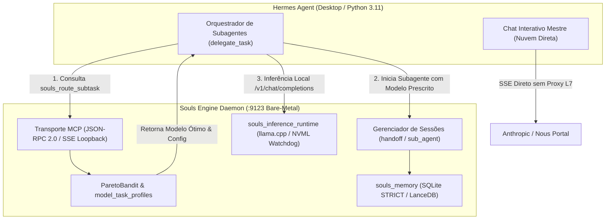

# SOULS_ENGINE_ROADMAP_NEXT_DELIVERIES.md — Roadmap Canônico de Entregas & Pendências Técnicas (v7)

> **ESTATUS DO DOCUMENTO:** CANÔNICO & VINCULANTE (DOCS-AS-GUARDRAILS)  
> **DATA DE CONSOLIDAÇÃO:** 2026-10-11  
> **INVENTÁRIO ATIVO HOMOLOGADO:** 15 Modelos de Elite (32,57 GB em `C:\Users\rosas\llm_local_models\`)  
> **BANCO RELACIONAL SSOT:** `Z:\souls_engine\.souls_data\db\souls_heuristic_vault.db`  

---

## 1. VISÃO GERAL DA ARQUITETURA SIMBIÓTICA

O **Souls Engine v7** opera como uma infraestrutura bare-metal headless (Rust/Tokio) em loopback TCP `127.0.0.1:9123`, atuando como acelerador de silício, motor de AST e hipocampo de memória L3 para o **Hermes Agent** (Python 3.11).



---

## 2. MATRIZ DE PENDÊNCIAS, ENTREGAS & MAPA DE TRANSPLANTE (`_donor/`)

### Bloco A: `souls_llm_cloud_arena` (Benchmarking e Rastreio de APIs de Nuvem)
* **Status Atual:** Especificação concluída em `docs/architecture/llm_benchmark_cost_matrix_crate_specification.md`.
* **Fontes Canônicas no `_donor/`:**
  * `_donor/souls_mc_core/src/finops/iron_cost.rs`: Lógica de precificação ponderada e conversão de tokens.
  * `_donor/souls_mc_protocol/src/metrics.rs`: DTOs de telemetria e custo por milhão de tokens.
* **Entregas Pendentes:**
  1. **Coletor de Preços e Limites:** Ingestão de tabelas de preços de provedores de nuvem (Nous Portal, OpenRouter, Anthropic) com precificação granular ($P_{\text{cache}}$, $P_{\text{in}}$, $P_{\text{out}}$).
  2. **Cálculo de Custo Ponderado ($C_{\text{task}}$):** Implementação dos pesos específicos por perfil (Coding: 0.4/0.4/0.2, Agentic: 0.6/0.3/0.1, Reasoning: 0.2/0.4/0.4, Fast: 0.1/0.8/0.1).
  3. **Unificação na Fronteira de Pareto:** Persistência em `cloud_models` permitindo ao `ParetoBandit` comparar o $V_{\text{task}}$ de silício local ($C_{\text{silicon}}$) com o $V_{\text{task}}$ de nuvem ($C_{\text{task}}$) sob a mesma equação logarítmica normalizada.

---

### Bloco B: `souls_server` (O Daemon Bare-Metal Headless & Servidor MCP)
* **Status Atual:** Topologia definida em `CRATES_SPECIFICATION.md` e contratos estabelecidos em `MCP_TOOL_CONTRACTS.md`.
* **Fontes Canônicas no `_donor/`:**
  * `_donor/souls_mc_core/src/bin/souls_mcp_server/`: Despachante JSON-RPC 2.0 e isolamento stdio contra ANSI.
  * `_donor/souls_mc_core/src/core/governance/mcp_transport.rs`: Envelopes canônicos e ganchos de stream SSE.
* **Entregas Pendentes:**
  1. **Transporte SSE Loopback (`127.0.0.1:9123`):** Servidor HTTP/SSE nativo em Tokio/Axum expondo o catálogo JSON-RPC 2.0 sem dependências de interface gráfica (zero Tauri, zero systray).
  2. **Implementação dos Endpoints MCP Canônicos (30 Ferramentas):**
     * `ops.route_subtask` (`souls_route_subtask`): Endpoint consultado pelo Hermes antes de acionar `delegate_task`.
     * `memory.handoff` & `memory.sub_agent`: Persistência de payloads de transição e controle de ciclo de vida de subagentes.
     * `ast.souls_ast_outline` & `ast.souls_ast_slice`: Desidratação de código (FinOps mandatório de economia de contexto).
     * `think.core_think` (`thinking`): Grafo Acíclico Dirigido (DAG) para cognição socrática multi-passo.
  3. **Gateway de Inferência Local (`/v1/chat/completions`):** Endpoint compatível com a API da OpenAI para que os subagentes delegados executem inferência local direcionada para o modelo físico ativo na GPU/CPU.

---

### Bloco C: Configurações & Alinhamento no Hermes Agent Desktop
* **Status Atual:** Diretórios e modelos físicos consolidados; integração de configuração pendente.
* **Entregas Pendentes:**
  1. **Configuração do `config.yaml` do Hermes:**
     * Registro do Souls Engine como servidor MCP com conexão local SSE:
       ```yaml
       mcp_servers:
         souls_engine:
           url: "http://127.0.0.1:9123/sse"
           transport: "sse"
       ```
     * Configuração do provider local `llama.cpp` apontando para a porta de loopback `:9123` com flags de aceleração física:
       `-ngl 99 -ctk f16 -ctv q4_0 -fa on -c 8192`
  2. **Unificação de Diretórios de Modelos:**
     * O Hermes Agent utiliza por padrão `%LOCALAPPDATA%\hermes\models`.
     * Criação de um *Junction Point* ReFS/NTFS transparente apontando `%LOCALAPPDATA%\hermes\models` $\to$ `C:\Users\rosas\llm_local_models` para evitar qualquer duplicação física de arquivos GGUF.
  3. **Injeção de Governança Agêntica (`souls-ops-finops`):**
     * Atualização do prompt de sistema do Hermes Agent condicionando o uso de `delegate_task` à consulta prévia ao `souls_route_subtask`.

---

### Bloco D: Transplante do Código Legado (`_donor/`) para as Crates Canônicas
* **Status Atual:** Mapeamento forense detalhado em `DONOR_EXTRACTION_MAP.md`.
* **Fontes Canônicas no `_donor/` por Crate:**
  1. **`crates/souls_memory`:**
     * `_donor/souls_mc_core/src/cognition/state_thinking/session_manager.rs`: Gerenciador de sessões concorrentes de subagentes, controle de bifurcação (`branchFromThought`) e fusão (`merge_sessions`).
     * `_donor/souls_mc_core/src/cognition/state_thinking/mpsc_bridge.rs`: Ponte multithread assíncrona não-bloqueante entre o servidor MCP e o banco de dados.
     * `_donor/souls_mc_core/src/cognition/memory/`: FrankenSQLite STRICT WAL (`souls_state.db`), LanceDB vetorial e Chyros Daemon (Langevin Decay).
  2. **`crates/souls_model_router`:**
     * `_donor/souls_mc_core/src/finops/pareto_bandit.rs`: Otimizador bayesiano multiobjetivo Thompson Sampling e cálculo da fronteira de Pareto com barreira térmica $\Phi$.
     * `_donor/souls_mc_core/src/finops/finops_router.rs`: Roteamento determinístico por perfil e cálculo de fallback chains.
  3. **`crates/souls_ast`:**
     * `_donor/souls_mc_core/src/cognition/ast/`: Parser Tree-sitter multilinguagem, gerador de outlines de funções/structs e fatiamento semântico.
     * `_donor/souls_mc_core/src/cognition/context/myers_diff.rs`: Algoritmo matemático de diff cirúrgico via crate `similar`.
     * `_donor/souls_mc_core/src/cognition/context/repo_heatmap.rs`: Motor de frecency via `gitoxide`.
  4. **`crates/souls_inference_runtime`:**
     * `_donor/souls_mc_core/src/core/vram_hardware/hardware_watchdog.rs`: Monitor NVML bare-metal e cálculo de média móvel exponencial de pico (`peak_ewma.rs`).
     * `_donor/souls_mc_core/src/core/vram_hardware/headroom_engine.rs`: Garantia do teto útil de 5.2GB no Windows 11 WDDM (ADR-004).

---

## 3. ARQUITETURA DE CONTROLE DE SESSÕES DE SUBAGENTES

### 3.1 Divisão de Responsabilidades (Hermes vs. Souls Engine)
* **Papel do Hermes Agent (Orquestrador Executivo):**
  * O Hermes cria as threads de subagentes e gerencia a lógica da conversa no topo.
  * O Hermes solicita a recomendação de modelo ao Souls Engine e passa as mensagens.
* **Papel do Souls Engine (Infraestrutura Bare-Metal & Hipocampo L3):**
  * **Arbitragem de Silício:** Decide qual modelo deve atender a demanda baseado em VRAM, temperatura da RTX 2060m e afinidade cognitiva da tarefa.
  * **Persistência de Sessão & Handoff:** Armazena o estado intermediário e histórico do subagente em `sub_agent_sessions` e `handoff_payloads` no SQLite STRICT, impedindo que o subagente polua o contexto do modelo mestre.
  * **Telemetria e Avaliação Pós-Execução:** Registra a latência, tokens gerados e taxa de sucesso do subagente na tabela `arena_telemetry` para calibração contínua do algoritmo bayesiano.

---

## 4. ESTRATÉGIA DE SESSÕES DE TRABALHO & ORDEM CRÍTICA DE EXECUÇÃO

Para blindar o desenvolvimento contra o *Context Rot* e garantir feedback funcional imediato sem quebras colaterais, o trabalho deve ser decomposto em **sessões sequenciais atômicas**:

```
┌────────────────────────────────────────────────────────────────────────────────┐
│                   SEQUÊNCIA CANÔNICA DE SESSÕES DE TRABALHO                    │
├──────────┬───────────────────────┬─────────────────────────────────────────────┤
│ Sessão 1 │ Bloco B: Daemon Base  │ Levantamento de souls_server.exe (:9123)    │
│          │                       │ Transporte Axum SSE loopback + health check │
├──────────┼───────────────────────┼─────────────────────────────────────────────┤
│ Sessão 2 │ Bloco D: Cérebro L3   │ Transplante de session_manager, pareto_     │
│          │                       │ bandit e souls_memory (SQLite STRICT)       │
├──────────┼───────────────────────┼─────────────────────────────────────────────┤
│ Sessão 3 │ Bloco C: Conexão Viva │ Configuração do Hermes Desktop config.yaml, │
│          │                       │ junction points e teste ao vivo do MCP      │
├──────────┼───────────────────────┼─────────────────────────────────────────────┤
│ Sessão 4 │ Bloco D: AST & NVML   │ Transplante de souls_ast (outlines) e       │
│          │                       │ souls_inference_runtime (NVML Watchdog)     │
├──────────┼───────────────────────┼─────────────────────────────────────────────┤
│ Sessão 5 │ Bloco A: Cloud Arena  │ Implementação de souls_llm_cloud_arena e    │
│          │                       │ ingestão de APIs externas (Nous/OpenRouter) │
└──────────┴───────────────────────┴─────────────────────────────────────────────┘
```

### Racional da Ordem:
1. **Por que o Bloco B vem primeiro?** Porque o Hermes Agent não pode ser configurado para se conectar a uma porta vazia. O servidor HTTP/SSE bare-metal precisa estar de pé e respondendo em `127.0.0.1:9123` antes de qualquer outra coisa.
2. **Por que a Sessão 2 implementa o Cérebro L3 antes do Hermes?** Para que, quando o Hermes fizer sua primeira chamada MCP (`souls_route_subtask` ou `sub_agent`), o backend já responda com dados reais do SQLite STRICT e do ParetoBandit em vez de stubs vazios.
3. **Por que o Bloco C (Hermes Desktop) entra na Sessão 3?** Porque neste ponto a conexão simbiótica é ativada de verdade! O usuário verá o Hermes Desktop conectado ao Souls Engine com feedback visual e funcional imediato.
4. **Por que o Bloco A (Cloud Arena) fica para o final?** Porque a infraestrutura local (dGPU RTX 2060m e CPU Host) é a fundação bare-metal do projeto. A nuvem atua como camada de fallback complementar que consome a mesma régua de Pareto já validada no silício local.

---

## 5. EVOLUÇÃO FUTURA: CALIBRAÇÃO DINÂMICA DE PRESETS & SELEÇÃO DE MODELOS DEFAULT NO HERMES

A integração do `souls_llm_cloud_arena` com o `souls_llm_local_arena` abre uma avenida para transformar o `config.yaml` do Hermes Agent de um arquivo estático para um sistema de governança orientado a telemetrias empíricas de custo e qualidade:

### 5.1 Seleção Baseada em Evidências do Modelo Mestre (Default Interactive Chat)
Ao auditar os modelos de nuvem sob os mesmos 4 perfis canônicos e normalizar seu Retorno de Silício Amortecido ($V_{\text{task}}$) versus o custo em dólares ($C_{\text{task}}$), o usuário obtém uma base científica para definir o modelo padrão do chat interativo do Hermes:
* **Preset "Heavy SWE & Architecture":** Define `claude-3-7-sonnet` como mestre para sessões de engenharia crítica, onde o custo de API ($3.40/1M) é justificado pela quase ausência de alucinações.
* **Preset "FinOps / Balanced Daily":** Define `deepseek-v3` ou `qwen-2.5-coder-32b` como mestre para sessões de exploração e prototipagem de alta cadência com custo até 10x menor ($0.18 - $0.28/1M).
* **Preset "Deep Theorem & Math":** Define `deepseek-r1` ou `o3-mini` como mestre para resolução de algoritmos formais.

### 5.2 Automação de Presets no `config.yaml` via Script / CLI do Souls Engine
Implementação futura de um comando utilitário (`souls_profile_sync` ou `souls_config_export`) capaz de:
1. Ler os dados consolidados de `model_task_profiles` e `cloud_models` no SQLite STRICT.
2. Gerar ou atualizar blocos nomeados de perfis no `config.yaml` do Hermes Agent.
3. Alternar entre presets operacionais com um único comando, alinhando simultaneamente as portas locais, fallbacks em nuvem e restrições de tokens.

### 5.3 Despacho Híbrido Dinâmico para Subagentes e Cron Jobs
Diferente do chat mestre interativo (que permanece fixo intradiálogo conforme o ADR-003 para preservar o *prefix caching*), as tarefas delegadas (`delegate_task`) e os agendamentos em segundo plano (*cron jobs*) operam com chaveamento 100% dinâmico:
* **Cron Jobs de Manutenção:** Rotinas periódicas de limpeza, indexação e sumarização são absorvidas compulsoriamente pelo Tier 0 (`smollm2-135m` a 149 TPS no i9) com custo financeiro zero e impacto térmico nulo na dGPU.
* **Subagentes de Suporte:** O `souls_route_subtask` decide dinamicamente se despacha a microtarefa para a RTX 2060m (`qwen3.5-agentic-coder` a 46 TPS) ou para a nuvem mais eficiente da Fronteira de Pareto.

---

## 6. CRITÉRIOS DE CONCLUSÃO (DEFINITION OF DONE)
1. Binário `souls_server.exe` compilando sem warnings e respondendo no `localhost:9123`.
2. O Hermes Agent Desktop se conecta ao servidor MCP e visualiza as 30 ferramentas.
3. Um comando `delegate_task` no Hermes consulta com sucesso o `souls_route_subtask` e executa um subagente no modelo local `qwen3-5-4b-agentic-coder`.
4. Os dados da sessão do subagente são persistidos e auditáveis no banco `souls_heuristic_vault.db`.
