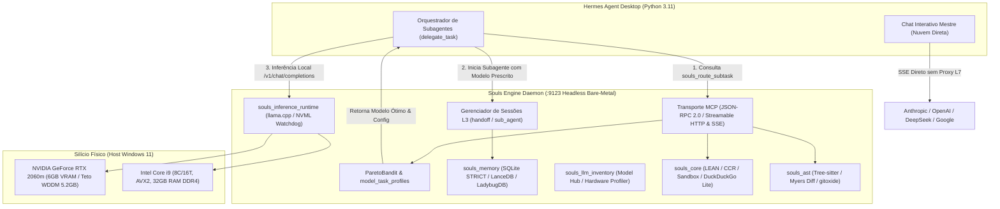
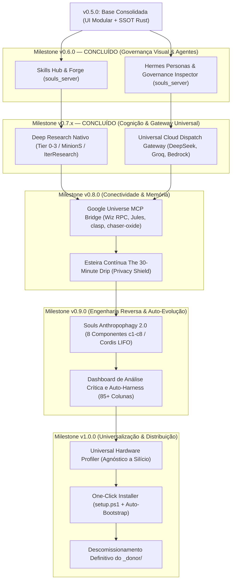

# SOULS_ENGINE_ROADMAP_NEXT_DELIVERIES.md — Roadmap Canônico de Entregas & Evolução Rumo à v1.0

> **STATUS DO DOCUMENTO:** CANÔNICO & VINCULANTE (DOCS-AS-GUARDRAILS)
> **VERSÃO CONSOLIDADA:** v0.9.0 (Fevereiro/2026) ➔ Meta Final: v1.0.0 Real
> **ARQUITETURA:** 11 Crates Canônicas Bare-Metal (Rust/Tokio) • Loopback HTTP/SSE `127.0.0.1:9123`  
> **SIMBIOSE:** Hermes Agent Desktop (Python 3.11) + Antigravity CLI + Web Dashboard SPA  
> **SSOT DE DADOS:** `Z:\souls_engine\.souls_data\db\souls_heuristic_vault.db` (FrankenSQLite STRICT WAL)

---

## 1. VISÃO GERAL & PRINCÍPIOS ARQUITETURAIS VINCULANTES

O **Souls Engine** opera como uma infraestrutura bare-metal headless (Rust/Tokio) em loopback TCP local `127.0.0.1:9123`. Ele atua como acelerador de silício, motor de AST, hipocampo de memória L3 e orquestrador de subagentes para o **Hermes Agent** e IDEs compatíveis (Antigravity, Cursor).



### As 6 Linhas Vermelhas (AGENTS.md)
1. **Zero Desktop UI Local / Systray:** O binário `souls_server.exe` / `souls_engine.exe` é 100% headless. A observabilidade visual pertence ao Web Dashboard SPA servido na porta `9123`.
2. **Nenhum Proxy L7 para o Chat Mestre:** O Hermes Agent resolve suas APIs de nuvem diretamente, preservando o *prefix caching*.
3. **Nenhum Chaveamento Intradiálogo:** O ParetoBandit atua exclusivamente em subagentes (`delegate_task`) e tarefas de suporte (`auxiliary.*`).
4. **Sem Poluição fora do Diretório Canônico de Dados:** No ambiente de desenvolvimento, reside em `Z:\souls_engine\.souls_data\`; em ambientes de produção/distribuição universal, resolve de forma agnóstica via `SOULS_DATA_DIR` (`%LOCALAPPDATA%\SoulsEngine\data\` no Windows, `~/.local/share/souls_engine/` no Linux, `~/Library/Application Support/SoulsEngine/` no macOS), sem nunca espalhar arquivos temporários soltos.
5. **Topologia Controlada:** Workspace estruturado estritamente nas crates canônicas homologadas.
6. **Zero `unsafe` Arbitrário:** Workspace sob `#![forbid(unsafe_code)]`, exceto delimitações auditadas com `// SAFETY:`.

---

## 2. HISTÓRICO CONSOLIDADO DE ENTREGAS (O QUE JÁ FOI REALIZADO)

Até a consolidação da **Milestone v0.6.0**, todo o ciclo fundacional de infraestrutura, inferência, governança comportamental (Skills + Personas) e interface foi construído e homologado:

### 2.1 Tabela Histórica de Sessões e Marcos (v0.1.0 ➔ v0.6.0)

| Sessão / Marco | Escopo Principal | Estado | Principais Entregas |
| :--- | :--- | :---: | :--- |
| **Sessões 1 & 2** | Daemon Base & Cérebro L3 | **100% CONCLUÍDO** | `souls_server` (:9123), Axum HTTP/SSE, FrankenSQLite STRICT WAL, LanceDB e LadybugDB. |
| **Sessão 3** | Conexão Viva Hermes Desktop | **100% CONCLUÍDO** | Configuração do `config.yaml`, junction ReFS de modelos, FinOps guardrails e MCP live. |
| **Sessão 4** | AST Tree-sitter & NVML | **100% CONCLUÍDO** | Transplante `souls_ast` (outlines, slices, callers), watchdog NVML bare-metal e cálculo EWMA. |
| **Sessão 5** | Cloud Arena Benchmarking | **100% CONCLUÍDO** | Crate `souls_llm_cloud_arena`, 9 perfis cognitivos, ingestão Nous/OpenRouter e sync diário. |
| **Sessão 6** | Governança Master Brain | **100% CONCLUÍDO** | Tríade de Líderes na nuvem, cálculo de Fronteira de Pareto e alternância de perfis. |
| **Sessão 7** | Web Dashboard SPA (V1) | **100% CONCLUÍDO** | Interface web inicial servida via Axum com abas de Overview, Arenas e Settings globais. |
| **Sessão 8** | Homologação Clínica E2E | **100% CONCLUÍDO** | 156/156 cenários clínicos aprovados (100%), 52 tools, 15 skills, zero leak de VRAM. |
| **Sessão 9 & 10** | Silício Neural & Des-staging | **100% CONCLUÍDO** | 15 modelos físicos mapeados, sandbox Win32 segura, LEAN compression e dedup SipHash. |
| **Sessão 11** | Skills & Curadoria Obsidian | **100% CONCLUÍDO** | 15 Skills sincronizadas, pipeline de curadoria `raw/` ➔ `wiki/` com Privacy Shield local. |
| **Sessão 12 & 13** | Telemetria SSE & Simbiose | **100% CONCLUÍDO** | Streaming SSE em tempo real, persistência em `souls_config.toml` e integração de plugins Hermes. |
| **Sessão 14 & 15** | Settings UX & Design System | **100% CONCLUÍDO** | Sub-abas com tooltips explicativos, modal de aplicação rápida de modelos e ranking Top 50. |
| **Sessão 16** | Context LEAN & Sandbox | **100% CONCLUÍDO** | Crate `souls_core` (DuckDuckGo Lite na RAM, truncagem head+tail 50/70, 65/65 testes PASS). |
| **Sessão 17** | Model Hub & Profiler | **100% CONCLUÍDO** | Crate `souls_llm_inventory` (RFC-007), download sequencial com HTTP Range e verificação SHA-256. |
| **Sessão 18** | Local Silicon Arena | **100% CONCLUÍDO** | Crate `souls_llm_local_arena`, 5 baterias empíricas ADR-007 no silício real (32/32 testes PASS). |
| **Sessão 19** | Two-Stage Switchboard | **100% CONCLUÍDO** | Switchboard em 2 estágios (<1.7ms na CPU AVX2), projeção dinâmica no `tools/list` (33/33 PASS). |
| **Milestone v0.5.0** | **Modularização UI & SSOT Rust** | **100% CONCLUÍDO** | **ADR-012:** Monólito de 15k linhas decomposto em 25 componentes em `templates/` via `concat!(include_str!(...))` em `.rodata`. Unificação de dependências no root `Cargo.toml`. Teto de contexto dGPU dinâmico baseado em VRAM real. Revisão total das sub-abas de Settings (zero mocks). |
| **Milestone v0.6.0** | **Skills Hub & Hermes Personas** | **100% CONCLUÍDO** | **Skills Hub:** Catálogo multi-ambiente, índice RAM 101k+, quarentena Zero-Trust, Auto-Fix seguro (`body_preserved_exact`) e Estúdio Forge. **Hermes Personas:** Aba dedicada `🎭 Personas`, Guardião de Privacidade & Coerência em 1 clique, cirurgia hierárquica YAML, Bancada Dupla (`Painel Rápido` + `SOUL.md`), Estúdio Criar/Clonar, Arquivamento e Comparador Myers Diff (48/48 testes PASS). |
| **Milestone v0.7.0** | **Deep Research Hub & SSOT Control Plane** | **100% CONCLUÍDO** | **Deep Research Hub:** Aba `🔬 Pesquisa Profunda` (5 sub-abas: Nova Missão STORM, Missões Ativas SSE, Biblioteca viva/Myers Diff/Obsidian, Scorecard E³ + Domain Trust, Doctor & 1-Click Provisioning), SSOT ReFS puro, 4 tools MCP `research.*` (59 tools canônicas), 53/53 testes PASS. |
| **Milestone v0.7.1** | **Tier 0 Determinístico Zero-LLM** | **100% CONCLUÍDO** | **souls_core::research:** Conversor streaming HTML->MD zero-allocation com blindagem UTF-8, chunker deslizante (~500-600 palavras c/ overlap de 80), normalizador de URLs e dedup SipHash 2-4, ranqueador lexical BM25 e esteira integrada de compressão (47/47 testes PASS). |
| **Milestone v0.7.2** | **Tier 1 Operário Local & Protocolo MinionS** | **100% CONCLUÍDO** | **souls_inference_runtime::minions:** Protocolo MinionS para extração de claims epistêmicos, estatísticas e síntese atômica, saídas estruturadas com auto-cura JSON (`heal_json_response`) e orquestrador de lote com FinOps WDDM (fallback CPU AVX2 com zero spillover PCIe a 0 MB VRAM extra, 52/52 testes PASS). |
| **Milestone v0.7.3** | **Universal Cloud Dispatch Gateway & Fallback Chains** | **100% CONCLUÍDO** | **souls_model_router + souls_llm_cloud_arena + souls_server:** Resolução de contingência em sub-150ms (`resolve_fallback_chain`), Circuit Breaker & Quarentena sob HTTP 429/500/timeout com auto-recuperação, FinOps Prompt Cache (DeepSeek, Groq, Cerebras, Together, Bedrock, Azure), catálogo multi-cloud canônico expandido e sub-aba visual `🛡️ Provedores & Fallback` no Dashboard (56/56 testes PASS). |
| **Alfândega v0.7.x** | **Revisão Ampla, Hardening & Release Oficial** | **100% CONCLUÍDO** | **Inspeção de Alfândega:** 193/193 testes PASS no workspace, isolamento Axum de RNG thread-safety (`std::thread::spawn`), MCP `route_subtask` enriquecido com `fallback_chain`/`cached_tokens`/`max_budget_usd`, compilação Release MSVC LTO (114.4 MB), live smoke test sub-5ms e instalação operacional em `%LOCALAPPDATA%\SoulsEngine` via `tools/install_souls.ps1`. |
| **Milestones v0.8.0 ➔ v0.8.3** | **Streaming PDF, Gateways Globais & Visão Cognitiva O(1)** | **100% CONCLUÍDO** | PDF Streaming nativo em SQLite STRICT WAL, integração de gateways de CLIs agênticas (`agy`, `claude`, `codex`), reverse-engineering do NotebookLM (Google Universe Bridge / GV1), e visão AXTree O(1) sem alocação de VRAM. |
| **Milestone v0.9.0** | **Maturidade de Produto, Precision Dark UI, Unificação Multi-Cloud & Personal Evolution Hub** | **100% CONCLUÍDO** | **v0.9.0 Oficial:** Agnosticismo real de hardware (Dynamic NVML / zero `%USER%` hardcoded), parser MoE inteligente (30B-A3B, 8x7B, 8x22B), ciclo completo de quarentena de skills (`Limpar Fila` e `Descartar Não Quero`), Doctor 2.0 com cofre atômico de credenciais, unificação dos 16 provedores canônicos no ParetoBandit/Arena/Subagentes, Design System Precision Dark com 0 alerts/confirms bloqueantes, Cockpit de Evolução Pessoal & Pulso do Ecossistema no Overview, purga definitiva de placebos e 100% das 175 funções onclick implementadas (296/296 testes PASS). |

### 2.2 Inventário de Ativos Consolidados na v0.6.0
* **Topologia de Crates:** 11 Crates canônicas estritamente sincronizadas via `[workspace.dependencies]`.
* **Catálogo MCP:** 55 Ferramentas de revelação progressiva divididas em 6 namespaces (`code.*`, `context.*`, `memory.*`, `think.*`, `ops.*`, `sys.*`).
* **Governança de Skills & Personas:** Catálogo unificado multi-superfície + Explorador de 101.000+ skills em RAM (<5ms) + Gestão completa de Personas Hermes (`default` e `profiles/*`) com soberania Read-Only sobre `MEMORY.md`/`USER.md`.
* **Desempenho de Compilação:** `cargo check -p souls_server` acelerado de ~8.7s para **2.06s** (~4.2x mais rápido).
* **Binário de Produção:** `souls_engine.exe` compilado em release MSVC (`lto = "thin"`, `codegen-units = 1`, `panic = "abort"`), pesando menos de 45 MB com zero dependências de DLLs externas.

---

## 3. MATRIZ DE DEMANDAS, SCRATCHPAD & ANÁLISE DE GAPS

Cruzamento do draft [`docs/reference/lembretes.txt`](file:///Z:/souls_engine/docs/reference/lembretes.txt) e dos documentos de pesquisa com o estado do repositório:

| Item do Lembrete | Descrição Sintética | Estado Atual | Destino no Roadmap & Referência |
| :--- | :--- | :---: | :--- |
| **#1 Refatoração de UI** | Quebrar monólito HTML em módulos para manutenção ágil | **JÁ REALIZADO (v0.5.0)** | Concluído via ADR-012 (25 parciais atômicos sob `templates/`). |
| **#2 Revisão de Deps Rust** | Unificar versões e auditar flags de compilação | **JÁ REALIZADO (v0.5.0)** | Concluído via SSOT em `[workspace.dependencies]`. |
| **#3 Skills Hub & Forge** | Visualização, descoberta, busca em APIs e criação agêntica local de skills | **CONCLUÍDO (v0.6.0)** | Concluído em `souls_server`: 4 sub-abas, índice RAM 101k+, Auto-Fix seguro, Pausar/Excluir com backup e Estúdio Forge. |
| **#4 Perfis do Hermes** | Inspecionar/editar `AGENTS.md`, `SOUL.md` e configs dos perfis no Dashboard | **CONCLUÍDO (v0.6.0)** | Concluído em `souls_server`: Aba `🎭 Personas`, Guardião de Privacidade & Coerência em 1 clique, Bancada Dupla, Estúdio Criar/Clonar e Comparador Myers Diff. |
| **#5 Deep Research Engine** | Capability/Tool base de pesquisa profunda em árvore com síntese e fontes | **GAP IDENTIFICADO** | **Milestone v0.7.0** ➔ Ref.: [Deep Research para o Ecossistema Hermes Agent e Souls Engine.md](file:///Z:/souls_engine/docs/reference/Deep%20Research%20para%20o%20Ecossistema%20Hermes%20Agent%20e%20Souls%20Engine.md). |
| **#6 Gateway Cloud Multi-Provedor** | Universalizar despacho de subagentes para além de OpenAI/Claude/Gemini | **GAP IDENTIFICADO** | **Milestone v0.7.0** (DeepSeek API, Groq, Together, Bedrock). |
| **#7 Google Universe Bridge** | Ferramentas MCP para Google Docs, Sheets, Drive, Calendar e Gmail | **GAP IDENTIFICADO** | **Milestone v0.8.0** ➔ Ref.: [Arquitetura Universal Google e Hermes.md](file:///Z:/souls_engine/docs/reference/Arquitetura%20Universal%20Google%20e%20Hermes.md). |
| **#8 Souls Anthropophagy** | Ingestão mecânica de repositórios ➔ Essências ➔ Janela de Vidro (85+ colunas Google Sheets) ➔ Deep Analysis & Backlog de Implementação | **GAP IDENTIFICADO** | **Milestone v0.9.1** ➔ Ref.: `_donor/souls_mc_anthropophagy` e `Ideação Curadoria de Contexto Souls MC.md`. |
| **#10 Souls Evolutive Harness** | Auto-evolução contínua, Cordis Microkernel, 8 componentes (`c1`–`c8`) e Catnap Protocol | **GAP IDENTIFICADO** | **Milestone v0.9.2** ➔ Ref.: [Estudo de Fetures para Harnesses Open-Source.md](file:///Z:/souls_engine/docs/reference/Estudo%20de%20Fetures%20para%20Harnesses%20Open-Source.md). |
| **#11 Percepção Multimodal Híbrida** | AXTree O(1) + On-Demand Snapshots (Canvas/Figma) + Áudio Soberano Local na CPU i9 (0 MB VRAM) | **GAP IDENTIFICADO** | **Milestone v0.9.3** ➔ Ref.: Arquitetura Híbrida de Grounding & FinOps. |
| **#9 Universal Installer & Hardware Adaptability** | Instalador zero-atrito, piso mínimo na 2060m adaptável a qualquer hardware | **GAP IDENTIFICADO** | **Milestone v1.0.0** (Universal Installer & Release Oficial). |

---

## 4. A TRILHA CANÔNICA RUMO À VERSÃO 1.0 REAL

A jornada da versão 0.5.0 até a 1.0.0 é dividida em **5 Milestones Sequenciais**, integrando os estudos de pesquisa aprofundada:

```
┌──────────────────────────────────────────────────────────────────────────────────┐
│                     JORNADA DE DESENVOLVIMENTO RUMO À v1.0                       │
├───────────────┬──────────────────────────────────┬───────────────────────────────┤
│ v0.5.0        │ Base Bare-Metal & UI Modular     │ [CONCLUÍDO] 11 Crates, ADR-012│
├───────────────┼──────────────────────────────────┼───────────────────────────────┤
│ v0.6.0        │ Governança Visual & Skills Hub   │ [CONCLUÍDO] Skills + Personas │
├───────────────┼──────────────────────────────────┼───────────────────────────────┤
│ v0.7.0        │ Deep Research Hub (Dashboard)    │ [CONCLUÍDO] Aba UI + MCP Pull │
├───────────────┼──────────────────────────────────┼───────────────────────────────┤
│ v0.7.1        │ Tier 0 Determinístico Zero-LLM   │ [CONCLUÍDO] BM25 + SipHash    │
├───────────────┼──────────────────────────────────┼───────────────────────────────┤
│ v0.7.2        │ Tier 1 Batch MinionS Silício     │ [CONCLUÍDO] MinionS SLM 0MB   │
├───────────────┼──────────────────────────────────┼───────────────────────────────┤
│ v0.7.3        │ Gateway Cloud & Fallback Chains  │ [CONCLUÍDO] Sub-150ms + Quaran│
├───────────────┼──────────────────────────────────┼───────────────────────────────┤
│ v0.8.0        │ Streaming PDF & Cache Epistêmico │ [CONCLUÍDO] Strict WAL + L3   │
├───────────────┼──────────────────────────────────┼───────────────────────────────┤
│ v0.8.1        │ Gateways Globais & CLIs Agênticas│ [CONCLUÍDO] agy, claude, codex│
├───────────────┼──────────────────────────────────┼───────────────────────────────┤
│ v0.8.2        │ Google Universe & NotebookLM     │ [CONCLUÍDO] Wiz RPC + Cofre GV1│
├───────────────┼──────────────────────────────────┼───────────────────────────────┤
│ v0.8.3        │ Visão Cognitiva O(1) & AXTree    │ [CONCLUÍDO] LEAN 71% + 0MB VRAM│
├───────────────┼──────────────────────────────────┼───────────────────────────────┤
│ v0.9.0        │ Maturidade & Cockpit de Evolução │ [CONCLUÍDO] Dark UI + Multi-Cl│
├───────────────┼──────────────────────────────────┼───────────────────────────────┤
│ v0.9.1 (PRÓX) │ Souls Anthropophagy (Repo Miner) │ 85+ Colunas Google Sheets SSOT│
├───────────────┼──────────────────────────────────┼───────────────────────────────┤
│ v0.9.2        │ Souls Evolutive Harness (Harness)│ Cordis Kernel, Catnap Protocol│
├───────────────┼──────────────────────────────────┼───────────────────────────────┤
│ v0.9.3        │ Percepção Multimodal Híbrida     │ AXTree + On-Demand Snap + VAD │
├───────────────┼──────────────────────────────────┼───────────────────────────────┤
│ v1.0.0 REAL   │ Universalização & Distribuição   │ Auto-Tuning, Installer 1-Click│
└───────────────┴──────────────────────────────────┴───────────────────────────────┘
```

---

### MILESTONE v0.6.0: GOVERNANÇA VISUAL, SKILLS HUB & HERMES PERSONAS — **[100% CONCLUÍDO]**

O objetivo desta etapa é transformar o Dashboard em uma central completa de gestão comportamental dos agentes e subagentes, sem depender de edição manual de arquivos no terminal.

#### 1. Módulo Skills Hub & Agêntico Forge (`templates/tabs/skills_hub.html`) — **[100% CONCLUÍDO]**
* **Catálogo Visual Multi-Ambiente:** Listagem ordenável e interativa das skills ativas/pausadas com detecção dinâmica de programas instalados no host (`.agents/skills/` ou app local, `%LOCALAPPDATA%\hermes\skills/`, Personas isoladas e `~/.gemini/...`).
* **Editor, Auto-Correção Segura & Governança:** Botão `Corrigir Automaticamente` preservando 100% das instruções do corpo (`body_preserved_exact`), explicação clara dos avisos preventivos/SO, `Pausar` (`SKILL.md.disabled`) e `Excluir` com backup no Histórico.
* **Skills Marketplace & Explorer (101k+):** Busca instantânea em RAM com vitrine personalizada (`Sugeridas para o Seu Ambiente`), filtro por Tema e Origem (`Comunidade` / `Oficial` / `GitHub Live`) e Área de Revisão antes de instalar.
* **Estúdio de Criação & Adaptação (Forge):** Assistente em linguagem natural com motor instantâneo gratuito, modelo local ou nuvem, Myers Diff visual e publicação seletiva multi-ambiente.

#### 2. Hermes Personas & Governance Inspector (`templates/tabs/personas_hub.html`) — **[100% CONCLUÍDO]**
* **Galeria Portátil de Assistentes Hermes:** Descoberta automática da Persona Principal (`default`) e perfis isolados (`%LOCALAPPDATA%\hermes\profiles/*`), com avatares reais (`assets/avatar.png`), status de conexão MCP e resumo de coerência.
* **Guardião de Privacidade & Coerência em 1 Clique:** Diagnóstico cruzando `SOUL.md` vs `config.yaml` vs `profile.yaml` (bloqueio de modelos `:free` em Personas de dados sensíveis, ativação de `mcp_servers.souls_engine` em `:9123/mcp` e higiene textual) com prévia `dry_run` em **Myers Diff** e backup automático antes de gravar.
* **Bancada Dupla (`Painel Rápido` + `SOUL.md`) & Soberania de Memória:** Edição visual sem tocar em YAML bruto via cirurgia hierárquica de blocos (`AGENTS.md` §8.1), checagem de contratos ancorados (`AGENTS.md` / `wiki/` do cofre Obsidian), visualização protegida Read-Only de `MEMORY.md`/`USER.md` (`AGENTS.md` §4) e zero exposição de `.env`/`auth.json`.
* **Estúdio Criar & Clonar + Ciclo de Vida Completo:** Criação guiada ou clonagem de novas Personas prontas para conversar no Hermes (com escolha de Skills iniciais), arquivamento/reativação segura e comparador lado a lado entre Personas com rollback em 1 clique.

---

### MILESTONE v0.7.x: COGNIÇÃO PROFUNDA, DEEP RESEARCH & GATEWAY UNIVERSAL

> **Documento de Referência Arquitetural SSOT:**  
> 📄 [Deep Research para o Ecossistema Hermes Agent e Souls Engine.md](file:///Z:/souls_engine/docs/reference/Deep%20Research%20para%20o%20Ecossistema%20Hermes%20Agent%20e%20Souls%20Engine.md)

Expansão das capacidades analíticas fundamentais combinando cérebro em nuvem, operários locais (SLMs), orquestração via Hermes Agent e eliminação de aprisionamento em provedores proprietários. Para assegurar a **Regra da Crate Única** e commits atômicos de alta previsibilidade, a milestone é dividida em 4 releases canônicas:

```
┌────────────────────────────────────────────────────────────────────────────────────────┐
│                   DECOMPOSIÇÃO CANÔNICA DA MILESTONE v0.7.x                            │
├───────────────┬──────────────────────┬────────────────────────┬────────────────────────┤
│ Versão        │ Escopo de Domínio    │ Crate Única Alvo       │ Entrega Principal      │
├───────────────┼──────────────────────┼────────────────────────┼────────────────────────┤
│ v0.7.0 (HOJE) │ Research ControlHub  │ souls_server           │ Aba UI + MCP + FS SSOT │
├───────────────┼──────────────────────┼────────────────────────┼────────────────────────┤
│ v0.7.1        │ Tier 0 Deterministic │ souls_core             │ BM25 + HTML->MD + SipH │
├───────────────┼──────────────────────┼────────────────────────┼────────────────────────┤
│ v0.7.2        │ Tier 1 Batch MinionS │ souls_inference_runtime│ MinionS SLM + 0MB VRAM │
├───────────────┼──────────────────────┼────────────────────────┼────────────────────────┤
│ v0.7.3        │ Multi-Cloud Gateway  │ souls_llm_cloud_arena &│ DeepSeek/Groq/Bedrock +│
│               │ & Fallback Chain     │ souls_model_router     │ Sub-aba Provedores     │
└───────────────┴──────────────────────┴────────────────────────┴────────────────────────┘
```

#### 1. Versão v0.7.0: Research Hub & Plano de Controle Operacional (`souls_server`) — **[100% CONCLUÍDO]**
* **Aba de Topo `🔬 Pesquisa Profunda`:** Painel de controle no Dashboard SPA modular (ADR-012) dividido em 5 sub-abas:
  - `🚀 Nova Missão`: Scoping interativo com planejador determinístico (STORM), estimativa FinOps antecipada e contrato mestre (`00_research_brief.json`).
  - `📡 Missões Ativas`: Observabilidade em tempo real via SSE (`/api/v1/research/stream`), medidor de turnos (com teto Beast Mode aos 72 turnos) e controle de *steering* em voo (pausar, injetar diretrizes, forçar síntese, cancelar).
  - `📚 Biblioteca`: Acervo de relatórios com leitor epistêmico (chips `[VERIFIED]`, `[SOURCED]`, `[REASONED]`, `[ESTIMATED]`), visualizador de fontes por tier, versões vivas (*deltas* incrementais v2+), ramificação de tópicos em missões filhas autônomas, comparador nativo Myers Diff, exportação de `.md` e promoção soberana para o Cofre Obsidian (`raw/research/` com higienização de PII via Privacy Shield em memória) e Hipocampo L2.
  - `🧪 Qualidade & Reputação`: Scorecard epistêmico consolidado com métrica $E^3$ (Epistemic Efficiency & Evidence), livro-razão dinâmico de reputação de domínios (*allow/block/boost*) com auto-rebaixamento de alucinações recorrentes, formulário de feedback por afirmação e assistente de auto-patch de regras para a skill `deepsoul-research`.
  - `🩺 Motor & Prontidão`: Verificador Doctor de pré-requisitos, formulário de parâmetros globais FinOps (`max_budget_usd`, esforço padrão, timeout de lease) e provisionamento 1-clique com prévia *dry-run* dos perfis (`fast-scout`, `verifier-readonly`) e da skill canônica no Hermes Agent.
* **Persistência Bare-Metal como SSOT no ReFS:** Estado contido em `Z:\souls_engine\.souls_data\research/{run_id}/` (zero DDL neste ciclo), com índice em RAM ultraveloz (`ResearchIndex`) e varredura de leases expirados.
* **Ferramentas MCP de Pull para o Hermes:** Exposição das ferramentas canônicas do namespace `research.*` (`research_claim`, `research_event`, `research_steering`, `research_complete`) expandindo o catálogo oficial para **59 ferramentas canônicas** (53/53 testes unitários e de integração Axum PASS).

#### 2. Versão v0.7.1: Tier 0 Determinístico Zero-LLM (`souls_core::research`) — **[100% CONCLUÍDO]**
* **Conversão HTML para Markdown Zero-Allocation (`html_cleaner.rs`):** Motor de parsing streaming de alta performance em Rust, limpando tags irrelevantes (`<script>`, `<style>`, `<nav>`, `<footer>`, `<header>`, `<iframe>`, etc.) e ruídos de navegação diretamente na memória, com decodificação de entidades HTML e integridade UTF-8 sem mojibake.
* **Segmentação Deslizante (`chunker.rs`):** Divisão de documentos longos em blocos de ~500 a 600 palavras com overlap de ~80 palavras para preservar contexto semântico entre passagens, acompanhado de offsets de caracteres e hash de integridade de 64 bits.
* **Deduplicação Canônica SipHash 2-4 (`dedup.rs`):** Normalização agressiva de URLs (purga de tracking `utm_*`, `fbclid`, âncoras e esquemas) e cálculo de impressões digitais invariantes de conteúdo (`ResearchDedupRegistry`).
* **Ranqueador Lexical Bare-Metal BM25 (`bm25.rs`):** Algoritmo Okapi BM25 rápido na CPU ($k_1 = 1.2$, $b = 0.75$) com tokenização sem stop-words em inglês/português, ranqueando passagens diretamente contra o *Briefing* da missão com 0 custo de tokens.
* **Esteira Determinística Integrada (`process_raw_html_passage`):** Pipeline único conectando limpeza, deduplicação, segmentação e ranking com taxas de compressão de 60% a 90% (47/47 testes unitários PASS).

#### 3. Versão v0.7.2: Tier 1 Operário Local & Protocolo MinionS (`souls_inference_runtime`) — **[100% CONCLUÍDO]**
* **Execução Paralela MinionS em Lote (`src/minions.rs`):** Decomposição de pesquisas e documentos brutos em tarefas atômicas de passo único especializadas (`ExtractClaims`, `VerifyCitation`, `ExtractStatistics`, `DetectContradiction`, `SynthesizeSection`) executadas localmente via `Tier1GenerativeEngine`.
* **Esquema Tipado `StructuredLocalOutput` & Auto-Cura JSON:** Extração determinística de afirmações epistêmicas (`EpistemicClaimOutput`), pontos de dados estatísticos (`StatisticDataPoint`) e sínteses parciais tipadas em Rust com autocorreção resiliente via `heal_json_response`.
* **Conformidade FinOps WDDM & Zero Spillover PCIe:** Orquestrador com seleção de dispositivo em tempo real (`MinionBatchOrchestrator`) monitorando o `HardwareWatchdog`: caso a VRAM ultrapasse $4.800$ MB ou a GPU atinja $\ge 78^\circ\text{C}$, a inferência sofre desvio transparente para CPU com instruções AVX2 (`gpu_layers = 0`), garantindo 0 MB de VRAM adicional e zero estrangulamento PCIe no host (52/52 testes unitários e de integração PASS).

#### 4. Versão v0.7.3: Universal Cloud Dispatch Gateway & Fallback Chains (`souls_llm_cloud_arena` & `souls_model_router` & `souls_server`) — **[100% CONCLUÍDO]**
* **Expansão Multi-Provedor Nativa & Prompt Cache Engine:** Suporte com cálculo de cache hits para DeepSeek API (v3/r1 com 74% de desconto em prompt cache), Groq (LPU a 0.35x de latência), Cerebras (WSE a 0.30x de latência • 420+ TPS), Together AI, Bedrock (Claude 3.5 Sonnet / Nova) e Azure OpenAI (GPT-4o).
* **Fallback Chain Inteligente por Perfil em Sub-150ms:** Roteamento de contingência em sub-150ms (`resolve_fallback_chain`) sob erros HTTP 429 (rate-limit), 500/503 (serviço indisponível) ou timeouts para o próximo modelo na Fronteira de Pareto.
* **Circuit Breaker & Cooldown Manager:** Quarentena automática (60s para 429, 30s para 500/503, 15s para timeout) evitando que subagentes disparem contra provedores em saturação, com auto-recuperação por sucesso verificado ou reset manual via API/UI.
* **Sub-Aba `🛡️ Provedores & Fallback` no Dashboard:** Monitoramento visual de circuit breaker em tempo real, cartões informativos de provedores cloud, tabela de quarentenas ativas com botão 1-clique de liberação e simulador interativo de resolução de cadeia com SLA <150ms (56/56 testes unitários e de integração PASS).

#### 5. Fechamento de Alfândega, Hardening & Instalação Oficial — **[100% CONCLUÍDO]**
* **Auditoria Abrangente do Workspace (193/193 Testes PASS):** Validação estrita de contratos de dados em todas as 9 crates canônicas (`souls_core`, `souls_ast`, `souls_memory`, `souls_inference_runtime`, `souls_llm_inventory`, `souls_llm_local_arena`, `souls_model_router`, `souls_llm_cloud_arena`, `souls_server`). Zero regressões, zero warnings e integridade das 6 Linhas Vermelhas.
* **Hardening de Concorrência Axum (RNG Thread-Safety):** Isolamento do `ThreadRng` do Bandit em `std::thread::spawn` com canal oneshot, garantindo conformidade estrita com o trait `Send` dos handlers do Axum.
* **Enriquecimento MCP & Endpoints REST:**
  - MCP `route_subtask`: inclusão da chave `fallback_chain` e suporte aos campos `cached_tokens` e `max_budget_usd`.
  - Novos endpoints: `GET /api/v1/router/providers`, `GET/POST /api/v1/router/quarantines`, `POST /api/v1/router/fallback/chain` e `POST /api/v1/research/tier0/process`.
  - Dashboard UI/UX: subaba *🛡️ Provedores & Fallback* com badge dinâmica de quarentenas e simulador em tempo real.
* **Compilação Release & Setup Simbiótico:**
  - Binário compilado com MSVC e LTO em 12m 46s (`114.4 MB`).
  - Instalação oficial via `tools/install_souls.ps1` com identidade dupla (`souls_server.exe` e `souls_engine.exe`) em `%LOCALAPPDATA%\SoulsEngine\`.
  - Smoke test ao vivo atestando resolução de fallback em `4.08 ms` e compressão determinística Tier 0 de `55.7%`.

#### 6. Melhorias Mapeadas da Trilha Cognitiva (Backlog Ativo & Matriz de Fases)
Com a entrega da infraestrutura básica do ciclo v0.7.x, as seguintes extensões estratégicas ficam formalmente mapeadas e distribuídas por prudência técnica e impacto imediato:

| Melhoria Mapeada | Fase Canônica | Tipo de Esforço | Justificativa Arquitetural |
|---|:---:|:---:|---|
| **Ingestão Bare-Metal de PDFs (Tier 0)** | **Início da v0.8.0** | Engenharia Direta | Sem incerteza teórica; acelera a ingestão de fontes no Google Drive e curadoria local. |
| **Cache Epistêmico de Passagens (L2/L3)** | **Início da v0.8.0** | Engenharia Direta | LanceDB/LadybugDB já operacionais; evita re-scraping web redundante entre pesquisas. |
| **Quarentena Dinâmica via Headers HTTP** | **Início da v0.8.0** | Refinamento Cirúrgico | Leitura de `retry-after` no Axum/Reqwest substituindo janela fixa de 60s por SLA real. |
| **Streaming SIMD de JSON & Buffer Pool mmap** | **v0.8.0+ / v0.9.0** | Otimização de Performance | Crucial sob alto volume de chamadas MinionS gerado pela automação tátil da v0.8.0. |
| **Pipeline STORM Multi-Agente em DAG** | **Milestone v0.9.0** | Arquitetura de Enxame | Requer o microkernel Cordis e a orquestração de enxame de auto-evolução da v0.9.0. |
| **Telemetria Fechada & Hedging Preemptivo** | **Milestone v0.9.0** | Calibração Estatística | Exige histórico e massa de dados de uso real no Hermes para evitar custos duplicados. |

1. **Evoluções do Deep Research Hub (Trilha Cognitiva & Ingestão):**
   - **Ingestão Bare-Metal de Documentos Ricos (PDF / EPUB / DOCX):** Implementação de parser determinístico no Tier 0 (`souls_core::research::pdf_extractor`) para extração direta de texto estruturado de PDFs locais sem gastar tokens com LLM nem invocar ferramentas externas.
   - **Cache Epistêmico de Passagens no LadybugDB / LanceDB:** Persistência automática de passagens ranqueadas por BM25 no grafo L2/L3 com deduplicação semântica, permitindo que novas pesquisas sobre o mesmo domínio recuperem contextos instantaneamente sem nova raspagem web.
   - **Pipeline STORM Multi-Agente com Debate Concorrente:** Orquestração de subagentes com personas divergentes que debatem hipóteses em grafo DAG antes da consolidação do relatório mestre.

2. **Evoluções do Tier 1 MinionS & Silício Local:**
   - **Streaming Sintático com Validação Incremental (SIMD JSON Parser):** Validação estrutural token-a-token em tempo real de `StructuredLocalOutput`, permitindo abortar prematuramente gerações fora de conformidade antes de consumir a janela máxima de tokens.
   - **Buffer Pool Mapeado (`memmap2`) para Extração em Lote:** Compartilhamento de buffers de tensores mapeados entre tarefas atômicas consecutivas de MinionS, eliminando o overhead de repetidas syscalls Win32 de alocação de memória.

3. **Evoluções do Universal Cloud Dispatch Gateway:**
   - **Telemetria em Malha Fechada (Closed-Loop Feedback):** Captura contínua de latências reais (TTFT / TPS) e taxas de erro reais observadas pelo Hermes Agent, retroalimentando as priors bayesianas do `ParetoBandit` via endpoint REST dedicado.
   - **Hedging Preemptivo (Latency Tail Mitigation):** Disparo assíncrono em background do segundo modelo da cadeia de fallback caso o nó primário não emita o primeiro token (TTFT) dentro de uma janela crítica (ex: 1.200 ms), mitigando picos de latência em tarefas urgentes.
   - **Quarentena Adaptativa com Base em Headers de Rate Limit:** Parsing dinâmico dos headers HTTP `x-ratelimit-reset` e `retry-after` recebidos durante respostas HTTP 429 para programar a janela exata de liberação do Circuit Breaker, substituindo o temporizador fixo de 60 segundos.

---

### MILESTONE v0.8.0: CONECTIVIDADE GOOGLE UNIVERSE, VISÃO COGNITIVA O(1) & CURADORIA CONTÍNUA

> **Documentos de Referência Arquiteturais SSOT:**  
> 📄 [Arquitetura Universal Google e Hermes.md](file:///Z:/souls_engine/docs/reference/Arquitetura%20Universal%20Google%20e%20Hermes.md)  
> 📄 [Arquitetura Agente Rust Bare-Metal (Navegação e Parsing O(1)).md](file:///Z:/souls_engine/docs/reference/%5BUPDATE%5D%20%5BDEPENDENCIES%5D%20Arquitetura%20Agente%20Rust%20Bare-Metal%20(Navega%C3%A7%C3%A3o%20e%20Parsing%20O(1)).md)  
> 📄 [Ideação Curadoria de Contexto Souls MC.md](file:///Z:/souls_engine/docs/reference/%5BRefinamento%5D%20Ideação%20Curadoria%20de%20Contexto%20Souls%20MC.md)  

Abertura do ecossistema para a vida pessoal e profissional do operador através da fusão simbiótica com as superfícies do ecossistema Google, automação tátil de interface e curadoria da base de conhecimento.

#### 1. Google Universe MCP Bridge (`souls_core::google_bridge`)
* **Estratégia de Dupla Camada Workspace:**
  - Multi-conta nativo (`manage_accounts`) suportando simultaneamente contas pessoais `@gmail.com` e corporativas Workspace.
  - Composição via Scratchpad (`manage_scratchpad` com live-sync endereçável por linhas para Docs e Sheets) e operações em lote (`bulk_operations`) para triagem de Gmail e Contatos.
* **Engenharia Reversa Wiz para NotebookLM (22 RPCs Canônicos):**
  - Conexão direta contra `notebook.cloud.google.com/_/.../batchexecute` utilizando cookies `__Secure-1PSID`, `__Secure-1PSIDTS` e `SAPISIDHASH` com extração do token CSRF `SNlM0e`.
  - Operações completas de notebooks: ingestão de fontes (`izAoDd`), verificação de frescura (`yR9Yof`), sincronização forçada com o Google Drive (`FLmJqe`), subagentes nativos de Fast/Deep Research (`Ljjv0c` e `QA9ei`), geração de Audio Overviews/Podcasts (`R7cb6c`) e criação de Mapas Mentais conceituais (`yyryJe`).
* **Gemini Web, Gems & Deep Research via `StreamGenerate`:**
  - Emulação do payload posicional de 69 elementos e cabeçalho JSPB (`x-goog-ext-525001261-jspb`) permitindo que subagentes invoquem Gems personalizadas e o agente de Deep Research do Gemini sem custo de tokens de API.
* **Orquestração de Frotas de Nuvem com Google Jules:**
  - Integração via `@google/jules-sdk` e `SamyRai/Juleson` com suporte a **Sessões Repoless** (máquinas virtuais efémeras na cloud da Google com Rust/Node/Python como ambiente serverless sem consumir recursos do host local) e despacho paralelo de frotas de até 60 sessões para PR reviews e refatorações concorrentes.
* **Google Apps Script Serverless (`@google/clasp`):**
  - Automação via Apps Script Execution API para sintetizar, instalar e invocar triggers orientados a eventos (ao receber email, submeter formulário ou alterar célula de planilha).
* **Automação Furtiva em Rust via `chaser-oxide`:**
  - Cliente CDP em Rust puro (fork especializado de `chromiumoxide`) consumindo apenas **50 a 100 MB de RAM** (contra 500+ MB do Playwright/Node.js), com evasão nativa ao Google SearchGuard, scripts de isolamento injetados antes da primeira navegação e renovação em background do cookie `__Secure-1PSIDTS`.

#### 2. Visão Cognitiva $\mathcal{O}(1)$ & Automação de Interface via AXTree e Formato LEAN (ADR-029)
* **Banimento Definitivo de VLMs e Screenshots Analógicos (0 MB VRAM):**
  - O processamento de imagens e o envio contínuo de capturas de tela (2K/4K) para VLMs (LLaVA, UI-TARS) foi permanentemente expurgado. Alocaria tensores massivos devorando de 1.5 GB a 2.5 GB de VRAM por passagem, violando o teto de 5.294 MB e provocando spillover catastrófico pelo barramento PCIe na RTX 2060m. A percepção do Souls Engine é 100% matemática, semântica e orientada à CPU Host.
* **Extração Nativa da Árvore de Acessibilidade (AXTree):**
  - Em vez de rasterizar pixels, o sistema extrai diretamente a árvore de acessibilidade do sistema operacional (Windows UI Automation API via `windows-sys`) e do navegador (via Chrome DevTools Protocol — `Accessibility.getFullAXTree` na crate Rust `chaser-oxide`).
  - Filtro de ruído extremo: descarta 95% da decoração visual HTML/CSS, capturando estritamente nós com papéis operacionais (`roles`, rótulos acessíveis, botões, campos de texto, menus, estados e caixas delimitadoras/`bounding_boxes`).
* **Mapeamento Geométrico e Controle Vetorial do Mouse:**
  - Ponto de clique determinístico e vetorial calculado na CPU Host pela média geométrica das coordenadas dos pontos diagonais opostos (`DOM.getBoxModel` no CDP ou `RECT` no Win32):
    $$\begin{bmatrix} x_{\text{clique}} \\ y_{\text{clique}} \end{bmatrix} = \begin{bmatrix} \frac{x_0 + x_2}{2} \\ \frac{y_0 + y_2}{2} \end{bmatrix}$$
  - Injeção direta de eventos HID nativos do kernel (`SendInput` via Win32 API e `Input.dispatchMouseEvent` via CDP), proporcionando precisão cirúrgica de clique com latência sub-milissegundo sem qualquer inferência visual de rede neural.
* **Convocação por Apontamento e Spotlight Contextual (`Alt+Space`):**
  - Mapeamento passivo contínuo das coordenadas $(X,Y)$ do mouse e do estado de ociosidade do usuário (`GetLastInputInfo`).
  - Ao convocar o assistente por atalho global (`Alt+Space`) ou pausar o mouse sobre um elemento de interface, o daemon em Rust consulta a coordenada exata contra o Grafo de Acessibilidade ativo na RAM Host e extrai apenas o nó sob o cursor (com seus nós pai/filho imediatos), criando um pacote de contexto cirúrgico e instantâneo.
* **Serialização no Formato LEAN (LLM-Efficient Adaptive Notation):**
  - Abandono de JSON/TOON bruto: a AXTree é serializada pelo parser zero-copy em Rust no formato **LEAN**, aplanando hierarquias profundas via Notação de Ponto (`Dot-Notation`) e compactando estados booleanos (`focused`, `editable`, `ignored`) em literais de caractere único (`T`, `F`, `_`).
  - Redução de **71% no consumo de tokens** em relação ao HTML/JSON tradicional, condensando a estrutura de telas completas em menos de 500 tokens no KV-cache do modelo.

#### 3. Ativação Plena da Esteira de Curadoria Obsidian DB ("The 30-Minute Drip")
* **Orquestração Autônoma em Segundo Plano:** Execução do script `curate_obsidian.ps1` via cron a cada 30 minutos, destilando 2 a 3 notas de `raw/` para `wiki/` com frontmatter YAML e links bidirecionais `[[...]]`.
* **Blindagem `obsidian-privacy-shield`:** Higienização de documentos sensíveis (médicos e financeiros) no silício local antes de qualquer síntese em contexto longo.
* **Monitoramento no Dashboard:** Exibição do backlog restante (dos 498 arquivos) e log de auditoria em tempo real na sub-aba de conhecimento.

---

### MILESTONE v0.9.1: SOULS ANTHROPOPHAGY (PIPELINE DE CANIBALIZAÇÃO & JANELA DE VIDRO GOOGLE SHEETS)

> **Documentos de Referência Arquiteturais SSOT:**  
> 📄 `_donor/souls_mc_anthropophagy` (Código Doador Canônico: `ssot_injector.rs`, `repo_heuristics`, 82/84 colunas)  
> 📄 [Ideação Curadoria de Contexto Souls MC.md](file:///Z:/souls_engine/docs/reference/%5BRefinamento%5D%20Ideação%20Curadoria%20de%20Contexto%20Souls%20MC.md)

O **Souls Anthropophagy** é o radar ativo e esteira industrial de **canibalização inteligente** de código e conceitos de repositórios open-source externos catalogados pelo operador. O objetivo é absorver o estado da arte de projetos externos sem duplicar slop nem reinventar a roda.


#### 1. A Linhagem das 85+ Colunas e a "Janela de Vidro" (Google Sheets SSOT)
* **Origem Canônica (`ssot_injector.rs`):** A tabela de 85+ colunas (82 canônicas + metadados de ciclo de vida) é a interface de auditoria humana entre o motor Rust e o operador, servindo como uma **"Janela de Vidro" (Glass Window)** em tempo real no Google Workspace.
* **Governança por Gatilhos de Status:** Em vez de executar pipelines cegos e caros, o status de cada repositório na planilha funciona como o orquestrador dos sub-processos de hidratação:
  - `NOVO / CATALOGADO`: Apenas metadados básicos (URL, estrelas, licença).
  - `RAW_INGESTED`: Código baixado e decomposto em AST/blobs pelo `souls_ast`.
  - `ESSENCES_EXTRACTED`: Resumo arquitetural e heurísticas das 85+ colunas preenchidas automaticamente.
  - `APROVADO_PARA_ANALISE`: O operador humano revisa na planilha e altera o status para autorizar o próximo passo. Linhas marcadas como `IGNORAR / DESCARTADO` são puladas permanentemente.
  - `DEEP_ANALYZED`: Dossiê de transplante gerado pelo enxame de agentes com mapeamento de componentes canibalizáveis.
  - `INTEGRADO / FECHADO`: Capacidade absorvida pelo Souls Engine via PR ou Skill.

#### 2. Os 3 Processos Sequenciais de Canibalização
1. **Processo 1: Ingestão Mecânica & Heurísticas (Tier 0 Zero-LLM):**
   - Clonagem leve de repositórios na Dev Drive `Z:\souls_engine\.souls_data\raw_repos\`.
   - Extração via Tree-sitter dos grafos de chamadas, complexidade ciclomática, densidade de testes e dependências.
   - Povoamento automático das 85 colunas na planilha do Google Workspace via API REST / Google Universe Bridge.
2. **Processo 2: Deep Analysis & Dossiê de Canibalização:**
   - Para os itens com status aprovado pelo operador na planilha, subagentes especializados analisam as camadas internas do projeto-alvo, identificando padrões de design, algoritmos e armadilhas documentadas.
   - Geração de um dossiê técnico estruturado (`CANIBALIZATION_BRIEF.md`) com árvore de dependências e estimativa de esforço.
3. **Processo 3: Backlog de Tarefas & Transplante Cirúrgico:**
   - Criação automática de tarefas atômicas e planos de implementação (`implementation_plan.md`) na fila de trabalho dos agentes.
   - Os agentes de codificação recebem o plano fatiado e executam a absorção da funcionalidade para dentro do Souls Engine seguindo estritamente a Regra da Crate Única e TDD.

---

### MILESTONE v0.9.2: SOULS EVOLUTIVE HARNESS (AUTO-EVOLUÇÃO CONTÍNUA & CORDIS KERNEL)

> **Documento de Referência Arquitetural SSOT:**  
> 📄 [Estudo de Fetures para Harnesses Open-Source.md](file:///Z:/souls_engine/docs/reference/Estudo%20de%20Fetures%20para%20Harnesses%20Open-Source.md)

O **Souls Evolutive Harness** é o framework de **auto-avaliação e benchmarking interno** do ecossistema, inspirado no Google Harness² e no microkernel reversível Cordis do DeepSeek. Ele atua sobre os componentes operacionais do próprio Souls Engine e do Hermes Agent.

#### 1. Mapeamento dos 8 Componentes Editáveis (`c1` a `c8`)
Em vez de reescrever ingenuamente o system prompt a cada falha, o sistema particiona sua anatomia operacional em 8 componentes sob governança estrita:
1. **`c1` System Prompt:** Essência e voz da alma (`SOUL.md` / `core.md`). **Camada Constitucional Fixada:** protegida por hash SHA-256 e fail-closed contra edições utilitaristas.
2. **`c2` Guardrails:** Filtros inibitórios e regras negativas ("nunca faça X"). Bipartido: guardrails operacionais contra repetições são auto-otimizáveis; tabus de segurança são imutáveis.
3. **`c3` Memory:** Memória de trabalho e fatos verificados. Higienização por evidência: expurgo de suposições não comprovadas e retenção estrita de fatos.
4. **`c4` Skills:** Procedimentos modulares sob demanda (`SKILL.md`). Alvo primário de auto-expansão.
5. **`c5` Tool Guidance:** Orientações sobre contratos de ferramentas, otimizadas para consolidar chamadas granulares e reduzir taxa de erro.
6. **`c6` Scripts:** Código determinístico auxiliar executável que substitui raciocínio LLM repetitivo, validado por sandbox WASM de 5 fases.
7. **`c7` Subagents:** Orquestração de sub-processos mentais e delegações atômicas.
8. **`c8` Plugins / Hooks:** Middleware de ciclo de vida montado via microkernel reversível.

#### 2. O Ciclo de Cochilo e Consolidação Subconsciente (*The Cognitive Catnap Protocol*)
* **Consolidação em Brechas de Ociosidade (Zero Gargalo Noturno):** Supera o modelo arcaico de rotinas noturnas (que falhariam com o PC desligado). Opera em **Micro-Cochilos Ociosos**: detecta brechas de inatividade do usuário no Windows 11 (`GetLastInputInfo`, CPU < 15%, GPU < 5% e < 50°C, zero prompts ativos no Hermes).
* **Micro-Lotes Atômicos Fatiados:** Audita 1 trajetória de subagente, higieniza 5 nós no LadybugDB ou roda 1 teste Propose-Probe-Compose em sandbox.
* **Preempção Instantânea com Zero-Lag (0 ms):** Ao menor movimento do mouse, teclado ou novo prompt no Hermes, o cochilo é interrompido imediatamente, o cursor é salvo no SQLite STRICT e o silício é liberado para o usuário sem travamentos.
* **Sondagem em Sombra (*Shadow Probing*):** Reexecuta turnos com falha em sandbox comparando o arnês base contra o mutante para comprovar melhoria real antes de aceitar qualquer alteração.

#### 3. Microkernel Reversível de Processos Mentais (DeepSeek Cordis)
* **Efeitos Reversíveis LIFO (`ctx.effect`):** Cada alteração possui operação inversa computável em pilha LIFO. Se a telemetria acusar regressão, o runtime reverte instantaneamente sem reiniciar o daemon (`fiber.dispose()`).
* **Coefeitos Reativos (`inject`):** Serviços externos declarados como coefeitos isolados para falhas parciais graciosas.

---

### MILESTONE v0.9.3: PERCEPÇÃO MULTIMODAL HÍBRIDA & GROUNDING DE INTERFACE

> **Documentos de Referência Arquiteturais SSOT:**  
> 📄 [Arquitetura Agente Rust Bare-Metal (Navegação e Parsing O(1)).md](file:///Z:/souls_engine/docs/reference/%5BUPDATE%5D%20%5BDEPENDENCIES%5D%20Arquitetura%20Agente%20Rust%20Bare-Metal%20(Navega%C3%A7%C3%A3o%20e%20Parsing%20O(1)).md)  
> 📄 [ADR-029: Visão Cognitiva O(1) via Árvore de Acessibilidade (AXTree)](file:///Z:/souls_engine/docs/decisions/adrs/ADR-029-axtree-accessibility-vision.md)

Desmistificação técnica definitiva dos domínios de **Visão de Tela** e **Processamento de Áudio**, equilibrando soberania bare-metal, latência e custo financeiro (FinOps).

#### 1. A Realidade da Visão: AXTree O(1) vs On-Demand Screenshots vs Streaming Contínuo
* **O Padrão Soberano — Visão Cognitiva $\mathcal{O}(1)$ via AXTree (95% dos Casos):**
  - Consumo de **0 MB de VRAM** e **0 tokens de imagem**.
  - Latência sub-5ms: lê diretamente a árvore de acessibilidade do Windows (`windows-sys` UIA) e do Chrome/Edge (`Accessibility.getFullAXTree` via CDP).
  - Fornece texto semântico estruturado, rótulos, estados e coordenadas vetoriais exatas de clique $(X, Y)$ serializadas no formato LEAN (redução de 71% de tokens).
* **Quando o AXTree NÃO é Suficiente (Cenários Reais que Exigem Pixels):**
  1. *Superfícies Gráficas / Canvas / WebGL:* Ferramentas visuais (Figma, Canva, Miro, Blender), editores de nós, gráficos renderizados via `<canvas>` (Tableau, Grafana) e PDFs escaneados como imagem, onde o AXTree reporta apenas um bloco genérico vazio sem filhos.
  2. *Auditoria Estética & QA Visual de Layout:* Verificar quebra visual de CSS, contraste de cores, alinhamentos finos e sobreposição de z-index ("o botão está visualmente desalinhado ou feio?"), julgamento impossível via árvore textual.
  3. *Ambientes Remotos / Virtualizados:* Sessões de RDP, VNC, TeamViewer, AnyDesk ou máquinas virtuais onde a acessibilidade local não penetra no sistema operacional convidado.
* **Por que Streaming Contínuo (30 FPS DXGI/WebRTC) é um Anti-Padrão Tóxico:**
  - Enviar 30 quadros por segundo para modelos de visão na nuvem consome gigabytes de banda, aquece a GPU desnecessariamente e custaria centenas de dólares por dia em tokens multimais.
  - **A Solução Canônica: Captura Sob Demanda (*On-Demand Visual Snapshot*):** O agente opera 95% do tempo via AXTree O(1). Quando e apenas quando encontra um elemento Canvas, ou quando o usuário pede explicitamente uma análise estética, ele invoca uma ferramenta de screenshot pontual em sub-50ms via DXGI, analisa a imagem estática e descarta o buffer.

#### 2. Áudio Soberano Local (CPU i9) + Cérebro Plugável vs Gemini Live
* **Pipeline de Áudio 100% Local (Soberania Bare-Metal, 0 MB VRAM, CPU AVX2):**
  - **VAD (Voice Activity Detection):** Silero VAD v5 com latência < 30ms e *barge-in* instantâneo (interrompe a fala do agente no milissegundo em que o usuário começa a falar).
  - **STT (Speech-to-Text):** SenseVoiceSmall rodando localmente na CPU i9 com geração de tags emocionais e de tom (`<HAPPY>`, `<ANGRY>`), convertendo voz em texto em sub-150ms.
  - **TTS (Text-to-Speech):** Kokoro-82M (pt-BR) não-autoregressivo na CPU (< 100ms para sintetizar a resposta) com áudio natural e zero risco de alucinação ou loop.
* **O "Cérebro Complementar" Desacoplado:**
  - A voz do usuário vira texto localmente; esse texto é despachado em streaming para **qualquer modelo LLM** (seja um modelo local no silício ou qualquer LLM de ponta na nuvem como Claude 3.7 Sonnet, DeepSeek V3/R1 ou GPT-4o).
  - A resposta textual gerada em streaming pelo cérebro é convertida em fala pelo Kokoro local em tempo real.
  - **Custo Operacional:** STT e TTS custam **R$ 0,00** (processamento puramente local). O custo de inteligência é apenas o valor padrão de tokens de texto da LLM escolhida (frações de centavos por interação).
* **Comparativo Crítico: Nossa Arquitetura vs Gemini Live:**

| Dimensão de Comparação | Nossa Arquitetura Local + Cérebro Plugável | Gemini Live API (Sessão WebRTC Multimodal) |
| :--- | :--- | :--- |
| **Consumo de VRAM** | **0 MB** (Silero + SenseVoice + Kokoro na CPU AVX2) | **0 MB** (Processamento na nuvem da Google) |
| **Custo por Hora** | **Centavos** (Apenas tokens de texto do cérebro LLM) | **$3,60 a $7,20 / hora** (Cobrado por minuto aberto de áudio/vídeo) |
| **Privacidade da Voz** | **100% Soberana** (Apenas o texto filtrado vai para a nuvem) | **Zero Soberania** (Áudio bruto de microfone transmitido continuamente) |
| **Barge-in / Interrupção** | **Sub-30ms** (Silero VAD local no kernel) | Depende da latência de rede e WebRTC (150–400ms) |
| **Aprisionamento (Lock-in)**| **Zero** (Troca de cérebro a qualquer momento sem mudar áudio) | **Total** (Preso à API e regras de conteúdo da Google) |

---

### MILESTONE v1.0.0 REAL: UNIVERSALIZAÇÃO, AUTO-TUNING & DISTRIBUIÇÃO PÚBLICA

A consagração do Souls Engine como um produto final robusto, instalável em qualquer máquina Windows 11 com o mínimo de atrito.

#### 1. Universal Hardware Profiler & Adaptabilidade Dinâmica
* **Agnosticismo de Silício com Piso Homologado:**
  - **Piso Mínimo Canônico:** RTX 2060m (6GB VRAM), CPU i9 (8C/16T), 32GB RAM.
  - **Adaptação para Hardwares Superiores (RTX 3060, 4070, 4090, Apple Silicon/DirectML):** O motor aloca automaticamente modelos maiores (7B–14B) e orçamentos maiores de KV-cache (até 64k tokens) sem alterar uma linha de código.
  - **Adaptação para Hardwares Modestos ou Sem dGPU (CPU Only / Intel iGPU / AMD):** Detecção automática de ausência de VRAM e desvio gracioso de todos os Tiers para instruções AVX2/AVX-512 na CPU, utilizando quantizações ultra-leves (Q4_0, Q3_K_S) e orçamentos de contexto conservadores (4k–8k tokens).

#### 2. Zero-Friction Universal Installer (`setup.ps1` & Bootstrapper Nativo)
* **Requisito Único do Usuário:** Apenas ter o **Hermes Agent Desktop** instalado na máquina.
* **Automação Completa do Script de Instalação:**
  1. **Verificação de Ambiente:** Validação do Windows 11, arquitetura x64 e permissões de administrador (UAC pontual para setup).
  2. **Estrutura de Armazenamento Agnóstica:** Criação automática do diretório de dados `%LOCALAPPDATA%\SoulsEngine\data\` (ou `Z:\souls_engine\.souls_data\` se ambiente dev em Dev Drive).
  3. **Imunização Automatizada contra o Windows Defender (Zero I/O Throttling):**
     - Em máquinas comuns com partição NTFS padrão, o Windows Defender realiza varredura síncrona bloqueante sobre arquivos `.db`, `-wal`, `-shm` e diretórios `.lance/`, provocando lentidão e o erro `database is locked (5)`.
     - O instalador executa compulsoriamente via PowerShell:
       ```powershell
       Add-MpPreference -ExclusionPath "$dataDir"
       Add-MpPreference -ExclusionProcess "souls_engine.exe"
       ```
     - Isso anula o impacto do antivírus sobre o SQLite WAL e o LanceDB, replicando o mesmo benefício do *Defender Performance Mode* presente no Dev Drive ReFS em qualquer partição NTFS comum.
  4. **Tuning de Alta Performance do SQLite para NTFS Comum:**
     - `PRAGMA synchronous = NORMAL;` (segurança ACID total em WAL, eliminando 90% dos bloqueios síncronos de flush do kernel NT).
     - `PRAGMA mmap_size = 268435456;` (256 MB de mapped I/O direto via cache de páginas do NT).
     - `PRAGMA temp_store = MEMORY;` (evita tocar o disco NTFS em tabelas transitórias).
     - `PRAGMA busy_timeout = 5000;` (resiliência contra concorrência sob rajadas de escrita).
  5. **Contorno à Ausência de Block Cloning do ReFS:**
     - No ReFS, a clonagem de arquivos é instantânea via Copy-on-Write (`FSCTL_DUPLICATE_EXTENTS_TO_FILE`). No NTFS, onde a cópia física é byte a byte, o Souls Engine substitui cópias manuais pelo comando nativo online `VACUUM INTO 'snapshot.db'` ou HardLinks NTFS idempotentes para snapshots atômicos sem travar leitores.
  6. **Opção de Dev Drive ReFS Dinâmico (Windows 11 Build 22621+):**
     - Para usuários avançados que desejam o teto máximo de I/O, o instalador pode oferecer a criação opcional de um VHDX ReFS de 10GB a 30GB via PowerShell (`Format-Volume -FileSystem ReFS`), mas o sistema opera com 100% de estabilidade no NTFS comum sem qualquer perda de funcionalidade.
  7. **Symlinks & Junctions Transparentes:** Linkagem do catálogo de modelos `%LOCALAPPDATA%\hermes\models` e instalação dos plugins do Hermes (`hermes_dashboard_souls` e `hermes_memory_souls`).
  8. **Injeção de Configurações no Hermes:** Configuração idempotente do `config.yaml` do Hermes registrando o Souls Engine como servidor MCP SSE na porta `9123`.
  9. **Auto-Calibração de Primeiro Boot:** Execução do profiler de hardware, cálculo dos limites de silício e geração do `souls_config.toml` personalizado.
  10. **Launch & Onboarding:** Inicialização limpa do daemon em segundo plano e abertura automática do Web Dashboard na página de boas-vindas com tour guiado.

#### 3. Arquitetura Agnóstica Cross-Platform (Windows 11 ➔ Linux ➔ macOS)
O Souls Engine nasce no Windows 11 bare-metal, mas sua arquitetura desacopla a camada de sistema de arquivos e serviços para expansão multiplataforma:
* **Resolução Dinâmica de Dados (`souls_core::paths`):**
  - **Windows 11:** `%LOCALAPPDATA%\SoulsEngine\data\` (NTFS com exclusões Defender / ReFS opcional).
  - **Linux (Ubuntu / Fedora / Arch):** `$XDG_DATA_HOME/souls_engine` (padrão `~/.local/share/souls_engine/`). Compatível nativamente com `ext4` e `btrfs` (que possui `reflink` equivalente ao block cloning do ReFS), gerenciado como daemon via `systemd` (`souls-engine.service`) com suporte a `io_uring`.
  - **macOS (Apple Silicon):** `~/Library/Application Support/SoulsEngine/`. O sistema de arquivos `APFS` possui *Clone Files* nativo com Copy-on-Write (idêntico ao ReFS), gerenciado via `launchd` (`~/Library/LaunchAgents/com.soulsengine.daemon.plist`) com aceleração Metal no `souls_inference_runtime`.

#### 4. Descomissionamento Total do Legado (`_donor/`)
* **Remoção Definitiva da Pasta `_donor/`:** Todo o código doador legado em quarentena é permanentemente deletado da árvore git, consolidando a independência arquitetural e autoria 100% nativa do Souls Engine v7.
* **Selo de Estabilidade Bare-Metal de Produção:** Binários assinados, documentação completa em formato de livro digital/wiki e pacote de release GitHub.

---

## 5. NOVAS IDEIAS EMERGENTES & CANDIDATOS A FUTUROS DEEP RESEARCHES

A análise dos três estudos de referência revelou padrões arquiteturais inéditos que enriquecem a visão de longo prazo do Souls Engine:

### 5.1 Ideias Emergentes Incorporadas ao Sistema
1. **The Cognitive Catnap Protocol (O Ciclo de Cochilos Cognitivos Ociosos):**
   Superação do gargalo do modelo clássico de lote noturno (esperar o computador ligado às 4h da manhã geraria um gargalo gigantesco e falhas recorrentes caso o usuário desligue a máquina). A consolidação opera em **Micro-Cochilos Ociosos**: detecta brechas naturais de inatividade do usuário ao longo do dia no Windows 11 (pausa para café, almoço, leitura estática, tela bloqueada) e executa micro-lotes fatiados de consolidação (poda e reconciliação no LadybugDB, expurgo de memórias efêmeras via Langevin Decay e calibração de skills). Se o operador mover o mouse, tocar no teclado ou enviar um prompt no Hermes, o motor interrompe o cochilo instantaneamente (*preempção de zero milissegundos*), salvando o cursor de progresso no SQLite STRICT sem qualquer impacto na fluidez do sistema.
2. **Repoless Google Jules como Offloader de Build na Nuvem:**
   Utilizar as sessões "Repoless" do Google Jules (com Gemini 3 Pro e máquinas virtuais Linux pré-equipadas com Rust, Node e Python) como um compilador serverless gratuito na nuvem para compilações pesadas ou testes extensos de crates, poupando a dGPU e a CPU física do host contra aquecimento térmico prolongado.
3. **Fatiamento MinionS na RAM via Dev Drive ReFS (`memmap2`):**
   Integrar o particionamento em blocos do protocolo MinionS diretamente com a infraestrutura de `memmap2` em Rust do Souls Engine sobre a unidade Dev Drive ReFS `Z:\`, alcançando fatiamento e ranqueamento BM25 em velocidade de memória RAM (< 1ms por megabyte de documento).
4. **Preservação de Cache de Prefixo via Injeção Efêmera em `pre_llm_call`:**
   Reforço da Linha Vermelha 2: nenhuma notificação ou telemetria em tempo real (Gmail, Calendar, Jules, VRAM) altera o system prompt. Toda a dinâmica entra efemeramente no turno do usuário ou via `prefetch()`, assegurando taxa de hit de prefix cache >95%.

### 5.2 Cadernos de "Deep Research" Estruturados para o Ecossistema

Para manter o padrão de excelência de especificação técnica e blindar o projeto contra premissas redundantes ou "slop" de mercado, foram consolidados quatro cadernos de pesquisa aprofundada com direcionamento cirúrgico para embasar as futuras implementações:

#### Deep Research 1: Grounding Visual Híbrido sob Demanda & FinOps de Visão (AXTree O(1) + Fast DXGI Snapshots para Áreas Gráficas / Canvas)
* **Contexto & Justificativa Técnica:**
  - O streaming contínuo de tela a 30 FPS (WebRTC/WebSockets contínuos) foi formalmente rechaçado como anti-padrão tóxico e desperdício de recursos: aloca continuamente tensores ou banda de rede, aquece a GPU e gera contas de centenas de dólares por dia em tokens na nuvem (ou $3,60–$7,20/h no Gemini Live).
  - O padrão oficial consolidado do Souls Engine é a **Visão Cognitiva $\mathcal{O}(1)$ via AXTree** (95% dos casos, 0 MB VRAM, 0 tokens de imagem).
  - A lacuna técnica que este caderno investiga é o **Grounding Visual Híbrido sob Demanda (On-Demand Visual Snapshot)**:
    1. *Detecção Heurística de Necessidade de Pixel:* Como o agente detecta automaticamente que a janela ativa é uma superfície gráfica (Figma, Canva, Miro, Blender, `<canvas>`, WebGL ou PDF escaneado) ou que a tarefa é de QA estético de CSS/Layout, disparando a captura sob demanda.
    2. *Captura Relâmpago DXGI em Sub-50ms:* Captura do quadro isolado via DirectX Desktop Duplication API (DXGI) direto na RAM Host (zero passagem por disco e zero alocação de VRAM).
    3. *Compressão Adaptativa em RAM:* Compressão enxuta em WebP/JPEG na CPU com corte cirúrgico da região de interesse (ROI) antes de enviar para a API de visão da LLM prescrita pelo ParetoBandit.
* **Desafio Bare-Metal & Hardware (RTX 2060m):**
  - Isolamento de handles DXGI e liberação imediata de buffers (`AcquireNextFrame` / `ReleaseFrame`) para evitar vazamento de memória WDDM.
  - Mitigação de latência: pipeline completo (detecção ➔ captura DXGI ➔ recorte ROI ➔ WebP na RAM) em menos de 60 ms.
* **Entregáveis Esperados:**
  - ADR formalizando a política de On-Demand Visual Snapshotting vs AXTree.
  - Ferramenta MCP `screen_inspect_region` e `screen_capture_canvas` consumindo 0 VRAM adicional.

#### Deep Research 2: LadybugDB High-Density Scaling & Catnap Pruning (petgraph RAM Footprint vs Mapped B-Tree sob Carga de 100k+ Nós & Langevin Decay)
* **Contexto & Justificativa Técnica:**
  - A disputa entre KùzuDB e LanceDB já foi formalmente liquidada (ADR-004): KùzuDB (C++ FFI) foi expurgado; LanceDB (`mmap` Arrow) é L3 Vetorial com 0 MB VRAM; e LadybugDB (`petgraph::DiGraph` em RAM persistido no FrankenSQLite STRICT WAL) é o Grafo Ontológico de L2.
  - A incerteza real reside na **escalabilidade e fragmentação de Heap** sob alta densidade: qual é o comportamento e a pegada de RAM do `petgraph` quando o grafo ontológico ultrapassar 100.000 nós e 500.000 arestas relacionais, geradas pela ingestão contínua de símbolos de código (Tree-sitter) e notas do Obsidian?
* **Desafio Bare-Metal & Concorrência:**
  - Evitar que o rebalanceamento de ponteiros do grafo na RAM trave as consultas de leitura do Hermes Agent.
  - Implementação da rotina de **Poda por Decaimento de Langevin e Expurgos BFS** fatiada em micro-lotes de 30 a 90 segundos durante os **Cochilos Cognitivos (*Cognitive Catnap Protocol*)**, garantindo preempção imediata (0 ms) se o usuário retomar o uso do computador.
* **Metodologia & Benchmarking Proposto:**
  - Simulação sintética de estresse gerando de 10.000 a 250.000 nós causais e medindo consumo de memória RSS no Windows 11 Dev Drive ReFS vs NTFS.
  - Avaliação de alternativas: `petgraph` puro vs estruturas em disco memory-mapped (ex: `lmdb-rkv`, `sled` ou B-Tree flat buffer) caso a RAM ultrapasse 500 MB.
* **Entregáveis Esperados:**
  - Dossiê empírico com curvas de latência BFS de 2 saltos e limite físico de nós em RAM.
  - Algoritmo de particionamento atômico e reconciliação assíncrona MPSC para o LadybugDB.

#### Deep Research 3: User-Session Daemonization, Session 0 NVML Bypass & Universal Packaging (Windows Task Scheduler vs SCM & Defender Exclusions)
> **Documento de Referência Arquitetural SSOT:**  
> 📄 [Arquitetura e Engenharia de Colorizacao de Logs para Servicos em Rust no Ambiente Windows PowerShell.md](file:///Z:/souls_engine/docs/reference/Arquitetura%20e%20Engenharia%20de%20Colorizacao%20de%20Logs%20para%20Servicos%20em%20Rust%20no%20Ambiente%20Windows%20PowerShell.md)

* **Contexto & Justificativa Técnica:**
  - O `souls_server.exe` já é um binário único headless com Graceful Shutdown em 5 fases. A discussão teórica entre UI Desktop e daemon está encerrada (ADR-001).
  - O ponto cego crítico identificado é o **Paradoxo da Isolação da Sessão 0 no Windows NT**: se o daemon for registrado cegamente como um Windows Service clássico via SCM (Service Control Manager), ele roda na Sessão 0. Na Sessão 0, o Windows 11 isola chamadas gráficas WDDM, e o driver C-FFI do NVML (NVIDIA) e o driver ACPI da ASUS (`\\.\ATKACPI` para leitura de ventiladores/potência de laptop) frequentemente retornam `ACCESS_DENIED` ou `DEVICE_NOT_FOUND`, cegando o Hardware Watchdog!
* **Desafio Bare-Metal & Governança Win32:**
  - Provar a viabilidade e estabilidade de um **Daemon de Sessão de Usuário de Alta Resiliência** (executado na Sessão 1 via Agendador de Tarefas do Windows / Task Scheduler com a flag `"Run only when user is logged on"` e reinício automático) vs um NT Service em Sessão 0 com elevação de privilégios.
  - Automação limpa e idempotente das exclusões do Windows Defender (`Add-MpPreference -ExclusionPath` e `-ExclusionProcess`) pelo instalador `setup.ps1` sem disparar alertas heurísticos do SmartScreen.
  - Padronização multiplataforma para execução como serviço sem privilégios de root (`systemd --user` no Linux e `LaunchAgents` no macOS).
* **Metodologia & Benchmarking Proposto:**
  - Testes de leitura de métricas térmicas e RPM em laptop ASUS com RTX 2060m sob Sessão 0 vs Sessão 1.
  - Validação do instalador PowerShell em máquina Windows 11 virgem sem ferramentas de desenvolvimento instaladas.
* **Entregáveis Esperados:**
  - Dossiê de arquitetura de daemonização e mitigação da Sessão 0.
  - Script universal `setup.ps1` com injeção de exclusões Defender, verificação de integridade e registro no Task Scheduler.

#### Deep Research 4: Cross-Platform Bare-Metal Storage & File-System Virtualization (NTFS vs ReFS vs APFS vs ext4 & Defender Evasion)
* **Contexto & Justificativa Técnica:**
  - No ambiente de desenvolvimento, o Souls Engine aproveita o Dev Drive ReFS (`Z:\`) com *Performance Mode* nativo do Defender e *Block Cloning*. Em máquinas de produção de usuários comuns, a instalação padrão operará sobre NTFS comercial (Windows 11), ext4/btrfs (Linux) ou APFS (macOS).
  - É imperativo garantir que o FrankenSQLite STRICT WAL e o LanceDB alcancem paridade de IOPS e imunidade contra bloqueios (`os error 5` / `database is locked`) em qualquer partição comercial.
* **Desafio Bare-Metal & I/O de Baixo Nível:**
  - Compensação da ausência de Block Cloning no NTFS: adoção do comando online `VACUUM INTO 'snapshot.db'` ou hardlinks idempotentes para snapshots sem congelamento de transações.
  - Validação das diretivas de tunings do SQLite (`PRAGMA synchronous = NORMAL;`, `PRAGMA mmap_size = 268435456;`, `PRAGMA temp_store = MEMORY;`) sob rajadas de escrita no NTFS.
  - Abstração do sistema de arquivos através do módulo `souls_core::paths` respeitando convenções XDG no Linux e Library no macOS.
* **Metodologia & Benchmarking Proposto:**
  - Benchmark comparativo de throughput de leitura vetorial e inserção SQLite (10.000 transações concorrentes) em NTFS sem exclusão vs NTFS com exclusão Defender vs ReFS.
* **Entregáveis Esperados:**
  - Matriz de calibração de I/O em runtime que aplica dinamicamente os melhores PRAGMAs com base no sistema de arquivos detectado pelo motor no boot.

---

## 6. MAPA DE DEPENDÊNCIAS & ORDEM CRÍTICA DE EXECUÇÃO (DAG)

Para assegurar uma esteira de entrega limpa e sem regressões (em estrita obediência à Regra da Crate Única por Turno):



---

## 7. DEFINITION OF DONE (DoD) PARA A VERSÃO 1.0 REAL

O Souls Engine só será declarado na versão **1.0.0 Real** quando atender cumulativamente a:
1. **Instalador Zero-Atrito:** Instalação e calibração automática em um computador Windows 11 virgem apenas com Hermes Agent instalado, sem erros e sem intervenção manual em arquivos JSON/YAML/TOML.
2. **Auto-Adaptação de Silício:** Execução suave e sem pânico em no mínimo 3 cenários físicos:
   - GPU NVIDIA com VRAM limitada (RTX 2060m / 3050);
   - GPU NVIDIA topo de linha (RTX 3090 / 4080 / 4090);
   - Máquina sem GPU dedicada (CPU-only Intel/AMD com AVX2).
3. **Catálogo de 60+ MCP Tools:** 100% das ferramentas com validação de tipagem, revelação progressiva via Two-Stage Switchboard e zero impacto em prefix cache do modelo mestre.
4. **Isolamento de Memória & Privacidade:** Zero vazamento de PII pessoal de saúde/finanças para provedores de nuvem, atestado pelo `PiiRedactor` e testes E2E.
5. **Zero Monólitos e Zero Código Morto:** Código-fonte limpo, pasta `_donor/` extinta, documentação sincronizada em ADRs e cobertura de testes automatizados superior a 95% em todas as crates.
