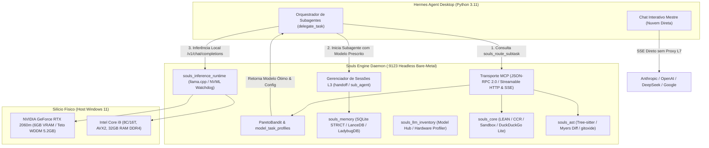
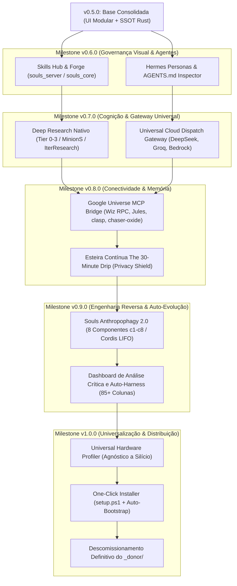

# SOULS_ENGINE_ROADMAP_NEXT_DELIVERIES.md — Roadmap Canônico de Entregas & Evolução Rumo à v1.0

> **STATUS DO DOCUMENTO:** CANÔNICO & VINCULANTE (DOCS-AS-GUARDRAILS)  
> **VERSÃO CONSOLIDADA:** v0.5.0 (Novembro/2026) ➔ Meta Final: v1.0.0 Real  
> **ARQUITETURA:** 11 Crates Canônicas Bare-Metal (Rust/Tokio) • Loopback HTTP/SSE `127.0.0.1:9123`  
> **SIMBIOSE:** Hermes Agent Desktop (Python 3.11) + Antigravity CLI + Web Dashboard SPA  
> **SSOT DE DADOS:** `Z:\souls_engine\.souls_data\db\souls_heuristic_vault.db` (FrankenSQLite STRICT WAL)

---

## 1. VISÃO GERAL & PRINCÍPIOS ARQUITETURAIS VINCULANTES

O **Souls Engine** opera como uma infraestrutura bare-metal headless (Rust/Tokio) em loopback TCP local `127.0.0.1:9123`. Ele atua como acelerador de silício, motor de AST, hipocampo de memória L3 e orquestrador de subagentes para o **Hermes Agent** e IDEs compatíveis (Antigravity, Cursor).



### As 6 Linhas Vermelhas (AGENTS.md)
1. **Zero Desktop UI Local / Systray:** O binário `souls_server.exe` / `souls_engine.exe` é 100% headless. A observabilidade visual pertence ao Web Dashboard SPA servido na porta `9123`.
2. **Nenhum Proxy L7 para o Chat Mestre:** O Hermes Agent resolve suas APIs de nuvem diretamente, preservando o *prefix caching*.
3. **Nenhum Chaveamento Intradiálogo:** O ParetoBandit atua exclusivamente em subagentes (`delegate_task`) e tarefas de suporte (`auxiliary.*`).
4. **Sem Poluição fora do Dev Drive ReFS (`Z:\`):** Toda persistência reside em `Z:\souls_engine\.souls_data\`.
5. **Topologia Controlada:** Workspace estruturado estritamente nas crates canônicas homologadas.
6. **Zero `unsafe` Arbitrário:** Workspace sob `#![forbid(unsafe_code)]`, exceto delimitações auditadas com `// SAFETY:`.

---

## 2. HISTÓRICO CONSOLIDADO DE ENTREGAS (O QUE JÁ FOI REALIZADO)

Até a consolidação da **Milestone v0.5.0**, todo o ciclo fundacional de infraestrutura, inferência, governança e interface foi construído e homologado:

### 2.1 Tabela Histórica de Sessões e Marcos (v0.1.0 ➔ v0.5.0)

| Sessão / Marco | Escopo Principal | Estado | Principais Entregas |
| :--- | :--- | :---: | :--- |
| **Sessões 1 & 2** | Daemon Base & Cérebro L3 | **100% CONCLUÍDO** | `souls_server` (:9123), Axum HTTP/SSE, FrankenSQLite STRICT WAL, LanceDB e LadybugDB. |
| **Sessão 3** | Conexão Viva Hermes Desktop | **100% CONCLUÍDO** | Configuração do `config.yaml`, junction ReFS de modelos, FinOps guardrails e MCP live. |
| **Sessão 4** | AST Tree-sitter & NVML | **100% CONCLUÍDO** | Transplante `souls_ast` (outlines, slices, callers), watchdog NVML bare-metal e cálculo EWMA. |
| **Sessão 5** | Cloud Arena Benchmarking | **100% CONCLUÍDO** | Crate `souls_llm_cloud_arena`, 9 perfis cognitivos, ingestão Nous/OpenRouter e sync diário. |
| **Sessão 6** | Governança Master Brain | **100% CONCLUÍDO** | Tríade de Líderes na nuvem, cálculo de Fronteira de Pareto e alternância de perfis. |
| **Sessão 7** | Web Dashboard SPA (V1) | **100% CONCLUÍDO** | Interface web inicial servida via Axum com abas de Overview, Arenas e Settings globais. |
| **Sessão 8** | Homologação Clínica E2E | **100% CONCLUÍDO** | 156/156 cenários clínicos aprovados (100%), 52 tools, 15 skills, zero leak de VRAM. |
| **Sessão 9 & 10** | Silício Neural & Des-staging | **100% CONCLUÍDO** | 15 modelos físicos mapeados, sandbox Win32 segura, LEAN compression e dedup SipHash. |
| **Sessão 11** | Skills & Curadoria Obsidian | **100% CONCLUÍDO** | 15 Skills sincronizadas, pipeline de curadoria `raw/` ➔ `wiki/` com Privacy Shield local. |
| **Sessão 12 & 13** | Telemetria SSE & Simbiose | **100% CONCLUÍDO** | Streaming SSE em tempo real, persistência em `souls_config.toml` e integração de plugins Hermes. |
| **Sessão 14 & 15** | Settings UX & Design System | **100% CONCLUÍDO** | Sub-abas com tooltips explicativos, modal de aplicação rápida de modelos e ranking Top 50. |
| **Sessão 16** | Context LEAN & Sandbox | **100% CONCLUÍDO** | Crate `souls_core` (DuckDuckGo Lite na RAM, truncagem head+tail 50/70, 65/65 testes PASS). |
| **Sessão 17** | Model Hub & Profiler | **100% CONCLUÍDO** | Crate `souls_llm_inventory` (RFC-007), download sequencial com HTTP Range e verificação SHA-256. |
| **Sessão 18** | Local Silicon Arena | **100% CONCLUÍDO** | Crate `souls_llm_local_arena`, 5 baterias empíricas ADR-007 no silício real (32/32 testes PASS). |
| **Sessão 19** | Two-Stage Switchboard | **100% CONCLUÍDO** | Switchboard em 2 estágios (<1.7ms na CPU AVX2), projeção dinâmica no `tools/list` (33/33 PASS). |
| **Milestone v0.5.0** | **Modularização UI & SSOT Rust** | **100% CONCLUÍDO** | **ADR-012:** Monólito de 15k linhas decomposto em 25 componentes em `templates/` via `concat!(include_str!(...))` em `.rodata`. Unificação de dependências no root `Cargo.toml`. Teto de contexto dGPU dinâmico baseado em VRAM real. Revisão total das sub-abas de Settings (zero mocks). |

### 2.2 Inventário de Ativos Consolidados na v0.5.0
* **Topologia de Crates:** 11 Crates canônicas estritamente sincronizadas via `[workspace.dependencies]`.
* **Catálogo MCP:** 55 Ferramentas de revelação progressiva divididas em 6 namespaces (`code.*`, `context.*`, `memory.*`, `think.*`, `ops.*`, `sys.*`).
* **Matriz de Skills:** 15 Skills canônicas procedimentais ativas em `.agents/skills` e `%LOCALAPPDATA%\hermes\skills`.
* **Desempenho de Compilação:** `cargo check -p souls_server` acelerado de ~8.7s para **2.06s** (~4.2x mais rápido).
* **Binário de Produção:** `souls_engine.exe` compilado em release MSVC (`lto = "thin"`, `codegen-units = 1`, `panic = "abort"`), pesando menos de 45 MB com zero dependências de DLLs externas.

---

## 3. MATRIZ DE DEMANDAS, SCRATCHPAD & ANÁLISE DE GAPS

Cruzamento do draft [`.souls_scratchpad/lembretes.txt`](file:///Z:/souls_engine/.souls_scratchpad/lembretes.txt) e dos documentos de pesquisa com o estado do repositório:

| Item do Lembrete | Descrição Sintética | Estado Atual | Destino no Roadmap & Referência |
| :--- | :--- | :---: | :--- |
| **#1 Refatoração de UI** | Quebrar monólito HTML em módulos para manutenção ágil | **JÁ REALIZADO (v0.5.0)** | Concluído via ADR-012 (25 parciais atômicos sob `templates/`). |
| **#2 Revisão de Deps Rust** | Unificar versões e auditar flags de compilação | **JÁ REALIZADO (v0.5.0)** | Concluído via SSOT em `[workspace.dependencies]`. |
| **#3 Skills Hub & Forge** | Visualização, descoberta, busca em APIs e criação agêntica local de skills | **GAP IDENTIFICADO** | **Milestone v0.6.0** (Aba dedicada + Agêntico Forge). |
| **#4 Perfis do Hermes** | Inspecionar/editar `AGENTS.md`, `SOUL.md` e configs dos perfis no Dashboard | **GAP IDENTIFICADO** | **Milestone v0.6.0** (Hermes Personas & Governance Inspector). |
| **#5 Deep Research Engine** | Capability/Tool base de pesquisa profunda em árvore com síntese e fontes | **GAP IDENTIFICADO** | **Milestone v0.7.0** ➔ Ref.: [Deep Research para o Ecossistema Hermes Agent e Souls Engine.md](file:///Z:/souls_engine/.souls_scratchpad/Deep%20Research%20para%20o%20Ecossistema%20Hermes%20Agent%20e%20Souls%20Engine.md). |
| **#6 Gateway Cloud Multi-Provedor** | Universalizar despacho de subagentes para além de OpenAI/Claude/Gemini | **GAP IDENTIFICADO** | **Milestone v0.7.0** (DeepSeek API, Groq, Together, Bedrock). |
| **#7 Google Universe Bridge** | Ferramentas MCP para Google Docs, Sheets, Drive, Calendar e Gmail | **GAP IDENTIFICADO** | **Milestone v0.8.0** ➔ Ref.: [Arquitetura Universal Google e Hermes.md](file:///Z:/souls_engine/.souls_scratchpad/Arquitetura%20Universal%20Google%20e%20Hermes.md). |
| **#8 & #10 Souls Anthropophagy 2.0** | Ingestão mecânica (Blobs) ➔ Essências ➔ Enxame (85+ colunas) ➔ Auto-Evolução | **GAP IDENTIFICADO** | **Milestone v0.9.0** ➔ Ref.: [Estudo de Fetures para Harnesses Open-Source.md](file:///Z:/souls_engine/.souls_scratchpad/Estudo%20de%20Fetures%20para%20Harnesses%20Open-Source.md). |
| **#9 Universal Installer & Hardware Adaptability** | Instalador zero-atrito, piso mínimo na 2060m adaptável a qualquer hardware | **GAP IDENTIFICADO** | **Milestone v1.0.0** (Universal Installer & Release Oficial). |

---

## 4. A TRILHA CANÔNICA RUMO À VERSÃO 1.0 REAL

A jornada da versão 0.5.0 até a 1.0.0 é dividida em **5 Milestones Sequenciais**, integrando os estudos de pesquisa aprofundada:

```
┌──────────────────────────────────────────────────────────────────────────────────┐
│                     JORNADA DE DESENVOLVIMENTO RUMO À v1.0                       │
├───────────────┬──────────────────────────────────┬───────────────────────────────┤
│ v0.5.0 (HOJE) │ Base Bare-Metal & UI Modular     │ [CONCLUÍDO] 11 Crates, ADR-012│
├───────────────┼──────────────────────────────────┼───────────────────────────────┤
│ v0.6.0        │ Governança Visual & Skills Hub   │ Skills Forge + Hermes Personas│
├───────────────┼──────────────────────────────────┼───────────────────────────────┤
│ v0.7.0        │ Cognição Profunda & Gateway Cloud│ Deep Research + Multi-Provider│
├───────────────┼──────────────────────────────────┼───────────────────────────────┤
│ v0.8.0        │ Conectividade & Integrações      │ Google Universe + Obsidian DB │
├───────────────┼──────────────────────────────────┼───────────────────────────────┤
│ v0.9.0        │ Souls Anthropophagy 2.0          │ 4 Camadas, Blobs & 85+ Colunas│
├───────────────┼──────────────────────────────────┼───────────────────────────────┤
│ v1.0.0 REAL   │ Universalização & Distribuição   │ Auto-Tuning, Installer 1-Click│
└───────────────┴──────────────────────────────────┴───────────────────────────────┘
```

---

### MILESTONE v0.6.0: GOVERNANÇA VISUAL, SKILLS HUB & HERMES PERSONAS

O objetivo desta etapa é transformar o Dashboard em uma central completa de gestão comportamental dos agentes e subagentes, sem depender de edição manual de arquivos no terminal.

#### 1. Módulo Skills Hub & Agêntico Forge (`templates/tabs/skills_hub.html`)
* **Catálogo Visual de Skills:** Listagem interativa das 15+ skills instaladas nos diretórios do sistema (`.agents/skills/`, `%LOCALAPPDATA%\hermes\skills/`, `~/.gemini/config/skills/`).
* **Visualizador de Metadados:** Exibição do nome, descrição, gatilhos de ativação, ferramentas MCP associadas e regras operacionais de cada `SKILL.md`.
* **Skills Marketplace & Explorer:** Interface de busca integrada para consultar repositórios de skills comunitárias (ex: Agent Marketplace, GitHub) via API do `souls_core`.
* **Skills Forge (Gerador Agêntico Local):** Assistente no dashboard que recebe uma necessidade em linguagem natural e utiliza o Tier 1 local ou subagente de nuvem para compor um novo `SKILL.md` padronizado, com validação sintática estrita antes da gravação.

#### 2. Hermes Personas & Governance Inspector (`templates/settings/subtab_personas.html`)
* **Inspeção de Perfis do Hermes:** Mapeamento dinâmico dos perfis existentes em `%LOCALAPPDATA%\hermes\profiles/` e perfil `default`.
* **Editor/Visualizador Seguro de `AGENTS.md` e `SOUL.md`:** Visualização formatada em Markdown com realce de sintaxe dos guardrails e identidade de cada persona, com controle de versão e diff antes da mutação.
* **Sincronização de Defaults:** Ajuste dos parâmetros de temperatura, max_tokens e restrições de cada persona com reflexo automático nas sessões do Hermes.

---

### MILESTONE v0.7.0: COGNIÇÃO PROFUNDA, DEEP RESEARCH & GATEWAY UNIVERSAL

> **Documento de Referência Arquitetural SSOT:**  
> 📄 [Deep Research para o Ecossistema Hermes Agent e Souls Engine.md](file:///Z:/souls_engine/.souls_scratchpad/Deep%20Research%20para%20o%20Ecossistema%20Hermes%20Agent%20e%20Souls%20Engine.md)

Expansão das capacidades analíticas fundamentais combinando cérebro em nuvem, operários locais (SLMs) e eliminação de aprisionamento em provedores proprietários.

#### 1. Deep Research Engine Nativo (`souls_core::research` & Ferramenta MCP `deep_research`)
* **Hierarquia Cognitiva em 4 Níveis (Tiering FinOps):**
  - **Tier 0 (Pré-Filtro Determinístico Zero-LLM):** Segmentação de páginas em blocos de ~600 palavras, desduplicação de URLs normalizados via SipHash, ranqueamento lexical BM25 local e conversão direta de HTML para Markdown limpo na RAM via `souls_core` (eliminando 65% do desperdício de tokens de LLM).
  - **Tier 1 (Operário Local / SLM via MinionS):** Execução paralela de subtarefas atômicas de passo único (*single-step*) em modelos locais de 3B a 8B (Qwen 2.5 Coder / Llama 3.2 no silício bare-metal). O protocolo MinionS extrai citações literais e preenche o esquema tipado `StructuredLocalOutput` (`explanation`, `citation`, `answer`), recuperando 97,9% da precisão de modelos de fronteira a uma fração do custo.
  - **Tier 2 (Explorador Rápido / FAST_LLM):** Subagentes dedicados (`fast-scout`) executados via `delegate_task` com DeepSeek v3 ou Gemini Flash para formular queries de busca diversificadas, explorar ramificações da árvore de busca e comprimir descobertas parciais.
  - **Tier 3 (Cérebro Estratégico / STRATEGIC_LLM):** Condução do scoping socrático inicial, planejamento de árvore e redação do relatório final longo.
* **Reconstrução do Espaço de Trabalho (`IterResearch`):** Em vez de manter um histórico contínuo que causa asfixia cognitiva (*cognitive suffocation*) e poluição por ruído, a pesquisa é dividida em rondas discretas; a cada ronda, os logs brutos são descartados e o agente reconstrói um relatório central em evolução (`01_evolving_report.md`).
* **Passagem por Referência de Arquivo (*Filesystem Pointer Handoff*):** Subagentes gravam seus artefatos densos diretamente no ReFS (`.souls_data/research/{run_id}/scouts/scout_{n}.md`) e devolvem apenas um ponteiro leve com metadados para o orquestrador.
* **Disciplina Epistêmica em 4 Níveis:** Todas as afirmações recolhidas recebem obrigatoriamente uma etiqueta de grau de evidência: `[VERIFIED]`, `[SOURCED]`, `[REASONED]` ou `[ESTIMATED]`, acompanhadas de polaridade causal (`supports` vs `refutes`).
* **Verificador Read-Only Confinado (`role-research-verifier`):** Subagente dedicado de auditoria final que opera em modo estritamente somente-leitura (`toolsets=["file"]`) para checar e vincular 100% das citações literais antes de liberar o relatório.

#### 2. Universal Cloud Dispatch Gateway para Subagentes (`souls_model_router` & `souls_llm_cloud_arena`)
* **Expansão Multi-Provedor Oficial:** Além de OpenAI, Anthropic e Google Gemini, suporte nativo direto com telemetria para:
  - **DeepSeek API:** Endpoints nativos v3 e r1 com cálculo real de cache hit/miss de tokens.
  - **Groq & Cerebras:** Despacho de ultra-baixa latência (300+ tokens/s) para tarefas de triagem rápida.
  - **Together AI & Mistral AI:** Modelos open-weights em nuvem com alta largura de banda.
  - **OpenRouter & Nous Portal:** Roteadores universais com balanceamento automático.
  - **AWS Bedrock / Azure OpenAI:** Conectores corporativos com autenticação IAM/Bearer.
* **Fallback Chain Inteligente por Perfil:** Se o provedor principal sofrer *rate limit* (HTTP 429) ou indisponibilidade (HTTP 500), o gateway chaveia automaticamente para o segundo colocado da Fronteira de Pareto com overhead inferior a 150ms.

---

### MILESTONE v0.8.0: CONECTIVIDADE GOOGLE UNIVERSE & CURADORIA CONTÍNUA

> **Documento de Referência Arquitetural SSOT:**  
> 📄 [Arquitetura Universal Google e Hermes.md](file:///Z:/souls_engine/.souls_scratchpad/Arquitetura%20Universal%20Google%20e%20Hermes.md)

Abertura do ecossistema para a vida pessoal e profissional do operador através da fusão simbiótica com as superfícies do ecossistema Google.

#### 1. Google Universe MCP Bridge (`souls_core::google_bridge`)
* **Estratégia de Dupla Camada Workspace:**
  - Multi-conta nativo (`manage_accounts`) suportando simultaneamente contas pessoais `@gmail.com` e corporativas Workspace.
  - Composição via Scratchpad (`manage_scratchpad` com live-sync endereçável por linhas para Docs e Sheets) e operações em lote (`bulk_operations`) para triagem de Gmail e Contatos.
* **Engenharia Reversa Wiz para NotebookLM (22 RPCs Canônicos):**
  - Conexão direta contra `notebook.cloud.google.com/_/.../batchexecute` utilizando cookies `__Secure-1PSID`, `__Secure-1PSIDTS` e `SAPISIDHASH` com extração do token CSRF `SNlM0e`.
  - Operações completas de notebooks: ingestão de fontes (`izAoDd`), verificação de frescura (`yR9Yof`), sincronização forçada com o Google Drive (`FLmJqe`), subagentes nativos de Fast/Deep Research (`Ljjv0c` e `QA9ei`), geração de Audio Overviews/Podcasts (`R7cb6c`) e criação de Mapas Mentais conceituais (`yyryJe`).
* **Gemini Web, Gems & Deep Research via `StreamGenerate`:**
  - Emulação do payload posicional de 69 elementos e cabeçalho JSPB (`x-goog-ext-525001261-jspb`) permitindo que subagentes invoquem Gems personalizadas e o agente de Deep Research do Gemini sem custo de tokens de API.
* **Orquestração de Frotas de Nuvem com Google Jules:**
  - Integração via `@google/jules-sdk` e `SamyRai/Juleson` com suporte a **Sessões Repoless** (máquinas virtuais efémeras na cloud da Google com Rust/Node/Python como ambiente serverless sem consumir recursos do host local) e despacho paralelo de frotas de até 60 sessões para PR reviews e refatorações concorrentes.
* **Google Apps Script Serverless (`@google/clasp`):**
  - Automação via Apps Script Execution API para sintetizar, instalar e invocar triggers orientados a eventos (ao receber email, submeter formulário ou alterar célula de planilha).
* **Automação Furtiva em Rust via `chaser-oxide`:**
  - Cliente CDP em Rust puro (fork especializado de `chromiumoxide`) consumindo apenas **50 a 100 MB de RAM** (contra 500+ MB do Playwright/Node.js), com evasão nativa ao Google SearchGuard, scripts de isolamento injetados antes da primeira navegação e renovação em background do cookie `__Secure-1PSIDTS`.

#### 2. Ativação Plena da Esteira de Curadoria Obsidian DB ("The 30-Minute Drip")
* **Orquestração Autônoma em Segundo Plano:** Execução do script `curate_obsidian.ps1` via cron a cada 30 minutos, destilando 2 a 3 notas de `raw/` para `wiki/` com frontmatter YAML e links bidirecionais `[[...]]`.
* **Blindagem `obsidian-privacy-shield`:** Higienização de documentos sensíveis (médicos e financeiros) no silício local antes de qualquer síntese em contexto longo.
* **Monitoramento no Dashboard:** Exibição do backlog restante (dos 498 arquivos) e log de auditoria em tempo real na sub-aba de conhecimento.

---

### MILESTONE v0.9.0: SOULS ANTHROPOPHAGY 2.0 & ENXAME DE AUTO-EVOLUÇÃO

> **Documento de Referência Arquitetural SSOT:**  
> 📄 [Estudo de Fetures para Harnesses Open-Source.md](file:///Z:/souls_engine/.souls_scratchpad/Estudo%20de%20Fetures%20para%20Harnesses%20Open-Source.md)

Transformação do módulo de antropofagia em um pipeline estruturado de auto-otimização recursiva inspirado no Google Harness², no microkernel reversível Cordis do DeepSeek e na telemetria hemisférica.

#### 1. Mapeamento dos 8 Componentes Editáveis (`c1` a `c8`) no Souls Engine
Em vez de reescrever ingenuamente o system prompt a cada falha, o Souls Engine particiona sua anatomia operacional em 8 componentes sob governança estrita:
1. **`c1` System Prompt:** Essência e voz da alma (`SOUL.md` / `core.md`). **Camada Constitucional Fixada:** protegida por hash SHA-256 e fail-closed contra edições utilitaristas.
2. **`c2` Guardrails:** Filtros inibitórios e regras negativas ("nunca faça X"). Bipartido: guardrails operacionais contra repetições são auto-otimizáveis; tabus de segurança são imutáveis.
3. **`c3` Memory:** Memória de trabalho e fatos verificados. Higienização por evidência: expurgo de suposições não comprovadas e retenção estrita de fatos.
4. **`c4` Skills:** Procedimentos modulares sob demanda (`SKILL.md`). Alvo primário de auto-expansão.
5. **`c5` Tool Guidance:** Orientações sobre contratos de ferramentas, otimizadas para consolidar chamadas granulares e reduzir taxa de erro.
6. **`c6` Scripts:** Código determinístico auxiliar executável que substitui raciocínio LLM repetitivo, validado por sandbox WASM de 5 fases.
7. **`c7` Subagents:** Orquestração de sub-processos mentais e delegações atômicas.
8. **`c8` Plugins / Hooks:** Middleware de ciclo de vida montado via microkernel reversível.

#### 2. O Ciclo de Sonho e Consolidação Subconsciente (*The Dreaming Loop*)
* **Execução Fora do Caminho Crítico:** O ciclo Propose–Probe–Compose (PPC) do Harness² consome múltiplos rollouts e nunca roda durante o chat síncrono ao vivo (o que destruiria a latência conversacional). Ele roda em background durante a ociosidade do host ou sob gatilhos de anomalia afetiva/erro.
* **Sondagem em Sombra (*Shadow Probing*):** Reexecuta turnos problemáticos em sandbox isolada, comparando o arnês base contra candidatos para comprovar se uma edição eliminou falhas reais antes de compor a melhoria.

#### 3. Microkernel Reversível de Processos Mentais (DeepSeek Cordis)
* **Efeitos Reversíveis LIFO (`ctx.effect`):** Cada skill ou hook auto-gerado possui uma operação inversa computável em uma pilha LIFO. Se a telemetria detectar degradação após uma evolução, o runtime desfaz as alterações instantaneamente sem reiniciar o daemon (`fiber.dispose()`).
* **Coefeitos Reativos (`inject`):** Serviços externos (MCPs, voz, APIs) são declarados como coefeitos; se um serviço cair, os processos dependentes entram em pausa graciosa sem quebrar a consciência textual do agente.

#### 4. O Pipeline Antropofágico em 4 Camadas & Tabela de 85+ Colunas
* **1. Raw Blueprints & Blobs:** Ingestão mecânica de novos repositórios de harnesses (Git / AST / Tree-sitter) salvos em SQLite.
* **2. Essences & Dehydration:** Destilação semântica de algoritmos e padrões (economia de 85% de tokens).
* **3. Swarm Critical Analysis:** Enxame avaliando o repositório contra a Matriz Ontológica de 85+ Colunas (arquitetura, concorrência, pegada de memória, licença e sinergia).
* **4. Continuous Evolution Pipeline:** Geração automática de ADRs, contratos de transplante e PRs cirúrgicos para o Souls Engine.

---

### MILESTONE v1.0.0 REAL: UNIVERSALIZAÇÃO, AUTO-TUNING & DISTRIBUIÇÃO PÚBLICA

A consagração do Souls Engine como um produto final robusto, instalável em qualquer máquina Windows 11 com o mínimo de atrito.

#### 1. Universal Hardware Profiler & Adaptabilidade Dinâmica
* **Agnosticismo de Silício com Piso Homologado:**
  - **Piso Mínimo Canônico:** RTX 2060m (6GB VRAM), CPU i9 (8C/16T), 32GB RAM.
  - **Adaptação para Hardwares Superiores (RTX 3060, 4070, 4090, Apple Silicon/DirectML):** O motor aloca automaticamente modelos maiores (7B–14B) e orçamentos maiores de KV-cache (até 64k tokens) sem alterar uma linha de código.
  - **Adaptação para Hardwares Modestos ou Sem dGPU (CPU Only / Intel iGPU / AMD):** Detecção automática de ausência de VRAM e desvio gracioso de todos os Tiers para instruções AVX2/AVX-512 na CPU, utilizando quantizações ultra-leves (Q4_0, Q3_K_S) e orçamentos de contexto conservadores (4k–8k tokens).

#### 2. Zero-Friction Universal Installer (`setup.ps1` & Bootstrapper Nativo)
* **Requisito Único do Usuário:** Apenas ter o **Hermes Agent Desktop** instalado na máquina.
* **Automação Completa do Script de Instalação:**
  1. **Verificação de Ambiente:** Validação do Windows 11, arquitetura x64 e permissões.
  2. **Estrutura de Armazenamento:** Criação automática do diretório de dados `Z:\souls_engine\.souls_data\` ou `%LOCALAPPDATA%\SoulsEngine\data\` (com suporte a fallback NTFS caso Dev Drive ReFS não esteja configurado).
  3. **Symlinks & Junctions Transparentes:** Linkagem do catálogo de modelos `%LOCALAPPDATA%\hermes\models` e instalação dos plugins do Hermes (`hermes_dashboard_souls` e `hermes_memory_souls`).
  4. **Injeção de Configurações no Hermes:** Configuração idempotente do `config.yaml` do Hermes registrando o Souls Engine como servidor MCP SSE na porta `9123`.
  5. **Auto-Calibração de Primeiro Boot:** Execução do profiler de hardware, cálculo dos limites de silício e geração do `souls_config.toml` personalizado.
  6. **Launch & Onboarding:** Inicialização limpa do daemon em segundo plano e abertura automática do Web Dashboard na página de boas-vindas com tour guiado.

#### 3. Descomissionamento Total do Legado (`_donor/`)
* **Remoção Definitiva da Pasta `_donor/`:** Todo o código doador legado em quarentena é permanentemente deletado da árvore git, consolidando a independência arquitetural e autoria 100% nativa do Souls Engine v7.
* **Selo de Estabilidade Bare-Metal de Produção:** Binários assinados, documentação completa em formato de livro digital/wiki e pacote de release GitHub.

---

## 5. NOVAS IDEIAS EMERGENTES & CANDIDATOS A FUTUROS DEEP RESEARCHES

A análise dos três estudos de referência revelou padrões arquiteturais inéditos que enriquecem a visão de longo prazo do Souls Engine:

### 5.1 Ideias Emergentes Incorporadas ao Sistema
1. **The Nightly Consolidation Loop (O Ciclo Noturno de Sonho):**
   Aproveitar os períodos de ociosidade do computador (madrugada, GPU ociosa a <45°C) para acionar autonomamente o ciclo de consolidação subconsciente do Harness². O motor audita os diários dos subagentes do dia, deduplica e poda arestas no grafo LadybugDB, comprime embeddings no LanceDB e gera patches de melhoria para as 15 skills sem consumir um único segundo da atenção do usuário.
2. **Repoless Google Jules como Offloader de Build na Nuvem:**
   Utilizar as sessões "Repoless" do Google Jules (com Gemini 3 Pro e máquinas virtuais Linux pré-equipadas com Rust, Node e Python) como um compilador serverless gratuito na nuvem para compilações pesadas ou testes extensos de crates, poupando a dGPU e a CPU física do host contra aquecimento térmico prolongado.
3. **Fatiamento MinionS na RAM via Dev Drive ReFS (`memmap2`):**
   Integrar o particionamento em blocos do protocolo MinionS diretamente com a infraestrutura de `memmap2` em Rust do Souls Engine sobre a unidade Dev Drive ReFS `Z:\`, alcançando fatiamento e ranqueamento BM25 em velocidade de memória RAM (< 1ms por megabyte de documento).
4. **Preservação de Cache de Prefixo via Injeção Efêmera em `pre_llm_call`:**
   Reforço da Linha Vermelha 2: nenhuma notificação ou telemetria em tempo real (Gmail, Calendar, Jules, VRAM) altera o system prompt. Toda a dinâmica entra efemeramente no turno do usuário ou via `prefetch()`, assegurando taxa de hit de prefix cache >95%.

### 5.2 Futuros Estudos de "Deep Research" Mapeados para o Ecossistema
Para manter o padrão de excelência de especificação técnica, foram identificados três domínios críticos que receberão seus próprios cadernos de pesquisa aprofundada antes da implementação correspondente:
* **Deep Research 1: Voice & Real-Time Multimodal Embodiment (Live Audio/Video Streamable Protocol):**
  Estudo da integração de protocolos de streaming de voz de ultra-baixa latência (WebRTC / OpenAI Realtime API / Gemini Live API vs motores locais bare-metal como Whisper-cpp + Kokoro-82M / Vapi / Twilio) acoplados à máquina de estados afetivos SODA.
* **Deep Research 2: Autonomous High-Cardinality Graph & Vector Engine (LadybugDB vs KùzuDB vs LanceDB Deep Benchmark):**
  Benchmark empírico no Windows NT sobre ReFS medindo concorrência multithread, tempo de busca em grafos causais com mais de 100.000 nós e consumo de memória sob WDDM.
* **Deep Research 3: Single-Binary Packaging & Production Daemonization (MSVC Self-Extractor vs Windows Service):**
  Engenharia de empacotamento para gerar um único binário auto-extraível e auto-instalável, com suporte nativo a registro como Windows Service (NT Daemon) resiliente a reinicializações do sistema operacional.

---

## 6. MAPA DE DEPENDÊNCIAS & ORDEM CRÍTICA DE EXECUÇÃO (DAG)

Para assegurar uma esteira de entrega limpa e sem regressões (em estrita obediência à Regra da Crate Única por Turno):



---

## 7. DEFINITION OF DONE (DoD) PARA A VERSÃO 1.0 REAL

O Souls Engine só será declarado na versão **1.0.0 Real** quando atender cumulativamente a:
1. **Instalador Zero-Atrito:** Instalação e calibração automática em um computador Windows 11 virgem apenas com Hermes Agent instalado, sem erros e sem intervenção manual em arquivos JSON/YAML/TOML.
2. **Auto-Adaptação de Silício:** Execução suave e sem pânico em no mínimo 3 cenários físicos:
   - GPU NVIDIA com VRAM limitada (RTX 2060m / 3050);
   - GPU NVIDIA topo de linha (RTX 3090 / 4080 / 4090);
   - Máquina sem GPU dedicada (CPU-only Intel/AMD com AVX2).
3. **Catálogo de 60+ MCP Tools:** 100% das ferramentas com validação de tipagem, revelação progressiva via Two-Stage Switchboard e zero impacto em prefix cache do modelo mestre.
4. **Isolamento de Memória & Privacidade:** Zero vazamento de PII pessoal de saúde/finanças para provedores de nuvem, atestado pelo `PiiRedactor` e testes E2E.
5. **Zero Monólitos e Zero Código Morto:** Código-fonte limpo, pasta `_donor/` extinta, documentação sincronizada em ADRs e cobertura de testes automatizados superior a 95% em todas as crates.
